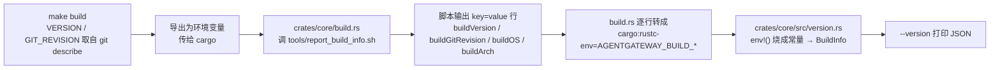
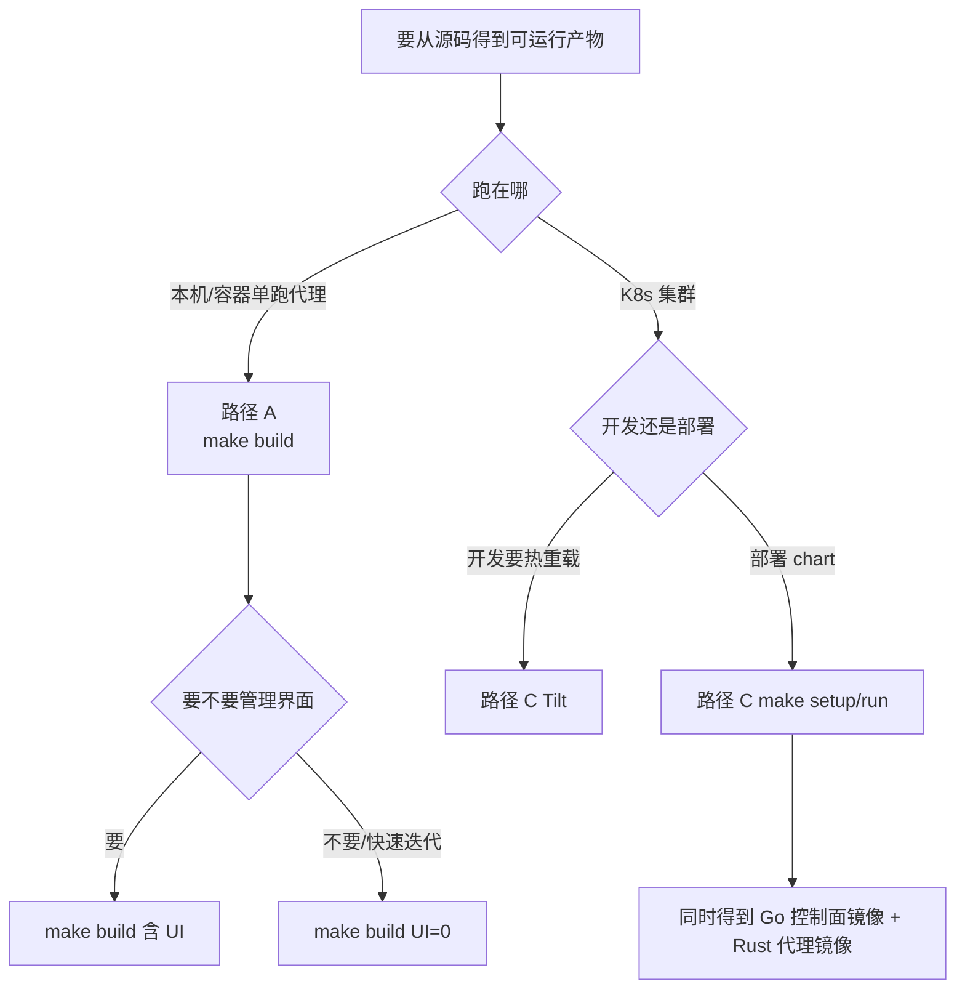

# 构建与运行 Runbook

> 代码基准：`adrian@f6a51b343a095141b3164b8a0965a4443857449d`；核实日期：2026-11-26。
> 本篇只回答一件事：这个仓库怎么从源码变成可运行的东西。所有命令与产物路径都取自当前工作区的 `Makefile` / `controller/Makefile` / `Dockerfile` / `DEVELOPMENT.md`。

## 0. 结论速览

这个仓库同时含 **Rust** 与 **Go** 两套代码，但它们是**两个互不依赖的独立程序**，各编各的二进制，**不会合并成一个产物**。`cargo build` 只构建 Rust 代理，完全不会碰 `controller/` 下的 Go 代码；Go 侧必须单独 `go build`。运行时两者通过 xDS 配置下发协作，因此完整 K8s 部署会拉**两个镜像**，而非塞进一个容器。

| 你要的东西 | 语言 | 构建入口 | 产物 |
|---|---|---|---|
| 数据面代理（核心产品，standalone 可单跑） | Rust | 根目录 `make build` | `target/release/agentgateway` |
| K8s 控制面 operator | Go | `cd controller && make agentgateway-controller` | `controller/_output/pkg/agentgateway/agentgateway-linux-<arch>` |
| CLI 工具 | Go | `cd controller && make agctl` | `controller/_output/pkg/agctl/agctl-<os>-<arch>` |
| 管理界面 | TypeScript | `cd ui && pnpm build` | `ui/dist`（编译期被嵌进 Rust 二进制） |

## 1. 仓库布局与构建边界

```
Cargo.toml            Rust workspace（default-members = crates/*）
crates/
  agentgateway/         代理二进制 crate，bin 名 = agentgateway
  agentgateway-app/     应用装配层，含 ui feature（嵌 UI 资产）
  core/ http/ llm/ hbone/ xds/ pool/ policy-core/ ...  代理的各个库
  protos/ xtask/        proto 代码生成 / schema 生成工具
controller/            Go 控制面（独立模块，root go.mod 之外还有 api/、tools/ 两个嵌套模块）
  cmd/agentgateway/     operator 入口 → agentgateway-controller 二进制
  cmd/agctl/            CLI 入口 → agctl 二进制
ui/                    React 管理界面，build 产物 ui/dist 被嵌进 Rust 二进制
catalog/ schema/       模型目录 / 配置 schema
```

构建边界三条硬事实：

1. Rust 的三个 `build.rs`（`crates/agentgateway-app`、`crates/core`、`crates/protos`）**均不调用 go**；`Cargo.toml` 与 `crates/agentgateway/Cargo.toml` **均不引用 controller**。
2. Go 控制面不参与 Rust 编译，也不被 Rust 链接。
3. 二者唯一的运行期耦合是配置下发（xDS），不是编译期耦合。

## 2. 前提条件

| 工具 | 版本 | 依据 |
|---|---|---|
| Rust | 由 `rust-toolchain.toml` 钉死 `1.100.0`（`rustup` 会自动装） | `rust-toolchain.toml` |
| Node | `24.22.1`（见 `ui/.nvmrc`） | `DEVELOPMENT.md` |
| pnpm | 由 Corepack 按 `ui/package.json` 的 `packageManager` 提供，环境里 `corepack enable` 一次即可 | `DEVELOPMENT.md` |
| Go | `go.mod` 声明 `go 1.27.1` / `toolchain go1.27.4`；仅构建控制面/CLI 时需要 | `go.mod` |
| Kind + Tilt + ctlptl + cross + Docker | 仅「K8s + Tilt 热重载」开发模式需要 | `DEVELOPMENT.md` |

### 2.1 工具链与 Node 版本口径

每个工具的版本都由**仓库里一个具体的文件钉死**，构建工具会自动对齐，一般无需手动装指定版本。下表「钉定文件」是唯一权威来源，「本机实测」是 2026-11-26 在这台 arm64 mac 上 `--version` 的真实输出。

| 工具 | 钉定文件 | 钉定值 | 生效方式 | 本机实测 |
|---|---|---|---|---|
| Rust 工具链 | `rust-toolchain.toml` | `channel = "1.100.0"` | 进入仓库目录 `rustup` 自动安装并切换；含 `rustc`/`rust-std`/`cargo`/`clippy`/`rustfmt`/`rust-docs` 组件 | `cargo 1.100.0` / `rustc 1.100.0` |
| Rust 镜像版 | `Dockerfile` | `rust:1.100.0-trixie`（musl 与 gnu 两个 builder 阶段一致） | 容器构建时固定 | — |
| Node（构建 UI） | `ui/.nvmrc` | `24.22.1` | `nvm use` 或 `corepack` 前手动切；`Dockerfile` 的 node 阶段用 `node:24.22.1-bookworm` | `v26.13.1`（**高于钉定值，见下**） |
| pnpm | `ui/package.json` → `packageManager` | `pnpm@11.20.0` | Corepack 读该字段自动取对应版本，环境里 `corepack enable` 一次即可 | `11.15.1`（Corepack 会按字段切到 11.20.0） |
| Go | `go.mod` | `go 1.27.1` + `toolchain go1.27.4` | Go 1.21+ 会按 `toolchain` 指令自动下载并使用指定工具链 | `go1.27.4 darwin/arm64` |

三条实操口径：

1. **Rust 版本不用手动对齐**。`DEVELOPMENT.md` 正文写「Rust 1.86+」，那是下限描述；实际由 `rust-toolchain.toml` 钉到 `1.100.0`，`rustup` 会按它自动装。以工具链文件为准。
2. **构建 UI 前把 Node 切到 `24.22.1`**。本机默认是 `v26.13.1`，高于 `ui/.nvmrc` 钉定值。`pnpm install --frozen-lockfile` 与 Playwright e2e 都按 24.22.1 验证过，建议 `nvm use`（读 `ui/.nvmrc`）后再跑 `make ui` / `pnpm build`，避免锁文件或浏览器版本漂移带来的偶发失败。
3. **pnpm 版本交给 Corepack**。不要全局 `npm i -g pnpm`，否则会绕过 `packageManager` 钉定的 `11.20.0`。`corepack enable` 后，在 `ui/` 下跑 `corepack pnpm <cmd>` 即可拿到正确版本（根 `Makefile` 的 `ui` 目标就是这么调的）。

需要临时覆盖某个工具链时：Rust 用 `rustup toolchain list` / `rustup default`，Go 用 `GOTOOLCHAIN` 环境变量（如 `GOTOOLCHAIN=go1.27.4`），Node 用 `nvm use 24.22.1`。这些只影响当前 shell，不改仓库钉定文件。

## 3. 路径 A：standalone 跑 Rust 代理（最常见）

### A1. 只改代理、想快速迭代（跳过 Node 构建）

```bash
export CARGO_NET_GIT_FETCH_WITH_CLI=true
make build UI=0
./target/release/agentgateway
```

`UI=0` 跳过 pnpm 构建，不需要 Node 工具链；若 `ui/dist` 已存在，仍会被嵌入。浏览器打开 `http://localhost:15000/ui` 查看管理界面（端口与路径依据 `DEVELOPMENT.md`）。

### A2. 完整构建（含 UI）

```bash
export CARGO_NET_GIT_FETCH_WITH_CLI=true
make build
```

等价于 `cd ui && corepack pnpm install --frozen-lockfile && corepack pnpm build`，再 `cargo build --release --features ui`。首次在新 checkout 上跑 `cargo build --features ui` 若没有 `ui/dist` 会失败——UI 资产不入库，必须先构建（`Makefile:44-64`）。

### A3. 其它 Rust 构建变体

| 命令 | 用途 |
|---|---|
| `make build-symcrypt` | TLS/AEAD/哈希/RNG 走 SymCrypt 提供方（替代默认 aws-lc-rs） |
| `make build-fips` | AWS-LC 提供方 FIPS 模式 |
| `make docker` | 构建 Rust 代理镜像（多阶段 node→rust→chainguard，最终单二进制 `/app/agentgateway`） |
| `make docker-musl` | musl 静态变体 |

## 4. 路径 B：构建 Go 控制面与 CLI

```bash
cd controller

# operator（注意：强制 GOOS=linux，产物是 linux 二进制）
make agentgateway-controller
# → _output/pkg/agentgateway/agentgateway-linux-<arch>   arch 由宿主机 uname 推导(arm64/amd64)

# CLI（按宿主机 os/arch）
make agctl
# → _output/pkg/agctl/agctl-<os>-<arch>

# CLI 全平台发布产物
make agctl-release   # linux/amd64 + linux/arm64 + darwin/arm64 + windows/amd64
```

对应镜像：

```bash
cd controller
make agentgateway-controller-docker   # 构建并 load 控制面镜像
```

控制面镜像 `controller/cmd/agentgateway/Dockerfile.agentgateway` 极简：把 `agentgateway-linux-$GOARCH` 拷进 `chainguard/static`，单二进制、非 root 运行。

## 5. 二进制是怎么生成的

两条工具链各自独立产出二进制，产物清单：

| 二进制 | 工具链 | 本地构建命令 | 产物路径 |
|---|---|---|---|
| `agentgateway`（Rust 代理） | cargo | `make build` | `target/release/agentgateway` |
| `agentgateway`（Go 控制面） | go | `cd controller && make agentgateway-controller` | `controller/_output/pkg/agentgateway/agentgateway-linux-<arch>` |
| `agctl`（Go CLI） | go | `cd controller && make agctl` | `controller/_output/pkg/agctl/agctl-<os>-<arch>` |
| `testbox`（e2e 测试容器） | go | `cd controller && make testbox` | `controller/_output/hack/testbox/testbox-linux-<arch>` |

> 注意：Rust 代理二进制和 Go 控制面二进制**都叫 `agentgateway`**，但毫无关系——前者是数据面代理（`target/release/`），后者是 K8s operator（`controller/_output/pkg/agentgateway/`）。同名不同物，别混淆。

### 5.1 Rust 二进制的版本信息注入

Rust 二进制里 `--version` 打印的 version/git revision **不是**运行时读的，而是编译期由 build script 烧进常量。完整链路：



关键事实：

- 根 `Makefile:5-6` 用 `git describe --tags --always --dirty` 推导 `VERSION`，`git rev-parse HEAD` 推导 `GIT_REVISION`；两者都失败时回落到 `jj`，再失败就是 `unknown`。
- `tools/report_build_info.sh` 会给 revision 追加 `-dirty` 后缀（工作区有未提交改动时），除非设 `IGNORE_DIRTY_TREE`。它同时输出 `buildOS` / `buildArch`（`uname`）。
- `crates/core/build.rs` 把脚本每行 `agentgateway.dev.<key>=<value>` 转成 `cargo:rustc-env=AGENTGATEWAY_BUILD_<key>=<value>`，另外自行注入 `RUSTC_VERSION` / `PROFILE_NAME` / `TARGET`。注意 `cargo:rerun-if-env-changed=VERSION`——改了 `VERSION` 环境变量会触发重新编译。
- `crates/core/src/version.rs` 用 `env!()` 把这些值烧成 `const`，聚合成 `BuildInfo`，`--version` 以 pretty JSON 输出，含 `version` / `git_revision` / `rust_version` / `build_profile` / `build_target`，以及按 crypto feature 填充的 `crypto_backend` / `crypto_fips`。
- 所以：**改了代码没提交就构建，二进制会带 `-dirty`**；要让 `--version` 显示干净的版本号，先提交或显式 `export VERSION=<x> GIT_REVISION=<sha>`。Docker 构建就是这么做的（`Dockerfile` 把 `VERSION` / `GIT_REVISION` 作为 build-arg 传进去，并断言 `--version` 不为 `unknown`）。

### 5.2 Go 二进制的版本信息注入

Go 侧用 `-ldflags -X` 在链接期覆盖包级变量：`controller/Makefile` 定义 `LDFLAGS := -X 'github.com/agentgateway/agentgateway/controller/pkg/version.Version=$(VERSION)' -s -w`，`VERSION` 默认 `v1.0.1-dev`。所有 go build 目标（`agentgateway-controller` / `agctl` / `testbox`）都带 `-ldflags='$(LDFLAGS)'`。`-trimpath`（仅 controller）去掉本地路径，`-s -w` 剥离符号表减小体积。

### 5.3 编译 profile 与交叉编译

Rust profile（`Cargo.toml`）：

| profile | 配置 | 用途 |
|---|---|---|
| `dev`（默认） | 含增量，`cel` / `libsqlite3-sys` / `agentgateway` 有针对性覆盖 | 日常开发 |
| `release` | `codegen-units = 1` + `lto = true`（最大优化） | `make build` 用的就是它 |
| `quick-release` | 继承 release，`codegen-units = 16`、`lto = false`、`incremental = true` | 快速出包 |
| `ci` | 继承 dev，`debug = 0` + `strip = "symbols"` | CI：快且体积小 |
| `bench` / `quick-release-debug` | 继承 quick-release，带调试符号 | 基准测试 / 需要符号 |

交叉编译：

- **Rust**：`make build-target` 接 `TARGET` / `PROFILE` 变量，如 `make build-target TARGET=x86_64-unknown-linux-musl PROFILE=release`。需先 `rustup target add <target>`。Tilt 在 Apple Silicon 上的 cross 编译见 §6 的工具链前置。Rust 侧没有签入 `Cross.toml`。
- **Go**：`controller/Makefile` 的 `agctl-release` 一次性产出 `linux/amd64` + `linux/arm64` + `darwin/arm64` + `windows/amd64` 四个产物；单独目标如 `agctl-linux-arm64` / `agctl-darwin-arm64` / `agctl-windows-amd64`。全部 `CGO_ENABLED=0`，纯静态。`agentgateway-controller` 固定 `GOOS=linux`。

### 5.4 Rust 二进制的入口与启动链

二进制目标 `[[bin]] name = "agentgateway"` 定义在 `crates/agentgateway-app/Cargo.toml`，`path = "src/main.rs"`——**入口不在数据面库 crate `crates/agentgateway`**，而在装配层 crate `agentgateway-app`。

入口函数是一行纯委托（`crates/agentgateway-app/src/main.rs:2`）：

```rust
fn main() -> anyhow::Result<()> { agentgateway_app::run() }
```

`run()`（`crates/agentgateway-app/src/lib.rs · pub fn run +0`，签名行 141）是真正的启动入口，进程级初始化按固定顺序：

| 步 | 动作 | 代码位置 |
|---|---|---|
| 1 | 关透明大页（仅 Linux，`prctl(PR_SET_THP_DISABLE)`），防线程栈被 2MB 大页撑大 RSS | `run +5` |
| 2 | 选分配器：Linux glibc=jemalloc、aarch64 musl=mimalloc、其余=系统 | `run +7~+17` |
| 3 | 装 crypto provider（`agentgateway::crypto::init()`），早于任何加密操作 | `run +20` |
| 4 | `Cli::parse()` 解析命令行并分发 | `run +21` |

`Cli`（`crates/agentgateway-app/src/lib.rs · struct Cli +0`，签名行 133）把代理参数 `RunArgs` flatten 到根命令，子命令 `command: Option<Commands>` 可选——所以**不带子命令就是跑代理**：

| 子命令 | 落点 | 备注 |
|---|---|---|
| `oneshot` | `commands::oneshot::execute` | 仅 Linux |
| `import` | `commands::import::execute` | |
| `migrate` | `commands::migrate::execute` | |
| **无（默认）** | `commands::run::execute(args.run)` | 启动代理 |

默认路径 `commands::run::execute`（`crates/agentgateway-app/src/commands/run.rs · (execute) +0`，签名行 12）在 current-thread tokio runtime 上按序：

1. 短路分支：`--version` / 长 version / `--copy-self`（musl 才可用）。
2. 读配置 `read_config_contents` → `--validate-only` 则只校验返回。
3. `parse_config` → 装 admin runtime handle → `telemetry::setup_logging`。
4. 按 `config.database` / `config.storage.mode` / `config.logging.database` 分别初始化 DB 池、config resource store、request log store；`ensure_session_key`。
5. **`proxy(config, config_resource_store).await`** —— 真正起代理监听、开始服务流量的落点（`async fn proxy` 定义在 `run.rs:204`；调用在 `execute +94`，即 `run.rs:106`）。返回后做 budget flush 与 request log store 的优雅收尾。

配置来源判定（`read_config_contents`，`lib.rs:172`）优先级：`--config`（内联）/ `--file`（`-` 读 stdin）互斥 → K8s 环境下无配置且无 `LOCAL_XDS_PATH` 直接报错 → 有 `LOCAL_XDS_PATH` 用空配置等 xDS 下发 → 否则回落到默认目录 `config.yaml`。

> 同名提醒：Go 控制面 operator 与 CLI 的入口是另外两个独立程序，分别在 `controller/cmd/agentgateway` 与 `controller/cmd/agctl`，与上面这个 Rust 入口毫无关系。

## 6. 路径 C：完整 K8s 栈

**Tilt 热重载开发**（本地 Kind + 本地 registry，改代码自动重建）：

```bash
ctlptl create cluster kind --name kind-kind --registry=ctlptl-registry
tilt up
```

Apple Silicon 注意：Tilt 会以 `linux/amd64` 跑 `cross` 构建容器（`cross` 的 aarch64 镜像无 `linux/arm64` manifest），需先装 Linux x86_64 变体工具链：

```bash
rust_version=$(awk -F'"' '/^channel =/ {print $2}' rust-toolchain.toml)
rustup toolchain install "${rust_version}-x86_64-unknown-linux-gnu" --profile minimal --force-non-host
```

**纯 Helm 部署**（构建镜像 + 装 CRD + 装 chart）：

```bash
cd controller
make setup     # 建 kind 集群 + 装 Gateway API/Inference Ext/Istio CRD + MetalLB + 构建并 load 镜像（不部署）
make run       # = setup + 部署 chart（crds + agentgateway）
```

## 7. 怎么选路径



- 只想跑网关代理、看管理界面 → 路径 A。
- 要在 K8s 上用 CRD/Gateway API 声明式管理 → 路径 C，会同时产出并部署两个镜像。
- 只想用 CLI（如导入模型目录 `make refresh-model-catalog`）→ 路径 B 的 `agctl`。

## 8. 常见坑

| 症状 | 原因 | 处理 |
|---|---|---|
| 新 checkout 上 `cargo build --features ui` 失败 | `ui/dist` 不存在，UI 资产不入库 | 先 `make ui`，或用 `make build`（自动带 UI 前置），或 `make build UI=0` 跳过 |
| `git fetch` 拉不下 Cargo 的 git 依赖 | 沙箱/代理下 libgit2 fetch 不通 | `export CARGO_NET_GIT_FETCH_WITH_CLI=true` |
| `make agentgateway-controller` 产物在 mac 上不能直接跑 | 该目标强制 `GOOS=linux` | 本机跑 CLI 用 `make agctl`（按宿主 os/arch） |
| 控制面镜像里找不到二进制 | 镜像期望文件名 `agentgateway-linux-$GOARCH` | 确认 `make agentgateway-controller` 已在 `_output/pkg/agentgateway/` 下产出对应 arch 文件 |
| Apple Silicon 上 Tilt 构建失败 | `cross` 默认 aarch64 镜像无 arm64 manifest | 按 §6 装 x86_64 工具链变体 |

## 9. 事实标记

- §3 的运行端口 `15000` 与 UI 路径 `/ui`、§6 的 Tilt/K8s 流程：依据 `DEVELOPMENT.md` 文档记载，未在本机实测，标 `[待运行验证]`。
- 三个二进制的构建命令、产物路径、镜像构成、构建边界（build.rs 无 go 调用、Rust 不引用 controller）：依据当前工作区 `Makefile` / `controller/Makefile` / `Dockerfile` / `controller/cmd/agentgateway/Dockerfile.agentgateway` / `crates/*/build.rs` 直接核实。
- 本机工具链实测：`cargo/rustc 1.100.0`、`go 1.27.4 darwin/arm64`、`node v26.13.1`、`pnpm 11.15.1`（Node 版本高于 `ui/.nvmrc` 记载的 `24.22.1`，构建 UI 前建议用 nvm 切到 `24.22.1`）。