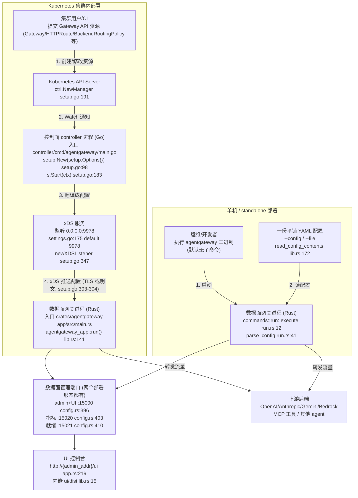

# 系统骨架（第一层：生产总览与系统骨架）

## 代码基准

| 项 | 值 |
|---|---|
| 仓库 | `agentgateway/agentgateway`（本地路径 `~/workspace/16_AI/agentgateway`） |
| 分支 @ 完整 SHA | `adrian` @ `47ea6aa03434e24502ec502ea98d7082112e2699` |
| 工作区状态 | 干净；仅 `docs/` 为本次新增未跟踪（`git status --short` 唯一输出 `?? docs/`） |
| 核实日期 | 2026-11-25 |
| 覆盖范围 | 本篇只覆盖**系统骨架**：有哪些常驻进程、真实入口、各自职责与可见结果。**不深入单请求链路**（一条请求进来后如何被路由/鉴权/改写，属 L2/L3）。 |

> 锚点约定：Rust 写 `文件 · impl Type · 方法 +0`，`+0` 指方法签名所在行；跨 impl 的方法一定写明所属 impl。Go 写 `文件 · 函数 +0`。所有锚点均已在 `adrian@47ea6aa0` 工作区逐条核实。

---

## 结论速览

Agentgateway 是一个跑在你自己环境里的**常驻代理服务**，站在「会调用工具/模型/彼此通信的 AI 程序（agent）」和「它们要访问的后端（大模型服务商、MCP 工具、其他 agent）」中间，给这些通信加上安全、可观测和治理能力。它对外提供三套能力：**LLM 网关**（用一个统一的 OpenAI 兼容接口，把流量路由到 OpenAI/Anthropic/Gemini/Bedrock，带预算与花费控制、prompt 增强、负载均衡、failover）、**MCP 网关**（把工具和数据源通过 MCP 接进来，支持 stdio/HTTP/SSE/Streamable HTTP 传输、OpenAPI 集成、OAuth）、**A2A 网关**（agent 之间的安全通信、能力发现、模态协商、任务协作）。落到进程形态，它是**两个常驻进程 + 一个控制台前端**：一个用 Rust 写的**数据面网关**（真正转发流量、能独立以「平铺 YAML 配置」跑起来），一个用 Go 写的**控制面 controller**（Kubernetes 里负责把 Gateway API 资源翻译成配置、再通过 xDS 推给数据面），加一个内嵌在数据面二进制里的 **UI 控制台**。

| # | 要点 | 说明 |
|---|---|---|
| 1 | 服务的是谁 | 需要把 agent↔LLM、agent↔tool、agent↔agent 通信纳入统一安全/可观测/治理的团队；既支持脱离 Kubernetes 的单机部署，也支持 Kubernetes 部署 |
| 2 | 解决什么问题 | 不改业务代码，就在中间加一层：统一入口、鉴权（JWT/API Key/OAuth）、细粒度 RBAC、限流、TLS、预算与花费控制、内容护栏、OpenTelemetry 指标/日志/追踪 |
| 3 | 进程形态 | **2 个常驻进程 + 1 个 UI**：Rust 数据面网关、Go 控制面 controller、内嵌 UI 控制台 |
| 4 | 数据面能独立跑 | 数据面可以**不带 controller**，直接读一份平铺 YAML 配置起服务（standalone 模式）；也可以作为 xDS 客户端，由 controller 下发配置 |
| 5 | 控制面只在 Kubernetes 用 | Go controller 依赖 Kubernetes API（Gateway API 资源），单机 standalone 部署不需要它 |
| 6 | 三个内建管理端口 | 数据面默认开三个管理端口：admin+UI `:15000`、指标 `:15020`、就绪探针 `:15021`（均可用环境变量覆盖） |
| 7 | 谁能用 | 平台/SRE 团队部署运维；应用开发者把 base URL 指向网关即可；安全团队用它的鉴权与策略；UI 给运维与开发看拓扑与状态 |

---

## 生产视角

系统在生产上是**三个可部署物**。下面先讲清三者关系，再逐一说明各自的入口、前置条件、输入、输出和可见失败。

### 三者的关系（一段话）

**控制面 controller（Go）**只在 Kubernetes 里跑：它盯着集群里的 Gateway API 资源，把它们翻译成网关配置，再通过 **xDS**（一种「控制面向数据面推送配置」的协议）下发给一个或多个 **数据面网关（Rust）**。**数据面网关**是真正干活、对外监听端口转发流量的进程：在 Kubernetes 部署里它听 controller 的 xDS 配置；在**单机 standalone 部署**里它可以完全独立，直接读一份 YAML 配置起服务，不需要 controller。**UI 控制台**不是独立进程，而是被编译进数据面二进制里、由数据面的 admin 端口对外提供页面。

### 生产总流程图

下图每个节点都对应真实的进程/入口/可见结果，不含抽象方框。

### 数据面网关（Rust）——真正转发流量的常驻进程

**真实入口**：`crates/agentgateway-app/src/main.rs`（整个文件只有 2 行，`fn main() { agentgateway_app::run() }`）→ `crates/agentgateway-app/src/lib.rs · pub fn run() +141`。

**run() 先做进程级初始化，再分发子命令**（`lib.rs +141` 到 `+170`，顺序如下）：
1. Linux 上关掉透明大页：`libc::prctl(libc::PR_SET_THP_DISABLE, 1, ...)`（`lib.rs +146`），避免线程栈等映射用 2MB 大页把 RSS 撑大。
2. 按 target 选全局分配器（`lib.rs +148`~`+158`）：`linux+musl+aarch64` 用 mimalloc，其它 `linux` 用 jemalloc，其余用 system。
3. 装进程级加密 provider：`agentgateway::crypto::init()`（`lib.rs +161`）。
4. `Cli::parse()`（`lib.rs +162`）后按子命令分发（`lib.rs +163`~`+169`）：
   - **无子命令（默认）**→ `commands::run::execute`（`crates/agentgateway-app/src/commands/run.rs · execute +12`）——**这才是真正起服务**；
   - `Oneshot` → `commands::oneshot::execute`（`commands/oneshot.rs +16`，仅 Linux，把网关作为子进程拉起并在就绪后 exec 一条命令）；
   - `Import` → `commands::import::execute`（`commands/import.rs +6`，从别的网关格式导入配置）；
   - `Migrate` → `commands::migrate::execute`（`commands/migrate.rs +5`，迁移本地配置里的废弃字段）。

**谁用**：所有真正要代理 AI 流量的场景。standalone 部署直接跑它；Kubernetes 部署里它作为 Pod 里的网关容器跑，听 controller 下发的配置。

**前置条件**：
- 一份配置来源。standalone 必须给 `--config`（内联字符串）或 `--file`（文件，`-` 表示 stdin）；`read_config_contents`（`lib.rs · read_config_contents +172`）会拒绝同时给两个，并且在检测到运行在 Kubernetes 里（`running_in_kubernetes()`，`lib.rs +214`，判据是存在环境变量 `KUBERNETES_SERVICE_HOST`）而又**没设 `LOCAL_XDS_PATH`** 时，要求必须提供配置（`lib.rs +196`~`+200`）。
- 若配置了 `database`，要能连上数据库（起请求日志/预算/hybrid 配置存储时用到）。

**输入**：一份 YAML 配置（`config::parse_config`，`run.rs +41`）；可选的数据库连接（`run.rs +57`~`+69`）；hybrid 存储模式下还会建 `config_store::ConfigResourceStore`（`run.rs +70`~`+81`）；可选的请求日志库（`run.rs +88`~`+104`）。

**输出（可见结果）**：起一个 Tokio 运行时，最终调 `agentgateway::app::run_with_ui_assets`（`crates/agentgateway/src/app.rs · run_with_ui_assets +21`），它会：
- 起**就绪探针服务** `management::readiness_server::Server`（`app.rs +45`）；
- 起 **xDS 状态管理器** `state_manager::StateManager`（`app.rs +125`），配置从 xDS 来时，网关要等首批 xDS 状态才放行就绪（`app.rs +139`~`+144`）；
- 起 **admin 服务**（内含 UI，`management::admin::Service`，`app.rs +148`）；
- 起 **指标服务** `management::metrics_server::Server`（`app.rs +165`）;
- 构造 `proxy::Gateway` 并在数据面 worker 池里跑 `gw.run()`（`app.rs +188`、`+198`）；
- 返回 `Bound { drain_tx, shutdown, stores, ready }`（`app.rs +210`）。

回到 `proxy()`（`commands/run.rs · proxy +204`）后：`spawn_readiness(&bound)`（`run.rs +210`）在设了 `READY_FD` 时把「就绪」信号通过文件描述符通知父进程（用于 Oneshot 模式），然后 `bound.wait_termination().await`（`run.rs +211`）**阻塞常驻**直到收到终止信号。默认监听地址（`crates/agentgateway/src/config.rs`）：

| 管理端口 | 默认值 | 覆盖方式 | 代码锚点 |
|---|---|---|---|
| admin（含 UI） | `localhost:15000`，UI 在 `/ui` | 环境变量 `ADMIN_ADDR` 或 `config.adminAddr` | `config.rs +391`~`+396`；UI 路径见 `app.rs · ui_url +218` |
| 指标 (Prometheus) | `0.0.0.0:15020` | `STATS_ADDR` / `config.statsAddr` | `config.rs +397`~`+403` |
| 就绪探针 | `0.0.0.0:15021` | `READINESS_ADDR` / `config.readinessAddr` | `config.rs +404`~`+410` |

> 业务监听端口（真正收 AI 流量的 listener）不在进程级写死，而是由配置/xDS 下发的 `Bind`/`Listener` 决定，在 `crates/agentgateway/src/store/binds.rs` 里完成实际端口绑定（`binds.rs · impl Store · bind_listener_single +616`、`bind_listener_per_core +625`、`bind_listeners +655`）。具体「哪条请求走哪个 listener」属 L2/L3，本篇不展开。

**可见失败**：
- 配置既给了 `--config` 又给了 `--file` → `read_config_contents` 直接 `bail!("only one of --config or --file")`（`lib.rs +176`）。
- 在 Kubernetes 里跑但没给配置也没设 `LOCAL_XDS_PATH` → 启动即失败，提示要 `--config`/`--file`/`LOCAL_XDS_PATH`（`lib.rs +197`~`+199`）。
- 管理端口地址非法 → `parse_config` 阶段报 `invalid ADMIN_ADDR/config.adminAddr` 之类（`config.rs +395`/`+402`/`+409`）。
- 数据库连不上 / 请求日志库初始化失败 → `run.rs +98`~`+99` 记 `failed to initialize request log database` 并返回错误，进程起不来。
- 业务 listener 端口被占用 → `binds.rs` 里 `bind listener for {address}` 带上下文报错（`binds.rs +618`/`+642`）。
- 只要传 `--validate-only`（`RunArgs.validate_only`，`lib.rs +68`），`execute` 会走 `validate()`（`run.rs +144`）只校验配置、打印 `Configuration is valid!` 后退出，**不起服务**（`run.rs +168`）。

### 控制面 controller（Go）——Kubernetes 里翻译并下发配置的常驻进程

**真实入口**：`controller/cmd/agentgateway/main.go · main +13`。它用 cobra 定义命令，`RunE` 里（`main.go +19`~`+33`）：传 `--version`/`-v` 只打印版本（`main.go +20`~`+23`）；否则 `setup.New(setup.Options{})`（`main.go +24`）→ `s.Start(cmd.Context())`（`main.go +28`）。

- `setup.New` 在 `controller/pkg/setup/setup.go · func New(opts Options) (*setup, error) +98`。
- `Start` 在 `controller/pkg/setup/setup.go · func (s *setup) Start(ctx context.Context) error +183`。

**谁用**：只在 **Kubernetes 部署**里用。它依赖 Kubernetes API，单机 standalone 部署**用不到它**。

**前置条件**：能连上 Kubernetes API Server；集群里装了 Gateway API 与 agentgateway 的 CRD；若启用 xDS TLS，需要能取到 TLS 证书（`setup.go +203`~`+209`）。

**输入**：Kubernetes 里的 Gateway API / agentgateway CRD 资源。`Start()` 里建 `ctrl.NewManager`（`setup.go +191`）来 Watch 这些资源，并建 krt 集合 `agwplugins.NewAgwCollections`（`setup.go +224`）。

**输出（可见结果）**：
- 建 `syncer.Syncer`（`buildSyncer`，`setup.go +293`/`+352`；内部 `controller.NewControllerBuilder`，`setup.go +372`），把 K8s 资源翻译成网关配置；
- 起 **xDS 服务**：xDS 监听器绑 `0.0.0.0` + `AgentgatewayXdsServicePort`（`setup.go +172`~`+173`，`newXDSListener` 在 `setup.go +347`），端口默认 **9978**（`controller/api/settings/settings.go +175`）；TLS 与明文可经 cmux 复用同一端口（`setup.go +298`~`+310`），否则按 TLS/明文二选一（`setup.go +311`~`+315`）；
- 起 **admin 服务** `admin.RunAdminServer`（`setup.go +319`）；
- 最后 `mgr.Start(ctx)`（`setup.go +322`）阻塞常驻跑控制器循环。

**可见失败**：建 manager 失败（连不上 API Server 等）→ `Start` 直接返回错误（`setup.go +191`~`+194`）；建 krt 集合失败 → 记 `error creating agw collections` 并返回（`setup.go +233`~`+235`）；建 jwks store 失败 → `error creating jwks store`（`setup.go +288`~`+290`）；建 syncer 失败 → 直接返回（`setup.go +293`~`+296`）。任一失败都会经 `main.go +37`~`+39` 的 `log.Fatal(err)` 让进程退出。

**配套 CLI**：`controller/cmd/agctl/main.go · main +5`，只调 `cli.Execute()`（`controller/pkg/cli`），是给运维用的命令行工具（`[推断]` 具体子命令集未在本篇逐条核实）。

### UI 控制台——不是独立进程，内嵌在数据面二进制里

**真实入口**：UI 静态资源来自 `ui/`（前端工程，`package.json` 里 `"name": "agentgateway-ui"`），构建产物 `ui/dist` 在编译期被 `include_dir!` 打进数据面二进制（`crates/agentgateway-app/src/lib.rs +15`，`static UI_ASSETS`，受 `cfg(ui_assets)` 门控；未启用时用空目录 `Dir::new("", &[])`，`lib.rs +17`）。

**谁用**：运维与开发者，用浏览器访问数据面 admin 端口。

**输入/输出**：由 `management::admin::Service` 托管（`app.rs +148`、`+157` 传入 `ui_assets`）；当打进来的 UI 资源非空时，启动日志会打印 `serving UI at {url}`（`app.rs +161`~`+163`），URL 形如 `http://{admin_addr}/ui`（`app.rs · ui_url +218`~`+219`）。

**可见失败**：以**未启用 UI 资源**的方式编译（不带 `ui_assets`）→ `UI_ASSETS` 为空目录，`app.rs +161` 的 `!ui_assets.entries().is_empty()` 为假，**不打印 serving UI**，访问 `/ui` 无页面。这属于编译期选择，不是运行时故障。

---

## 开发视角

### 组件职责表（进程/模块 ↔ 生产环节）

| 生产环节 | 进程/模块 | 职责 | 代码锚点 |
|---|---|---|---|
| 进程引导 + 子命令分发 | `agentgateway-app` crate | 进程级初始化（关大页/选分配器/装 crypto provider）、解析 CLI、分发 run/oneshot/import/migrate | `agentgateway-app/src/lib.rs · pub fn run() +141`；`main.rs +1` |
| 起服务（standalone 主路径） | `agentgateway-app::commands::run` | 读配置→解析→（可选）连库/预算/hybrid 存储/请求日志→进入 proxy 循环 | `commands/run.rs · execute +12`；`proxy +204` |
| 配置解析与默认值 | `agentgateway::config` | 把 YAML 解析成 `Config`，填充 admin/stats/readiness 默认地址等 | `config.rs +390`~`+410`；`config::parse_config` 调用点 `run.rs +41` |
| 运行时装配（监听器/服务） | `agentgateway::app` | 起就绪探针、xDS 状态管理器、admin（含 UI）、指标服务、构造 `proxy::Gateway`，返回 `Bound` | `app.rs · run_with_ui_assets +21`；`Bound +210` |
| 配置下发（K8s） | `controller`（Go） | Watch Gateway API 资源→翻译→经 xDS 推给数据面 | `controller/pkg/setup/setup.go · New +98`、`Start +183` |
| 配置接收（数据面） | `agentgateway::state_manager` | 作为 xDS 客户端接收并落地配置，驱动就绪 | `app.rs +125`；`+139`~`+146` |
| 端口绑定 | `agentgateway::store::binds` | 按下发的 `Bind`/`Listener` 实际 bind 业务端口（单 listener 或 per-core） | `binds.rs · impl Store · bind_listeners +655` |
| 流量转发 | `agentgateway::proxy` | `Gateway::run()` 真正处理请求（LLM/MCP/A2A 三类） | `app.rs +188`/`+198`；`lib.rs · ProxyInputs +957` |
| 管理与可观测 | `agentgateway::management` | admin 服务（含 UI）、指标服务、就绪探针 | `app.rs +45`/`+148`/`+165`；`management/admin.rs` |
| 策略引擎 | `agentgateway::cel` / `policy-core` / `policies/cors` | CEL 表达式求值 + 策略接口契约 + 具体策略实现 | 已确认：`policy-core/src/lib.rs +1`（module doc「Shared contracts for independently compiled agentgateway policies」）；`policies/cors/src/lib.rs +10`（`use agent_policy::{RequestPolicy, ...}`）、`+19`（`TRACE_POLICY_KIND = "cors"`）；CEL 求值引擎与扩展函数见 `cel-fork/cel/src/lib.rs`、`celx/src/lib.rs · insert_all +19` |
| UI | `ui/`（前端工程） | 控制台前端，构建产物内嵌进数据面二进制 | `agentgateway-app/src/lib.rs +15`；`ui/package.json` |

### Rust workspace 主要 crate 一览

工作区成员取自 `Cargo.toml` 的 `members`（`Cargo.toml +11`~`+28`）。下表职责均已逐个读各 crate 的 `lib.rs`（或 `main.rs`）头部模块声明 + `ls src/` 核实，证据强度列给出锚点；仍标 `[源码未确认]` 的仅限需要读函数体内部才能确认的细节。

| crate（`Cargo.toml` 路径） | 职责 | 证据强度 |
|---|---|---|
| `crates/agentgateway` | 网关主库：`Config`/`ProxyInputs`/`app`/`proxy`/`state_manager`/`store`/`management`/`llm`/`mcp`/`a2a` 等 | 已确认（`lib.rs +742` `Config`、`+957` `ProxyInputs`；`app.rs`、顶层模块 `ls` 结果） |
| `crates/agentgateway-app` | 可执行入口：`main.rs` + `run()` + `commands/`（run/oneshot/import/migrate），内嵌 UI 资源 | 已确认（`main.rs`、`lib.rs +141`、`commands/*`） |
| `crates/core`（`agent_core`） | 基础库：`strng`、`telemetry`、`version` 等 | 已确认（`commands/run.rs +4` `use agent_core::{strng, telemetry, version}`） |
| `crates/xds`（`agent_xds`） | xDS 客户端/指标，承接控制面下发的配置 | 已确认被使用（`app.rs +63` `agent_xds::Metrics::new`） |
| `crates/hbone`（`agent_hbone`） | HBONE mTLS 隧道：client/pool/server 三模块，HTTP/2 CONNECT 建隧道 | 已确认（`hbone/src/lib.rs +18`~`+20` 三个 `pub mod`；`DEFAULT_HBONE_PORT: u16 = 15008` 在 `+23`；`H2Config` 在 `+32`；调用点 `app.rs +94` `WorkloadHBONEPool`） |
| `crates/llm` | LLM 网关：各 provider 为顶层模块 + 模型目录/tokenizer/转换 | 已确认（`ls crates/llm/src`：`openai/anthropic/gemini/azure/bedrock/vertex/copilot/custom.rs` + `conversion/`、`parse/`、`model_catalog.rs`、`tokenizer.rs`；`lib.rs +11`~`+19` 逐个 `pub mod`）；`app.rs +122` `crate::llm::catalog::ModelCatalog`。`[源码未确认]` 仅限 provider 选择/分派的函数体内部（未逐行读） |
| `crates/cel-fork/cel`、`crates/cel-fork/cel-derive` | CEL 表达式引擎 fork；`cel` 提供解析/求值/类型，`cel-derive` 提供 `DynamicType` derive 宏 | 已确认（`cel/src/lib.rs +11`~`+13` `pub mod common/context/parser`、`+22` `functions`、`+24` `objects`、`+37` `types`，`pub use cel_derive::DynamicType` 在 `+40`；`cel-derive/src/lib.rs +1` module doc「Derive macros for cel-rust」） |
| `crates/celx` | 往 `cel::Context` 注册 agentgateway 专有 CEL 扩展函数（general/strings/math/cidr/optimize/flatten） | 已确认（`celx/src/lib.rs · pub fn insert_all +19`~`+34`，逐个调 `general/strings/math/cidr/optimize/flatten::insert_all`；`pub use` `FlattenSignal`/`DefaultOptimizer` 在 `+16`~`+17`） |
| `crates/pool` | 基于 hyper 的 HTTP 客户端 + 连接池工具库 | 已确认（`pool/src/lib.rs +1` module doc「Utilities for working with hyper」；`pub mod connect/pool/rt/service` 在 `+7`~`+14`；`pub use client::{Builder, Client, Error, ResponseFuture}` 在 `+15`） |
| `crates/http` | HTTP 相关工具/类型（backend TLS 文件访问等） | 部分确认（`app.rs +80` `crate::http::backendtls::set_file_access`）；其余模块本篇未逐行核 |
| `crates/policy-core`（`agent_policy`） | 策略 crate 与网关运行时之间的共享契约/依赖边界，定义 `RequestPolicy`/`PolicyContext`/`RequestAction`/`PolicyError` 等接口 | 已确认（`policy-core/src/lib.rs +1`~`+7` module doc 明确「dependency boundary between policy implementations and the gateway runtime」；`mod backend/expression/policy/properties/trace` 在 `+43`~`+47`；被 `policies/cors/src/lib.rs +10` 引用） |
| `crates/policies/cors` | CORS 策略实现，实现 `policy-core` 的 `RequestPolicy` | 已确认（`policies/cors/src/lib.rs +10`~`+12` `use agent_policy::{PolicyContext, RequestAction, RequestPolicy, ...}`；`TRACE_POLICY_KIND = "cors"` 在 `+19`；origin/method/header 走 `WildcardOrList` 通配或列表，`+21`~`+45`） |
| `crates/htpasswd-verify-fork` | 校验 Apache htpasswd 文件，支持 MD5/BCrypt/SHA1/Unix crypt | 已确认（`htpasswd-verify-fork/src/lib.rs +1`~`+3` module doc；`pub struct Htpasswd` 在 `+23`，`Hash` 枚举 `MD5/BCrypt/SHA1/Crypt` 在 `+26`~`+31`；`MAX_BCRYPT_COST = 14` 在 `+21`；`pub mod md5` 在 `+16`） |
| `crates/protos` | tonic 生成的 protobuf 类型（envoy xDS 各 service + istio workload） | 已确认（`protos/src/lib.rs +3` `pub mod envoy`、`+7` `tonic::include_proto!("envoy.service.discovery.v3")` 等、`+39` `pub mod istio`、`+41` `istio.workload`） |
| `crates/xtask` | 开发期代码生成任务：`schema`（生成配置 schema）/`metrics`（生成指标文档）/`cel`（求值 CEL） | 已确认（`xtask/src/main.rs · main +26`~`+32` 三分支 → `schema::generate_schema`/`metrics::generate_metrics`/`cel::evaluate_command`；`get_task +15` 限定 `schema|metrics|cel`）；且为唯一**不在** `default-members` 的成员（`Cargo.toml +29`~`+45`） |

> 说明：`default-members`（`Cargo.toml +29`）包含除 `xtask` 外的全部成员，意味着日常 `cargo build` 默认不编译 `xtask`。

### 下一步阅读入口（供 L2/L3）

- 单请求链路（路由选择、鉴权、策略、转发）：从 `crates/agentgateway/src/proxy/`（`Gateway::run()`）与 `store/binds.rs` 的 `get_bind_listener`（`binds.rs +738`）进入。
- 配置如何从 K8s 资源变成数据面状态：`controller/pkg/setup/setup.go · buildSyncer +352` → `controller/pkg/controller/start.go`；数据面侧 `state_manager::StateManager::run()`（`app.rs +146`）。
- 三类网关能力落点：`crates/agentgateway/src/llm/`、`mcp/`、`a2a/`（顶层模块，`ls` 已确认存在；内部职责属 L2/L3）。