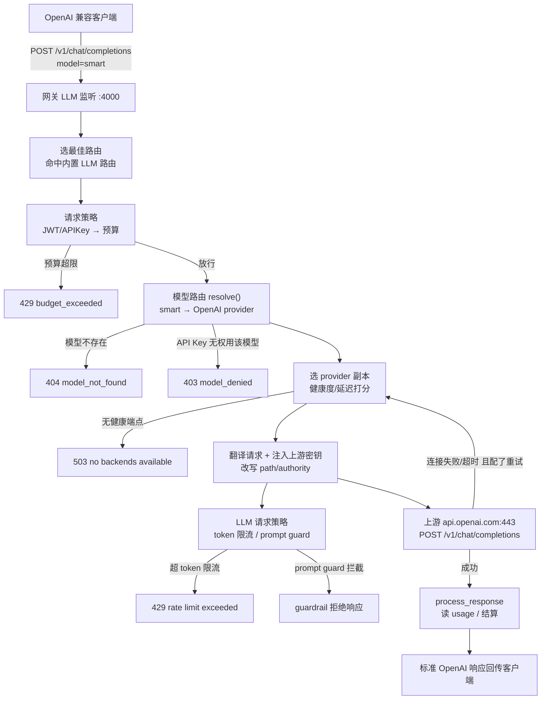
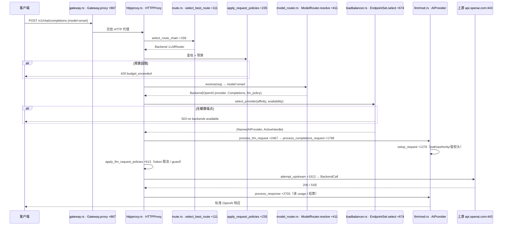

# 一次 LLM 请求（第二层：一次真实操作）

> 锚点约定见 `00-docs-style-guide.md`：Rust 写 `文件 · impl Type · 方法 +0`，`+0` 指方法签名行，跨 impl 写明所属 impl。

## 代码基准

| 项 | 值 |
|---|---|
| 仓库 | `agentgateway/agentgateway`（本地 `~/workspace/16_AI/agentgateway`） |
| 分支 @ 完整 SHA | `adrian` @ `47ea6aa03434e24502ec502ea98d7082112e2699` |
| 工作区状态 | 干净；仅 `docs/` 为未跟踪新增 |
| 核实日期 | 2026-11-25 |
| 覆盖范围 | 客户端用一个 OpenAI 兼容 chat 请求打进网关 → 网关选 provider / 施加治理 → 转发上游 → 响应回传。**不含** MCP/A2A 链路（属 `03-一次MCP调用.md`）。 |

本篇示例配置取自仓库自带样例 `examples/llm-basic/config.yaml`（代码已确认其内容）：LLM 服务端口 `4000`，声明两条模型映射 —— `smart` → OpenAI 的 `gpt-5.5`（密钥取 `$OPENAI_API_KEY`），`anthropic/*` → Anthropic（去掉 `anthropic/` 前缀）。下面的真实例子走 `smart` 这条。

---

## 结论速览

| 问题 | 答案 | 证据 |
|---|---|---|
| 客户端打到哪个端口/路径 | `llm.port`（缺省 `4000`）上的 `/v1/chat/completions` | `types/local.rs · Const：DEFAULT_LLM_PORT +52`；`llm/model_router.rs · static SERVING_ENDPOINTS +88`（`/v1/chat/completions` → `Completions`） |
| 谁发请求 | 任何会说 OpenAI 协议的客户端（SDK / curl / 上层 agent） | 样例 `examples/llm-basic/config.yaml` |
| 前置条件 | 配置里得有 `llm.models`，每条指定 `provider` 与 `params`（含上游密钥） | `examples/llm-basic/config.yaml`；`types/local.rs · Struct：LocalLLMProvider +485` |
| 决定转发到哪个 provider | 先按模型名解析到 `ModelRoute`/虚拟模型，再把请求交给该 provider 的 `AIProvider` 枚举值 | `llm/model_router.rs · impl ModelRouter · resolve +411`、`resolve_concrete_model +797`；`llm/mod.rs · Enum：AIProvider +137` |
| 同一 provider 多副本时选哪个 | 按「健康度 ÷（1 + 延迟惩罚）」打分，两次随机采样取高分；全部被踢出才动用 `rejected` 兜底池 | `types/loadbalancer.rs · impl EndpointSet · select +674`；`types/loadbalancer.rs · impl EndpointInfo · score +1034` |
| 策略/治理在哪生效 | 请求策略（鉴权/预算）→ LLM 请求策略（token 限流、prompt guard）→ 响应侧（用量结算）三段 | `proxy/httpproxy.rs · apply_request_policies +235`；`apply_llm_request_policies +613`；`llm/mod.rs · process_response +2703` |
| 上游长什么样 | 按 provider 改写 path/authority + 注入鉴权头，body 按目标格式重渲染 | `llm/mod.rs · setup_request +1276`；`process_chat_request +2542` |
| 上游挂了怎么办 | 连接类错误可重试（`UpstreamCallFailed`/`UpstreamCallTimeout`/`DnsResolution`）；多优先级组时换下一组 provider | `proxy/mod.rs · impl ProxyError · is_retryable +420`；`llm/mod.rs · impl AIBackend · new +88`（`num_buckets() > 1` 才建健康检查） |
| 预算超限返回什么 | `429`，错误码 `budget_exceeded` | `proxy/mod.rs +604`（`TOO_MANY_REQUESTS`）、`+760`（`"code": "budget_exceeded"`） |

---

## 生产视角：这一次真实操作

### 1. 真实入口与操作者

网关是一个常驻 Rust 进程。启动后按配置里的 `llm.port` 起一个 HTTP 监听（样例里是 `4000`）。操作者是任意 OpenAI 兼容客户端 —— 它只需要把 `base_url` 指到网关，用平时打 `api.openai.com` 的那套代码原样发请求即可。

前置条件（代码已确认）：配置里必须有 `llm.models`，每条给出对外的 `name`、`provider` 和 `params`；`params` 里带上游密钥或让网关通过 backend auth 注入。没有可匹配的模型名，请求会被直接拒掉（见失败表现一节）。

### 2. 输入：一个 OpenAI 兼容 chat 请求

```bash
curl -sS http://127.0.0.1:4000/v1/chat/completions \
  -H "Authorization: Bearer $CLIENT_KEY" \
  -H "Content-Type: application/json" \
  -d '{
    "model": "smart",
    "messages": [
      {"role": "user", "content": "用一句话解释什么是反向代理"}
    ],
    "stream": false
  }'
```

`model` 填的是配置里对外的名字 `smart`，不是上游真名 `gpt-5.5` —— 换 provider 不用改客户端。密钥用的是客户端侧凭证，网关会按 provider 要求改写成上游要的形式（OpenAI 保留 `Authorization: Bearer`，Anthropic 则搬到 `x-api-key`，见 `llm/mod.rs · set_required_fields +1615`）。

### 3. 处理环节（逐步）

逐步结果表（对应上面这条请求）：

| 步 | 发生了什么 | 可见结果 |
|---|---|---|
| 1 | TCP 连上 4000 端口，进入 HTTP 代理 | 连接被接受，进入路由 |
| 2 | 按路径/主机选最佳路由 | 命中网关内置 LLM 路由，后端是 `Backend::LLMRouter` |
| 3 | 施加请求策略（CORS → OIDC → JWT → Basic → API Key → **预算** → ext_authz → 授权） | 鉴权通过；预算未超则放行 |
| 4 | 模型路由：读 body 里的 `model`，匹配到 `smart` | 解析出目标后端 = OpenAI provider（`params.model = gpt-5.5`） |
| 5 | 选 provider 副本 | 按健康/延迟打分选一个 OpenAI 端点，登记一次在途请求 |
| 6 | 解析 LLM 路由类型 | 路径 `/v1/chat/completions` → `RouteType::Completions` |
| 7 | 翻译请求 | 读 body 解析成 `completions::Request`；应用模型别名（`smart` → `gpt-5.5`）；流式时强制补 `stream_options.include_usage`；按 `model` 找到「OpenAI 入 → OpenAI 出」的翻译器 |
| 8 | 施加 LLM 请求策略 | 按 token 数做本地限流（可配 `tokenize` 预分词以提前计数）、prompt guard、prompt 富化 |
| 9 | 构造上游请求 | path/authority 设成 `api.openai.com:443/v1/chat/completions`，注入鉴权头，重算 body |
| 10 | 发到上游，带超时 | 上游返回 `200`（流式则是 SSE） |
| 11 | 处理响应 | 非流式缓冲后读取 usage；流式边转发边统计；结算 token 限流与用量 |
| 12 | 回传客户端 | 客户端拿到标准 OpenAI 格式响应 |

生产流程图（节点 = 真实入口 / 环节 / 可见结果）：



图的三条要点：分叉点集中在「预算/鉴权（进上游前）」「模型能否解析（进上游前）」「上游可用性（进上游后）」三处；重试箭头只在配置了 `retry` 且 body 可缓冲时存在（`proxy/httpproxy.rs +1192~+1221`）；所有 `X*` 终点都是网关自己生成的响应，不会到上游。

### 4. 输出：上游响应怎么返回

上游响应回到网关后，由当前 provider 的 `process_response` 接手：成功 + 流式走 `process_streaming`（`llm/mod.rs +3275`），成功 + 非流式先缓冲再按输入格式（这里 `Completions`）读取 usage 并结算 token 限流；非 2xx 走缓冲路径，由 `process_error`（`llm/mod.rs +3588`）把上游错误翻译成统一的 LLM 错误体。之后响应原样交回客户端，客户端看到的就是一份普通 OpenAI 响应（流式时最后会多一个带 usage 的 SSE 事件，代码已确认这是网关主动补的，见 `process_completions_request +1812~+1826` 的注释与赋值）。

### 5. 失败表现

| 场景 | 客户端看到 | 代码依据 |
|---|---|---|
| 上游 provider 连不上/超时 | `502`/`504` 类网关错误；若配了 `retry` 且 body 未超缓冲上限，网关先重试同一后端 | `proxy/mod.rs · is_retryable +420`（`UpstreamCallFailed`/`UpstreamCallTimeout`/`DnsResolution` 可重试）；`httpproxy.rs +1192~+1221` |
| 该 provider 全部端点被健康检查踢出 | `503`，文案 `no backends available` | `proxy/mod.rs +588`（`NoHealthyEndpoints → SERVICE_UNAVAILABLE`）、`+472` |
| 多优先级 failover（`virtualModels[].routing.failover`） | 低 priority 组全坏时自动换下一组；组内按健康/延迟选最好的 | `types/local.rs · LocalLLMFailoverRouting +582`、`+5229~+5260`（按 priority 分组塞进 `EndpointSet`）；`loadbalancer.rs · select +711~+768`（先 active 各桶，再 `rejected` 兜底） |
| 请求的 model 没配 | `404`，错误码 `model_not_found` | `model_router.rs +489`、`model_not_found_response +832` |
| 客户端 API Key 无权用该 model | `403` 类授权拒绝 | `model_router.rs +465~+467`（`ApiKeyModelDenied`）、`+890` |
| 预算（token/请求额度）超限 | `429`，`budget_exceeded`，带 `retry-after` | `http/budget/mod.rs · check +437`、`BudgetExceededAction +241`；`proxy/mod.rs +604`、`+749~+765` |
| 本地 token 限流超限 | `429`，带 `x-ratelimit-*` 头；已扣的其它规则会退款 | `httpproxy.rs · apply_llm_request_policies +628~+653` |
| prompt guard / 护栏拦截 | 网关直接返回护栏响应，请求不出网 | `httpproxy.rs +3079~+3086`（`RequestResult::GuardrailRejected`） |
| 上游返回 4xx/5xx | 上游状态码与翻译后的错误体透传给客户端 | `llm/mod.rs · process_response +2743~+2756`、`process_error +3588` |

---

## 开发视角：每一步对应哪段代码

### 源码映射表（生产步骤 ↔ 代码锚点）

| 生产步骤 | 代码锚点 |
|---|---|
| 进程启动 → 解析 CLI → 走 run 子命令 | `crates/agentgateway-app/src/lib.rs · pub fn run +141`（`None => commands::run::execute` 在 `+168`）→ `commands/run.rs · execute +12` |
| 起 LLM 监听端口 | `proxy/gateway.rs · impl Gateway · run +185`（`BindEvent::Add` 分发）→ `proxy_bind +420`（按 `BindProtocol` 分派）→ `proxy +867` |
| 选路由 | `proxy/httpproxy.rs · select_route_chain +158` → `http/route.rs · select_best_route +111` |
| 施加请求策略（含预算） | `httpproxy.rs · apply_request_policies +235`（`budget` 在 `+278~+281`） |
| 模型路由：决定转发到哪个 provider | `httpproxy.rs · make_backend_call +2598~+2631`（`Backend::LLMRouter` 分支调 `router.resolve`）→ `llm/model_router.rs · impl ModelRouter · resolve +411`、`resolve_concrete_model +797`、`resolve_virtual_model +619`、`serving_endpoint +205` |
| 选 provider 副本（load-balance / failover） | `httpproxy.rs +2704~+2714`（调 `ai.select_provider`）→ `llm/mod.rs · impl AIBackend · select_provider +103` → `types/loadbalancer.rs · impl EndpointSet · select +674`；打分 `impl EndpointInfo · score +1034`；兜底池 `+711` 的 `last_resort` |
| 解析路由类型 | `httpproxy.rs · resolve_llm_route_type +2448`（优先用 policy 的 `routes`，否则用模型路由结果，最后兜 `Completions`） |
| 翻译 + 解析请求体 | `httpproxy.rs · process_llm_request +2467`（`Completions` 分支 `+2477`）→ `llm/mod.rs · impl AIProvider · process_completions_request +1798` → `process_chat_request +2542`；翻译器选择 `chat_translation +1154`；模型别名 `apply_model_alias +2438` |
| LLM 请求策略（token 限流 / prompt guard） | `httpproxy.rs · apply_llm_request_policies +613`（本地 token 限流 `+628~+653`，远程 `+654~+663`） |
| 构造上游请求（path/authority/鉴权头） | `llm/mod.rs · impl AIProvider · setup_request +1276`；`set_default_path +1338`、`set_default_authority +1575`、`set_required_fields +1615`；上游 host `default_connector_target +1258`（OpenAI → `api.openai.com:443`，常量 `crates/llm/src/openai.rs +62~+65`） |
| 发到上游 + 超时 | `httpproxy.rs · impl HTTPProxy · attempt_upstream +1613`（`make_backend_call` 在 `+1641`，超时包装 `+1664~+1670`） |
| 重试 | `httpproxy.rs +1192~+1304`（重试循环、`x-retry-attempt` 头 `+1276`）；判据 `should_retry +3972` |
| 处理响应 + 结算 usage | `httpproxy.rs +3372~+3394`（调 `provider.process_response`）→ `llm/mod.rs · process_response +2703`；流式 `process_streaming +3275`；错误翻译 `process_error +3588` |
| 错误 → HTTP 状态码/错误体 | `proxy/mod.rs · impl ProxyError · external_message +439`、`status`（`NoHealthyEndpoints → 503` 在 `+588`，`BudgetExceeded → 429` 在 `+604`）、`budget_exceeded` 错误体 `+749~+765` |

### 调用链（谁调谁、参数怎么传、错误怎么传播）

1. `Gateway::proxy +867` 接受 TCP 流，构造 `HTTPProxy`（`httpproxy.rs +949~+954`）并交给其请求处理入口；入口先 `select_route_chain +158` 拿到 `SelectedRouteChain`（含 `backend`）。
2. `apply_request_policies +235` 按**固定顺序**逐个 `apply_without_response`（cors → oidc → jwt → basic_auth → api_key → budget → ext_authz → authorization）。任一策略返回 `Err(ProxyError)`（如 `BudgetExceeded`）就短路，直接转成错误响应，**不进上游**。
3. 命中 `Backend::LLMRouter` 时，`make_backend_call +2584` 在 `+2598` 分支调 `router.trace_path`（记录路径模板）与 `router.resolve(&mut req, &inputs.model_catalog, &client)`。`resolve` 返回 `ResolveResult`：`ModelDiscovery` → 直接返回模型列表；`Rejected` → 带状态码的拒绝响应；`Error` → `ProxyError::ModelRouter`；`Backend(resolved)` → 拿到 `resolved.backend` + `resolved.route_type` + `resolved.llm_policy`（这三者随后在 `+2620~+2629` 合并进路由策略）。
4. 拿到 `Backend::AI(n, ai)` 后（`+2697`）：先算会话亲和键 `affinity_key`（`session_affinity` 策略），再 `ai.select_provider(affinity_key, |p| ...)`。闭包返回 provider 的可用度（有 `provider_backend` 的 Service 取其端点平均健康度，否则恒 `1.0`）。`None` → `ProxyError::NoHealthyEndpoints`（`+2714`）。选中后 `start_request` 登记在途请求，返回的 `ActiveHandle` 记进日志用于结束后结算健康度。
5. `resolve_llm_route_type +2448` 决定 `RouteType`；再 `apply_inference_routing +2313`（若配了 inferenceRouting）。这些结果汇成 `BackendCall`（含 `target` 与合并后的 `BackendPolicies`）。
6. 回到 `make_backend_call` 的后半段（`+3038`）：`process_llm_request +2467` 按 `route_type` 分派到 `provider.process_completions_request`。这里参数传递是：`&NamedAIProvider`（含 `tokenize`/`path_override`/`path_prefix`/`host_override`）、`&BackendInfo`、`Option<&llm::Policy>`、`Request`（body 已被 dtrace 包裹）、`&mut Option<&mut RequestLog>`、模型目录句柄。返回 `Result<RequestResult, AIError>`，`AIError` 经 `ProxyError::AIRequest` 包装（`+2486`）。
7. `RequestResult` 四个变体分别处理（`+3060~+3086`）：`Success` 继续；`DirectResponse`/`Rejected` → `ProxyError::direct_response*`；`GuardrailRejected` → `ProxyError::GuardrailRejected`。
8. `Success` 拿到改写后的 `Request` + `LLMRequest`（供日志/计费用）+ `upstream_route_type`，随后 `setup_request +1276` 落实上游 path/authority/鉴权头（错误经 `ProxyError::Processing` 上抛，`+3101`）。再 `apply_llm_request_policies +613` 施加 token 限流与 prompt guard，得到 `LLMResponsePolicies`（响应侧结算要用）。
9. `attempt_upstream +1613` 用 `make_backend_call` 的 future 加超时（`+1664`）。返回 `Ok(resp)` 后进入响应段：`+3372` 判断 `backend_policies.llm_provider` 与 `llm_request` 都存在，则调 `provider.process_response(...)`，参数包含 `PolicyClient`、`LLMRequest`、`LLMResponsePolicies`、请求快照、`LLMLogging`、模型目录、上游 `Response`；`AIError` 经 `ProxyError::AIResponse` 包装（`+3393`）。
10. 错误传播统一走 `ProxyError`：`impl ProxyError · is_retryable +420` 决定能否重试（仅 `UpstreamCallFailed`/`UpstreamCallTimeout`/`DnsResolution`），`external_message +439` 决定给客户端的文案，状态码映射在同 impl 的 `status` 方法（`NoHealthyEndpoints → 503` `+588`、`BudgetExceeded → 429` `+604`）。

开发实现图（节点 = 真实文件 / 模块 / 函数）：



图的前提与分支：`resolve` 之前必须已拿到模型目录（`inputs.model_catalog`）；`select_provider` 只在 `Backend::AI` 分支发生，若配置直接把路由指到单个 AI backend（无 LLMRouter）则跳过 `resolve` 直接进选副本；重试环未在图中画出，它在 `attempt_upstream` 外层的重试循环里（`+1257~+1304`）。

### LLM 路由核心事实（本篇实际 grep + 定点阅读所得）

- 「根据什么决定转发到哪个 provider」：**模型名**。`ModelRouter::resolve +411` 从请求里读 `model`（`requested_model +1062`），先查 `virtual_models`（支持 weighted / failover / conditional / callout 四种路由，`resolve_virtual_model +619`），再退到具体模型 `resolve_concrete_model +797`（按名字通配 `model_name_matches` + 头匹配 `header_matches` + 可见性 + 授权）。命中的 `ModelRoute.backend` 就是目标后端，`route_type` 由 `policies.passthrough` 或 `classify_route(path) +214` 决定。
- 「怎么构造上游请求」：`AIProvider::setup_request +1276`（path → authority → required fields 三步），具体 host 来自 `default_connector_target +1258`，body 由 `chat_translation +1154` 选出的 `ChatTranslation::render_request +595` 重渲染，最后 `apply_final_transformations`（`+2601~+2604`）做策略级 body 改写。
- 「failover / load-balance 在哪」：两层。**模型层** failover 在 `types/local.rs +5229~+5273`：把 `failover.targets` 按 `priority` 排序分块，每块成一个 `EndpointSet` bucket，整体作为一个 `Backend::AI`。**副本层**在 `EndpointSet::select +674`：无亲和键时两次随机采样取 `score × availability` 最高者（`+692~+707`），有亲和键时用 rendezvous hash（`+744~+764`）；桶遍历顺序是「所有 active 桶 → 所有 rejected 桶」（`+711` 的 `[false, true]`），这就是「本组全坏才换下一组 / 用兜底池」的实现。多桶时 `AIBackend::new +90` 自动附带健康检查策略。

---

## 未决与标记清单

| 项 | 标记 | 说明 |
|---|---|---|
| 示例端口 `4000`、样例模型名 `smart`/`gpt-5.5` | 代码已确认（来自 `examples/llm-basic/config.yaml` 与 `DEFAULT_LLM_PORT +52`） | 实际部署监听地址/端口取决于运行时配置 |
| 一次真实请求的端到端时延、上游实际返回内容 | `[待运行验证]` | 本篇未起服务实测，仅静态核读 |
| 非流式响应是否也强制带 usage 字段 | 代码已确认仅**流式**补 `include_usage`（`+1818~+1826`）；非流式行为未逐行核到 |  |
| remote rate limit / budget 的持久化后端（sqlite/postgres）具体表结构 | 本篇未展开 | 见 `crates/agentgateway/src/http/budget/`（`sqlite_schema.sql`、`postgres_migrations/`） |
| `xds` 控制面下发的 `Failover` 路由（`types/agent_xds.rs +1998`）与本地配置路径的等价性 | `[推断]` | 两者都产出 `VirtualModelRouting::Failover`，但 xds 侧 `targets` 为空、只带 `backend` 引用，行为差异未逐行比对 |

### 源码索引（便于跳转复核）

- `crates/agentgateway-app/src/lib.rs:141` `run`
- `crates/agentgateway-app/src/commands/run.rs:12` `execute`
- `crates/agentgateway/src/proxy/gateway.rs:867` `proxy`；`:420` `proxy_bind`
- `crates/agentgateway/src/proxy/httpproxy.rs:158` `select_route_chain`；`:235` `apply_request_policies`；`:613` `apply_llm_request_policies`；`:1613` `attempt_upstream`；`:2448` `resolve_llm_route_type`；`:2467` `process_llm_request`；`:2584` `make_backend_call`；`:3972` `should_retry`
- `crates/agentgateway/src/llm/mod.rs:81` `AIBackend`；`:103` `select_provider`；`:137` `AIProvider`；`:1154` `chat_translation`；`:1258` `default_connector_target`；`:1276` `setup_request`；`:1615` `set_required_fields`；`:1798` `process_completions_request`；`:2542` `process_chat_request`；`:2703` `process_response`；`:3275` `process_streaming`；`:3588` `process_error`
- `crates/agentgateway/src/llm/model_router.rs:77` `SERVING_ENDPOINTS`；`:205` `serving_endpoint`；`:214` `classify_route`；`:411` `resolve`；`:619` `resolve_virtual_model`；`:797` `resolve_concrete_model`；`:890` `api_key_model_authorized`
- `crates/agentgateway/src/types/loadbalancer.rs:206` `EndpointSet`；`:674` `select`；`:811` `num_buckets`；`:1034` `score`
- `crates/agentgateway/src/types/local.rs:52` `DEFAULT_LLM_PORT`；`:582` `LocalLLMFailoverRouting`；`:5229` failover 分组构建
- `crates/agentgateway/src/proxy/mod.rs:420` `is_retryable`；`:439` `external_message`；`:588`/`:604` 状态码映射
- `crates/agentgateway/src/http/budget/mod.rs:437` `check`
- `crates/llm/src/openai.rs:62` `DEFAULT_HOST_STR`；`:65` `DEFAULT_BASE_PATH`
- `examples/llm-basic/config.yaml`
