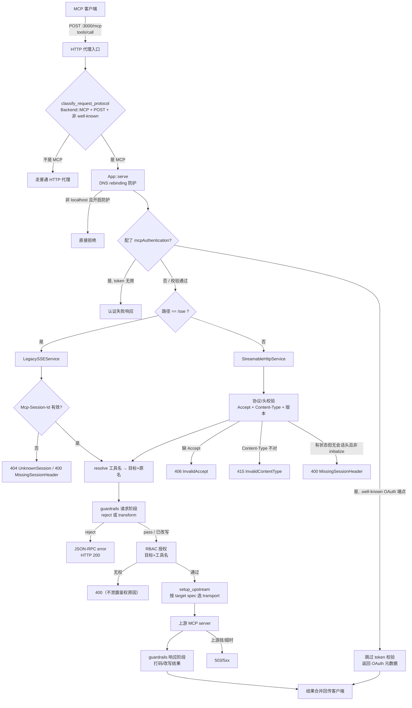
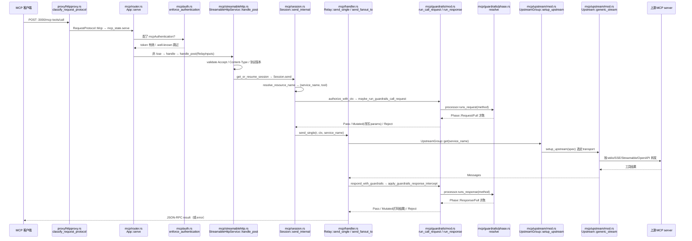

# 一次 MCP 调用（第二层：一次真实操作）

> 锚点约定见 `00-docs-style-guide.md`：Rust 写 `文件 · impl Type · 方法 +0`，`+0` 指方法签名行，跨 impl 写明所属 impl。

## 代码基准

| 项 | 值 |
|---|---|
| 仓库 | `agentgateway/agentgateway`（本地 `~/workspace/16_AI/agentgateway`） |
| 分支 @ 完整 SHA | `adrian` @ `47ea6aa03434e24502ec502ea98d7082112e2699` |
| 工作区状态 | 干净；仅 `docs/` 为未跟踪新增 |
| 核实日期 | 2026-11-25 |
| 覆盖范围 | 一个 MCP 客户端向网关发起一次 MCP 操作（`tools/list` 或 `tools/call`）→ 网关按 guardrails/RBAC 处理 → 按目标配置选定的 transport 转发上游 MCP server → 结果合并回传。**不含** LLM 链路（见 `02-一次LLM请求.md`）、不含 A2A。 |

本篇示例配置取自仓库自带样例 `examples/mcp-basic/config.yaml` 与 `examples/mcp-guardrails/expression/config.yaml`（内容均已读确认）：MCP 服务端口 `3000`，前者声明一个 stdio 目标 `everything`（`npx @modelcontextprotocol/server-everything`），后者在同一端口上叠加一组 `mcpGuardrails` 表达式处理器。

---

## 结论速览

| 问题 | 答案 | 证据 |
|---|---|---|
| 客户端打到哪个端口/路径 | 顶层 `mcp.port`（缺省 `3000`）；Streamable HTTP 走任意路径，legacy SSE 走 `/sse` | `types/local.rs · Const：DEFAULT_MCP_PORT +53`、`+5411`（`port.unwrap_or(DEFAULT_MCP_PORT)`）；`mcp/router.rs · impl App · serve +182`（`req.uri().path() == "/sse"` 分流） |
| 谁发请求 | 任何会说 MCP 协议的客户端（rmcp SDK、UI Playground、上层 agent/LLM） | `ui/src/mcp.ts · initializeMcpSession +20`（UI 自己就是这样一个客户端） |
| 请求怎么被认成 MCP | 后端是 `Backend::MCP` 且方法为 POST、非 well-known OAuth 端点、非 gRPC | `proxy/httpproxy.rs · classify_request_protocol +94`（返回 `RequestProtocol::Mcp`） |
| 前置条件 | 配置里得有 `mcp.targets`，每个 target 指定一种 transport（`mcp`/`sse`/`stdio`/`openapi`）及其 backend | `examples/mcp-basic/config.yaml`；`types/agent.rs · Enum：McpTargetSpec +2080` |
| 下游传输类型怎么选 | 由**入口路径**决定：`/sse` 走 legacy SSE 服务，其余 POST 走 Streamable HTTP 服务 | `mcp/router.rs · impl App · serve +182`；`mcp/streamablehttp.rs · impl StreamableHttpService · handle +84`（按 method + `stateful_mode` 分派） |
| 上游 transport 怎么选 | 由**每个 target 的 spec** 决定：`Sse`→SSE 客户端、`Mcp`→Streamable HTTP 客户端、`Stdio`→子进程、`OpenAPI`→OpenAPI 处理器 | `mcp/upstream/mod.rs · impl UpstreamGroup · setup_upstream +714`（四处 `McpTargetSpec::…` 分支） |
| 多个 target 怎么联邦 | 一个请求 fan-out（扇出）到所有匹配 target，再把各家的 `*/list` 结果合并成一份 | `mcp/handler.rs · impl Relay · send_fanout +1708`、`send_list +1719`、`merge_tools +855`；扇出宽度 = `UpstreamGroup::new_for_request +554` 里 `targets.len() != 1` 判定的 `is_multiplexing` |
| 单 target 的 `tools/call` 怎么走 | 先把客户端视图的工具名解析回「目标 + 原名」，再单发到那个 target | `mcp/session.rs · impl Session · send_internal +660`（`CallToolRequest` 分支：`resolve_resource_name` → `authorize_with_ctx` → `send_single`）；`mcp/handler.rs · impl Relay · send_single +1512` |
| guardrails 在哪生效 | 请求阶段：`tools/call` 等单发方法在 `authorize_with_ctx` 里跑，扇出方法在 fanout 前统一跑一次；响应阶段在结果流上跑 | `mcp/session.rs · impl Session · authorize_with_ctx +327`；`mcp/handler.rs +1287`（fanout 请求阶段）、`apply_guardrails_response_intercept +2371`；`mcp/guardrails/mod.rs · run_call_request +398`、`run_response +425` |
| 某方法跑请求还是响应阶段由谁定 | 每个 processor 的 `methods` 映射按「精确 > 前缀通配 > 后缀通配 > `*`，同-kind 取更长，末位字母序」解析出 `Phase` | `mcp/guardrails/phase.rs · resolve +37`、`match_kind +68`；`Phase::runs_request/runs_response +20/+23` |
| OAuth 在哪 | 配了 `mcpAuthentication` 时，在进入 transport 之前统一强制；`.well-known` OAuth 端点跳过 token 校验 | `mcp/router.rs · impl App · serve +167`（调 `auth::enforce_authentication`）；`mcp/auth.rs · enforce_authentication +63`（`is_well_known_endpoint` 跳过）、`handle_mcp_request +76`、`strip_oauth_protected_resource_prefix +257` |
| 没过校验返回什么 | 协议类错误按 JSON-RPC 语义映射 HTTP 码（如 `InvalidAccept`→406、`UnknownSession`→404）；RBAC 拒绝故意返回 `400`（不泄露是鉴权导致）；guardrails 拒绝包成 JSON-RPC error 但 HTTP 仍是 `200` | `proxy/mod.rs · impl ProxyError · http_status +614`（含 `+644` Authorization→400、`+645` McpGuardrails→200） |

---

## 生产视角：这一次真实操作

### 1. 真实入口与操作者

网关是一个常驻 Rust 进程。顶层 `mcp.port`（缺省 `3000`）上起一个 HTTP 监听，MCP 流量和普通 HTTP 代理共用同一套 HTTP 代理入口，靠「后端类型是不是 MCP」来分流。操作者是任意 MCP 客户端：它把网关当成一个标准 MCP server，按 Streamable HTTP（新一代，无状态、一个 POST 进一个 POST 出）或 legacy SSE（旧一代，POST + 单独的 GET 事件流 + `Mcp-Session-Id`）说话。

前置条件（代码已确认）：配置里必须有 `mcp.targets`，每个 target 指定一种 transport。没有 target 或所有 target 的条件表达式都不满足时，请求以 `503` 失败（`mcp::Error::NoBackends` / `Unavailable`，见 `proxy/mod.rs +639/+642`）。

### 2. 输入：一个 MCP 请求

先 `initialize` 建会话（legacy 需要，新一代可跳过），然后列工具、调工具：

```bash
# 1) 建会话（legacy/有状态模式）
curl -sS -D - http://127.0.0.1:3000/mcp \
  -H "Content-Type: application/json" \
  -H "Accept: application/json, text/event-stream" \
  -d '{"jsonrpc":"2.0","id":1,"method":"initialize","params":{
        "protocolVersion":"2025-06-18","capabilities":{},"clientInfo":{"name":"demo","version":"0"}}}'
# 响应头里拿 Mcp-Session-Id: <SID>

# 2) 列工具（扇出 + 合并）
curl -sS http://127.0.0.1:3000/mcp \
  -H "Content-Type: application/json" -H "Accept: application/json, text/event-stream" \
  -H "Mcp-Session-Id: <SID>" \
  -d '{"jsonrpc":"2.0","id":2,"method":"tools/list"}'

# 3) 调工具（单发；配了 guardrails 时会先过请求阶段处理器）
curl -sS http://127.0.0.1:3000/mcp \
  -H "Content-Type: application/json" -H "Accept: application/json, text/event-stream" \
  -H "Mcp-Session-Id: <SID>" \
  -d '{"jsonrpc":"2.0","id":3,"method":"tools/call","params":{
        "name":"echo","arguments":{"message":"hi vincent@corp.example"}}}'
```

三个必须的头部（代码强制）：`Content-Type: application/json`、`Accept` 同时含 `application/json` 与 `text/event-stream`，有状态模式下还要 `Mcp-Session-Id`。缺任何一个都会在进入业务逻辑前被拒（见失败表现）。

### 3. 处理环节（逐步）

以第 3 步 `tools/call echo` 为例，叠加 `examples/mcp-guardrails/expression/config.yaml` 的 guardrails：

| 步 | 发生了什么 | 可见结果 |
|---|---|---|
| 1 | TCP 连上 3000，进 HTTP 代理 | 连接被接受 |
| 2 | `classify_request_protocol` 判定：后端是 `Backend::MCP` + POST + 非 well-known → MCP | 进入 MCP 处理路径 |
| 3 | 路由到 MCP 后端，调 `App::serve` | 进入 MCP 专属流程 |
| 4 | DNS rebinding 防护（若开启）：非 localhost 请求被拒 | 正常放行 |
| 5 | MCP 认证（若配了 `mcpAuthentication`）：校验 token、处理 `.well-known` OAuth 元数据 | token 有效则放行 |
| 6 | 按 `Mcp-Session-Id` 找回/新建会话 | 命中已有会话，复用上游连接状态 |
| 7 | `tools/call` 不是扇出方法：先把客户端视图名字 `echo` 解析回「目标 + 原名」 | 得到 `service_name` 与原始工具名 |
| 8 | **guardrails 请求阶段**：按 `methods: {"tools/call": request}` 命中的处理器依次跑 | 含 `DO_NOT_SEND` → 整个请求被拒；命中邮箱正则 → `message` 里的邮箱被改写成 `[EMAIL]` |
| 9 | **RBAC 授权**：按「目标 + 工具名」验证策略 | 无权则拒绝（对外表现 `400`） |
| 10 | 按 target 的 spec 选上游 transport，把请求发到上游 MCP server | 上游返回工具结果 |
| 11 | **guardrails 响应阶段**：对返回结果跑 `methods: {"tools/call": response}` 的处理器 | 返回文本里的 demo secret 被打码 |
| 12 | 结果回传客户端 | 客户端拿到标准 JSON-RPC result |

`tools/list` 的差别只在第 7–10 步：它是扇出方法，不解析单个名字，而是把请求同时发给所有匹配 target，再把各家 `ListToolsResult` 按「目标名前缀 + 工具名」合并、逐个工具过 RBAC、去重（`merge_tools`）。

生产流程图（节点 = 真实入口 / 环节 / 可见结果，含失败终点）：



### 4. 失败表现一览

| 症状 | HTTP | 触发条件 | 证据 |
|---|---|---|---|
| 406 Not Acceptable | 406 | `Accept` 没同时含 `application/json` 和 `text/event-stream` | `mcp/streamablehttp.rs · handle_post +122`；`proxy/mod.rs +616` |
| 415 Unsupported Media Type | 415 | `Content-Type` 不是 `application/json` 开头 | `mcp/streamablehttp.rs +127`；`proxy/mod.rs +618` |
| 400 Bad Request | 400 | JSON 解析失败 / 有状态模式下带会话头却非 initialize / 版本不支持 | `mcp/streamablehttp.rs +203`；`proxy/mod.rs +619/+623/+627` |
| 404 Not Found | 404 | 会话 ID 未知，或方法名不存在 | `mcp/streamablehttp.rs +185`；`proxy/mod.rs +622/+632` |
| 405 Method Not Allowed | 405 | 无状态模式收到 GET/DELETE | `mcp/streamablehttp.rs +100`；`proxy/mod.rs +614` |
| 413 Payload Too Large | 413 | 请求体超过 buffer 上限 | `mcp/streamablehttp.rs +141`；`proxy/mod.rs +620` |
| 503 Service Unavailable | 503 | 没有 target / 所有 target 条件不满足 / 上游不可用 | `mcp/upstream/mod.rs +594`；`proxy/mod.rs +639/+642` |
| 400（故意的） | 400 | RBAC 授权拒绝，刻意不返回 401/403 以免泄露「因鉴权被拒」 | `proxy/mod.rs +643/+644` |
| 200 + JSON-RPC error | 200 | guardrails 请求/响应阶段 reject，错误走 JSON-RPC error 对象 | `proxy/mod.rs +645`；`mcp/handler.rs +785` |

---

## 真实例子：`tools/call echo` 从头串到尾

配置（`examples/mcp-guardrails/expression/config.yaml` + `examples/mcp-basic/config.yaml` 合并视角，脱敏）：

```yaml
mcp:
  port: 3000
  targets:
  - name: everything          # 单 target ⇒ 非多路复用
    stdio:
      cmd: npx
      args: ["@modelcontextprotocol/server-everything"]
  policies:
    mcpGuardrails:
      processors:
      - kind: expression
        methods: {"tools/call": request}      # 只在请求阶段跑
        condition: "mcp.params.name == 'echo' && has(mcp.params.arguments.message) &&
                    mcp.params.arguments.message.contains('DO_NOT_SEND')"
        reject: "Messages containing DO_NOT_SEND may not be sent upstream"
      - kind: expression
        methods: {"tools/call": request}
        condition: "mcp.params.name == 'echo' && has(mcp.params.arguments.message)"
        transform: "mcp.params.with(p, p.merge({'arguments': p.arguments.merge(
                      {'message': p.arguments.message.regexReplaceAll(
                        '[A-Za-z0-9._%+-]+@[A-Za-z0-9.-]+[.][A-Za-z]{2,}', '[EMAIL]')})}))"
      - kind: expression
        methods: {"tools/call": response}     # 只在响应阶段跑
        # ……把返回文本里的 demo secret 打码
```

走一遍 `tools/call echo {"message":"hi vincent@corp.example"}`：

1. 客户端 POST 到 `:3000/mcp`，带 `Mcp-Session-Id`。`classify_request_protocol` 判为 MCP，进入 `App::serve`。
2. 无 `mcpAuthentication` ⇒ 跳过认证；DNS rebinding 未开启 ⇒ 放行。
3. 路径不是 `/sse` ⇒ 走 `StreamableHttpService::handle` → `handle_post`。协议头校验通过，解析出 `CallToolRequest`。
4. `send_internal` 命中 `CallToolRequest` 分支：`resolve_resource_name` 把客户端视图的 `echo` 解析成「目标 `everything` + 原名 `echo`」（单 target 非多路复用时前缀为空，名字不变）。
5. `authorize_with_ctx` 先跑 guardrails 请求阶段：processor 1 的条件不满足（没有 `DO_NOT_SEND`）→ Pass；processor 2 条件满足 → 把 `message` 改写为 `hi [EMAIL]`，记为 Mutated。随后 RBAC 对 `Tool(everything, echo)` 验证 → 通过。
6. 改写后的参数被写回请求，`send_single` 经 `UpstreamGroup` 找到 `everything` 这个 target。它的 spec 是 `Stdio` ⇒ `setup_upstream` 启动 `npx @modelcontextprotocol/server-everything` 子进程，请求经 stdio 管道发给上游（带 10s 默认超时）。
7. 上游返回工具结果，流经 `respond_with_guardrails`：`apply_guardrails_response_intercept` 跑响应阶段处理器，把结果文本里的 secret 打码。
8. 客户端收到标准 JSON-RPC result，`message` 已变 `hi [EMAIL]`，且不含敏感串。

若把 `message` 换成含 `DO_NOT_SEND` 的串，第 5 步 processor 1 会直接 Reject，客户端拿到一个 JSON-RPC error 对象（HTTP 仍是 200），请求根本不会发往上游。

---

## 开发视角：每步映射到真实代码

### 源码映射表

| 生产步骤 | 文件 · impl Type · 方法 +偏移 | 说明 |
|---|---|---|
| 监听端口缺省 3000 | `crates/agentgateway/src/types/local.rs · Const：DEFAULT_MCP_PORT +53`；`+5411` | `port.unwrap_or(DEFAULT_MCP_PORT)` |
| 请求被认成 MCP | `crates/agentgateway/src/proxy/httpproxy.rs · classify_request_protocol +94` | `Backend::MCP` + POST + 非 well-known + 非 gRPC → `RequestProtocol::Mcp` |
| 进入 MCP 后端 | `crates/agentgateway/src/proxy/httpproxy.rs · Backend::MCP 分支 +2892` | 调 `inputs.mcp_state.serve(...)` |
| MCP 总入口 | `crates/agentgateway/src/mcp/router.rs · impl App · serve +75` | 建 `McpBackendGroup`、DNS 防护、认证、下游传输分流 |
| 目标/策略合并 | `crates/agentgateway/src/mcp/router.rs · impl App · serve +84` | 每个 target 的 backend + inline 策略合并成 `McpTarget` |
| DNS rebinding 防护 | `crates/agentgateway/src/mcp/router.rs · impl App · serve +146`；`mcp/dns_rebinding.rs · reject_non_localhost` | 非 localhost 拒绝 |
| OAuth / 认证强制 | `crates/agentgateway/src/mcp/router.rs · impl App · serve +167`；`crates/agentgateway/src/mcp/auth.rs · enforce_authentication +63` | `is_well_known_endpoint` 跳过 token 校验；`handle_mcp_request +76`；`strip_oauth_protected_resource_prefix +257` |
| 下游传输分流 | `crates/agentgateway/src/mcp/router.rs · impl App · serve +182` | `/sse` → `LegacySSEService`（`mcp/sse.rs · impl LegacySSEService · handle +34`），否则 Streamable |
| Streamable 入口分派 | `crates/agentgateway/src/mcp/streamablehttp.rs · impl StreamableHttpService · handle +84` | 按 (method, stateful_mode) 分派 POST/GET/DELETE |
| 协议/头校验 | `crates/agentgateway/src/mcp/streamablehttp.rs · handle_post +107`（Accept `+115`、Content-Type `+127`）；`validate_request_protocol +486`；`validate_standard_headers +347` | 失败即返回对应 `mcp::Error` |
| 会话找回/新建 | `crates/agentgateway/src/mcp/streamablehttp.rs · handle_post +172/+195`；`mcp/session.rs · impl SessionManager · get_or_resume_session`、`create_session` | `Mcp-Session-Id` 头驱动 |
| 无状态路径 | `crates/agentgateway/src/mcp/streamablehttp.rs · serve_stateless +226` | 新一代无会话；按需合成 upstream initialize 并清理 |
| 构建 relay（扇出组+策略+guardrails） | `crates/agentgateway/src/mcp/handler.rs · impl RelayInputs · build +381` | 造 `UpstreamGroup` + `McpAuthorizationSet` + `McpGuardrails` |
| 上游组构建 / 多路复用判定 | `crates/agentgateway/src/mcp/upstream/mod.rs · impl UpstreamGroup · new_for_request +554` | `targets.len() != 1` → `is_multiplexing`；条件不满足的 target 被剔除 |
| **上游 transport 选择** | `crates/agentgateway/src/mcp/upstream/mod.rs · impl UpstreamGroup · setup_upstream +714` | `McpTargetSpec::Sse +717`→`sse::Client`；`Mcp +738`→`streamablehttp::Client`（路径缺省 `/mcp`）；`Stdio +763`→子进程；`OpenAPI +790`→`openapi::Handler` |
| 会话发消息（总调度） | `crates/agentgateway/src/mcp/session.rs · impl Session · send +65` → `send_internal +531` | 按 `ClientRequest` 种类分派 |
| **federation：扇出** | `crates/agentgateway/src/mcp/handler.rs · impl Relay · send_fanout +1708`、`send_fanout_to +1255` 附近、`send_list +1719` | 同时发给所有选中 target；`send_list` 处理多路复用游标 |
| **federation：合并** | `crates/agentgateway/src/mcp/handler.rs · impl Relay · merge_tools +855`（`merge_initialize +905`、`merge_prompts`、`merge_resources` 同族） | 按「目标名前缀 + 原名」改名、逐工具 RBAC 过滤、去重 |
| `tools/call` 名字解析 | `crates/agentgateway/src/mcp/session.rs · send_internal +660`；`mcp/handler.rs · resolve_resource_name +497` | 客户端视图名 → 目标 + 原名 |
| **guardrails 阶段判定** | `crates/agentgateway/src/mcp/guardrails/phase.rs · resolve +37`、`match_kind +68`、`impl Phase · runs_request +20`/`runs_response +23` | 精确 > 前缀 > 后缀 > `*`，同-kind 取更长，末位字母序 |
| guardrails 处理器执行 | `crates/agentgateway/src/mcp/guardrails/mod.rs · impl Processor · runs_request +345`、`call_request +353`、`response +379`；`run_call_request +398`、`run_response +425` | `Outcome::{Pass, Mutated, Reject}`；CEL 表达式 vs 远程处理器两条路 |
| 请求阶段触发（单发方法） | `crates/agentgateway/src/mcp/session.rs · authorize_with_ctx +327` → `mcp/handler.rs · maybe_run_guardrails_call_request +801`/`run_guardrails_call_request +765` | 先 guardrails 再 RBAC（guardrails 可能给 CEL 补上下文） |
| 请求阶段触发（扇出方法） | `crates/agentgateway/src/mcp/handler.rs · send_fanout_to 内 +1285` | 整个 fanout 只跑一次，`params` 为 `None`（无单一可改写 body） |
| 响应阶段触发 | `crates/agentgateway/src/mcp/handler.rs · apply_guardrails_response_intercept +2371` | 只对终态 `Response` 跑 `run_response` |
| 单发到上游 | `crates/agentgateway/src/mcp/handler.rs · impl Relay · send_single +1512` | `generic_stream` → `respond_with_guardrails` |
| transport 归一化发送 | `crates/agentgateway/src/mcp/upstream/mod.rs · impl Upstream · generic_stream +335`（transport 分派 match 在 `+379`） | stdio `+380`（10s 默认超时）/ SSE `+395` / Streamable `+402`（initialize 时抓 session id）/ OpenAPI `+419` |
| 底层 transport trait | `crates/agentgateway/src/mcp/upstream/stdio.rs · trait MCPTransport +258`；`mcp/upstream/sse.rs · impl MCPTransport for SseClient +43` | SSE 客户端实现同一 trait，收发归一 |
| 错误 → HTTP 映射 | `crates/agentgateway/src/proxy/mod.rs · impl ProxyError · http_status +614` | 含 Authorization→400、McpGuardrails→200 |

### 调用链

扇出方法（`tools/list`）：

```
httpproxy.classify_request_protocol                      → RequestProtocol::Mcp
  └─ httpproxy Backend::MCP 分支                          → inputs.mcp_state.serve(...)
       └─ mcp::router::App::serve(pi, name, backend, policies, req, log)
            ├─ auth::enforce_authentication(req, auth, client)        [可选, 配了 mcpAuthentication]
            ├─ path == "/sse" → LegacySSEService::handle(req, RelayInputs)
            └─ 否则 → StreamableHttpService::handle(req, RelayInputs)
                 └─ handle_post → validate_* → SessionManager.get_or_resume_session
                      └─ Session.send(ctx, message)
                           └─ send_internal → ListToolsRequest 分支
                                ├─ RelayInputs::build → UpstreamGroup::new_for_request
                                │                         └─ setup_connections → setup_upstream(spec)  ← transport 选择
                                ├─ guardrails::run_call_request (fanout, body=None)                 ← 请求阶段
                                └─ Relay::send_list(r, ctx, merge_tools(), encoder)
                                     └─ send_fanout_to: 对每个 target
                                          ├─ Upstream::generic_stream → transport 分派 match     ← 实际转发
                                          └─ merge_tools(): 改名 + RBAC 过滤 + 去重                  ← federation 合并
                                           └─ respond_with_guardrails → apply_guardrails_response_intercept ← 响应阶段
```

单发方法（`tools/call`）：

```
Session.send → send_internal → CallToolRequest 分支
  ├─ Relay::resolve_resource_name(Tool, name, ctx, meta)   → (service_name, tool)
  ├─ Session::authorize_with_ctx(service_name, TOOLS_CALL, params, extensions, ctx, Tool(id))
  │    ├─ Relay::maybe_run_guardrails_call_request          ← 请求阶段 (reject/transform)
  │    └─ McpAuthorizationSet::validate(Tool, TOOLS_CALL, cel)  ← RBAC
  └─ Relay::send_single(r, ctx, service_name, log)
       ├─ UpstreamGroup::get(service_name)
       ├─ build_guardrails_ctx
       ├─ Upstream::generic_stream → generic_request(match self)   ← 按 target spec 转发
       └─ respond_with_guardrails → apply_guardrails_response_intercept ← 响应阶段
```

参数怎么传：`RelayInputs`（backend 组 + 授权集 + guardrails + `PolicyClient`）由 `router::serve` 组装，经 `StreamableHttpService::handle` 一路带到 `RelayInputs::build`，变成 `Relay`；会话复用时 `Session::with_inputs` 用新 inputs 重建 relay，只保留旧 relay 的上游连接状态（`prev`）。错误统一走 `UpstreamError` / `mcp::Error`，在 `Session::handle_error` 收口成 `ProxyError`，最后由 `ProxyError::http_status` 映射成 HTTP 码。

开发实现图（sequenceDiagram，节点 = 真实文件·函数）：



### 关键判定的代码事实

- **下游传输类型**只有两种入口：路径 `/sse` 走 legacy SSE，其余 POST 走 Streamable HTTP（`router.rs · serve +182`）。README 里说的 stdio/HTTP/SSE/Streamable 多种 transport，指的是**上游 target** 支持的形态，不是下游监听形态。
- **上游 transport 选择**完全由 `McpTargetSpec` 决定，集中在 `setup_upstream` 一个 match 里（`upstream/mod.rs +714`），四种分支各自构造不同的 client/进程，之后都收敛到 `Upstream` 枚举，再用 `generic_request` 的 match 归一化发送。
- **federation**（多 target 联邦）的宽度在 `new_for_request` 里由 `targets.len() != 1` 定为 `is_multiplexing`；`tools/list` 这类扇出方法靠 `send_list` + `merge_tools` 把多份结果合成一份并按前缀改名，`tools/call` 这类单发方法则用 `resolve_resource_name` 反向解析名字后只发一个 target。
- **guardrails 阶段**不是硬编码在调用点，而是每个 processor 自带 `methods` 映射，运行时用 `phase::resolve` 按方法名解析出 `Phase`，再由 `runs_request`/`runs_response` 决定是否参与。方法名常量集中在 `guardrails/methods.rs`（如 `TOOLS_CALL +12`、`TOOLS_LIST +20`）。
- **OAuth**：`.well-known` 端点在 `enforce_authentication` 里被显式跳过 token 校验，改由 `handle_mcp_request` 提供 OAuth 元数据/授权服务器代理；受保护资源元数据前缀由 `strip_oauth_protected_resource_prefix` 处理。

### 标注

- 全文锚点均来自本工作区 `adrian @ 47ea6aa0` 的 grep 定位 + 定点阅读（单次读取 ≤ 200 行），无推断锚点。
- 已定点读函数体确认的点（原先标 `[源码未确认]`，现已坐实）：`impl SessionManager · get_or_resume_session +1050`（`mcp/session.rs`）先在内存 `sessions` 写锁下按 id 查找，命中则校验 `backend_id` 与 `conditions_match(&builder.backend, ctx)`、刷新 `last_access`、`with_inputs` 注入本次请求输入后克隆返回；未命中走持久化恢复——`SessionState::decode(id, &self.encoder)` 失败即返 `mcp::Error::UnknownSession`，非 `MCP` 变体或持久化 `backend` 与当前 `backend_id` 不符返 `None`，随后 `builder.build(ctx, None)` 重建 relay 并 `set_sessions(state.sessions)` 回灌上游会话态，只有 `has_connection_teardown()` 为真才 `insert_session` 重新入表（有 idle reaper 才需要驻留）。`create_session +1104` 只 `session_id()`（`uuid::Uuid::new_v4`）造 id 并包 `Session`，注释明确 `// Do NOT insert yet`，入表交给调用方后续 `insert_session`。`respond_with_guardrails`（`handler.rs +2071`）按 `guardrails: Option<GuardrailsCtx>` 分派：有则 `wrap_with_guardrails(stream, guardrails)`（`+2134`，`stream.then` 逐条 `apply_guardrails_response_intercept` 可改写/替换消息）再 `messages_to_response`，无则直接 `messages_to_response`；`keep_alive` 与 modern/legacy 判定（`ctx_downstream_modern +2091`）一并传入。`rewrite_outbound_server_messages`（`handler.rs · impl Processor · +420`）是 `stream.map_server_messages` 的顺序改写管线：`rewrite_resource_messages` → `rewrite_task_messages` → `GetSkillResult` 时 `rewrite_skill` 并对 skill 资源 uri 跑 `policies.validate(SKILLS_GET)` → `apps::rewrite_tool_list_ui_meta` 对 tools/list 内嵌 UI 资源 uri 跑 `policies.validate(TOOLS_LIST)`。
- 未做运行验证：本文所有端口/状态码/改写效果均来自代码阅读与样例配置，未实际起服务发请求，标 `[待运行验证]`。
- 单发链路里 `send_single` 调的是 `generic_stream`（`handler.rs +1532`），扇出链路里 `send_fanout_to` 调的也是 `generic_stream`（`handler.rs +1316`）；两者最终都进入 `impl Upstream · generic_stream +335` 的 transport 分派。此处已按签名与调用点对齐；上面四条函数体亦已定点读到，本篇 Rust 数据面侧不再有 `[源码未确认]` 项。