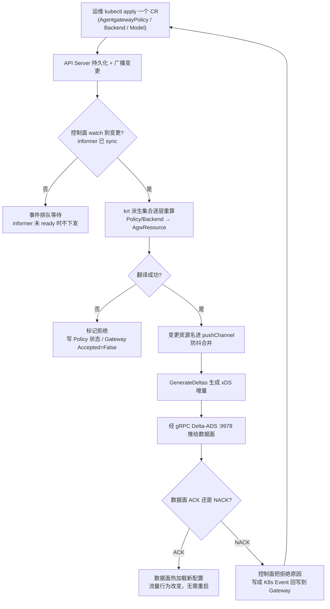
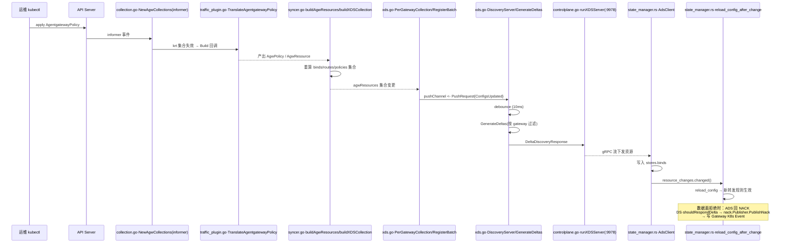

# 控制面的一次 reconcile：CR 怎么被 watch、怎么翻译成 xDS 下发给数据面

> 代码基准：分支 `adrian` @ `47ea6aa03434e24502ec502ea98d7082112e2699`（工作区干净，仅本篇文档为未跟踪新增）；核实日期 2026-11-25。
> 范围：用户提交/修改一个 agentgateway 自定义资源（CR，Custom Resource，用户自定义的 Kubernetes 资源类型）后，Go 控制面如何感知、翻译、并经 xDS 下发给 Rust 数据面，直到数据面热加载生效。不覆盖：数据面内部 AI/MCP 请求转发（见 `02`、`03` 篇）、控制面自身的部署（Helm）、`agctl` CLI 内部实现。

## 0. 结论速览

### 0.1 这套机制现在能做什么

用户把一条「网关该怎么转发」的意图写成 CR（比如把某个后端标成需要 mTLS、给某条路由挂限流），`kubectl apply` 提交后，**不需要重启任何 Pod**，几毫秒到几十毫秒内运行中的 Rust 网关就会按新配置转发流量。控制面全程只做两件事：**盯着这些 CR 的变化**，以及**把 CR 翻译成数据面能读懂的二进制配置再推过去**。

### 0.2 关键结论

| # | 结论 | 代码证据 |
|---|---|---|
| 1 | 控制面**不是** controller-runtime 的 `Reconcile()` 逐对象循环来翻译配置；翻译走的是 **krt 响应式集合**（krt = kgateway 的响应式派生状态库，informer 事件自动沿派生链传播） | `setup.go` 用 `krt.NewFilteredInformer`/`kclient.NewFilteredDelayed` 建 watch；`syncer.go` 用 `krt.NewCollection` 派生 |
| 2 | 真正叫 `Reconcile()` 的只有两个：**Gateway**（负责把数据面 Deployment 拉起来）和 **GatewayClass**（负责登记网关类）。它们管「数据面跑不跑」，不管「配置内容」 | `gatewayReconciler.Reconcile` `+0`；`gatewayClassReconciler.reconcile` `+0` |
| 3 | CR 类型实际叫 **`AgentgatewayPolicy` / `AgentgatewayBackend` / `AgentgatewayModel` / `AgentgatewayParameters`**，不是 AIGatewayRoute / Agent / MCPServer | `controller/api/v1alpha1/agentgateway/` 四个 `_types.go`；`collection.go` 建 informer |
| 4 | xDS server 是一个 **gRPC Delta-ADS**（聚合发现服务，增量推送）服务，默认监听 **9978**，在 `setup.New` 里建 listener、`Start` 里起服务 | `controller/api/settings/settings.go:175` `AgentgatewayXdsServicePort` `default:"9978"`；`newXDSListener` `+0`；`runXDSServer` `+0` |
| 5 | CR 变更 → 翻译 → 推送的触发点是 `PerGatewayCollection` 注册的 **batch 回调**，它把变更资源名塞进 `pushChannel`，由 DiscoveryServer 防抖后 `GenerateDeltas` 生成增量下发 | `xds.go` `PerGatewayCollection` `+29`；`GenerateDeltas` `+0` |
| 6 | 数据面收到 xDS 后**热加载**：xDS 客户端把资源写进 store，`watch_resource_changes` 订阅到变化就 `reload_config_after_change`，全程不重启进程 | `state_manager.rs` `watch_resource_changes` `+0`；`reload_config_after_change` `+0` |
| 7 | 数据面拒绝配置会 **NACK**（拒绝确认），控制面把它转成 Kubernetes Event 写回 CR，形成闭环 | `shouldRespondDelta` `+0`；`nack/publisher.go` `PublishNack` `+0` |

### 0.3 不做什么

不校验业务语义对不对（比如上游 OpenAI 的 key 是否有效）——控制面只保证 CR 能翻译成合法的 xDS 资源；上游凭证对不对，是数据面真正发请求时才暴露。控制面也不参与数据面请求转发（那是 Rust 侧的事，见 `02`/`03` 篇）。

---

## 1. 生产视角：实际怎么用、会得到什么

### 1.1 参与者、真实入口与前置条件

| 角色 | 是谁 | 做什么 |
|---|---|---|
| 平台/应用运维 | 提交 CR 的人 | `kubectl apply -f xxx.yaml` |
| Kubernetes API Server | 集群组件 | 存 CR、广播变更事件 |
| Go 控制面 | `agentgateway` Deployment（本仓库 `controller/` 编译产物） | watch CR → 翻译 → 经 xDS 推送；同时把数据面 Deployment 拉起来 |
| Rust 数据面 | `agentgateway-proxy` Deployment（`crates/agentgateway-app`） | 连上 xDS 拉配置、热加载、真正转发 AI/MCP 流量 |

前置条件（缺一不可，都可判断）：

1. 有一个可用的 Kubernetes 集群，`kubectl` 已配好 context。
2. **CRD 已安装**：`agentgateway.dev_agentgatewaybackends.yaml`、`agentgateway.dev_agentgatewaypolicies.yaml` 等已 apply（Helm chart `agentgateway-crds` 自带）。
3. **控制面已运行**：`agentgateway` Deployment 就绪，健康探针 `:9093` 通过（`setup.go` `New` 里写死 `HealthProbeBindAddress: ":9093"`）。
4. 有一个 `Gateway`（`gateway.networking.k8s.io`），其 `gatewayClassName` 指向本控制面管理的 GatewayClass——否则 CR 挂不到任何网关上，不会被翻译。
5. 网络上，数据面 Pod 能连到控制面的 xDS Service **9978** 端口。

### 1.2 生产主流程图



图上的分支说明：

- **C1（informer 未 ready）**：控制面刚启动、缓存还没从 API Server 拉全时，事件会被 hold 住，`Syncer.Start` 里 `WaitForCacheSync` 通过前不推进（`syncer.go` `Start` `+0`、`setupSyncDependencies` `+0`）。
- **E1（翻译失败）**：CR 字段非法或引用了不存在的对象，翻译插件产不出合法资源；Gateway 会被打上 `Accepted=False / Reason=InvalidParameters`（`gw_controller.go` `Reconcile` `+48` 一带对 `ErrNoValidPorts`/`ErrUnsupportedRoutability`/非法参数的处理）。
- **K（数据面 NACK）**：数据面认为下发的配置跑不通（比如 TLS 证书文件路径在它那边不存在），回一个带 `ErrorDetail` 的 DeltaDiscoveryRequest；控制面 `shouldRespondDelta` 解析后调 `PublishNack`，运维在 `kubectl describe gateway` 的 Events 里能看到原因，改 CR 后重新走整条链。

### 1.3 输入、处理环节、输出与接收方

| 环节 | 输入 | 处理 | 输出 | 接收方 |
|---|---|---|---|---|
| 提交 | 一份 CR YAML | API Server 校验 schema、落 etcd | 资源创建/更新事件 | 控制面 informer |
| watch | informer 事件 | krt 集合记录最新对象 | 派生集合失效信号 | 各翻译插件 |
| 翻译 | Policy/Backend/Model/Route + Service/Secret/ConfigMap | 插件把 K8s 对象翻译成 `AgwResource`（数据面中间表示） | 带 `Gateway` 归属的 `AgwResource` 集合 | xDS 集合层 |
| 下发 | `AgwResource` 变更 | 防抖 → 生成 DeltaDiscoveryResponse | gRPC 流上的资源增量 | 数据面 xDS 客户端 |
| 生效 | xDS 资源 | 写入 store → 触发 reload | 新的转发规则 | 数据面请求处理路径（`02`/`03` 篇） |

### 1.4 失败表现速查

| 现象 | 大概率原因 | 运维能看到什么 |
|---|---|---|
| apply 成功但流量行为不变 | CR 没挂到受管 Gateway 上（`parentRefs`/`targetRefs` 名字对不上） | Gateway Events 无相关记录；`agctl` 看 xDS 资源里没有该对象 |
| Gateway 一直 `Accepted=False` | 引用的 GatewayParameters/后端引用非法 | `kubectl get gateway -o yaml` 里 condition 带 `InvalidParameters` + message |
| 数据面起来了但连不上配置 | 数据面到 9978 网络不通、或 xDS TLS/认证不匹配 | 控制面日志 `starting server address=...:9978` 在，但没有数据面连接；数据面侧报连接失败 |
| 配置推下去但没生效 + 有 Event | 数据面 NACK | Gateway 上出现 `AgentGatewayNackError` 事件，message 是数据面给的诊断 JSON |

### 1.5 一次真实操作示例

场景：给一个已存在的后端 `payments-backend` 加上 mTLS（双向 TLS）。运维写两个 CR：

```yaml
apiVersion: agentgateway.dev/v1alpha1
kind: AgentgatewayBackend
metadata:
  name: payments-backend
  namespace: agentgateway-system
spec:
  ai:                      # 实际字段以 CRD 为准，此处为脱敏示意
    llm:
      host: payments.internal
      port: 443
---
apiVersion: agentgateway.dev/v1alpha1
kind: AgentgatewayPolicy
metadata:
  name: payments-mtls
  namespace: agentgateway-system
spec:
  targetRefs:
  - group: agentgateway.dev
    kind: AgentgatewayBackend
    name: payments-backend
  backend:
    tls:
      sni: api.example.internal
      mtlsCertificateRef:
      - kind: File
        file:
          cert: /var/run/certs/tls.crt
          key: /var/run/certs/tls.key
          root: /var/run/certs/ca.crt
```

（上面 `AgentgatewayPolicy` 段照抄自 `examples/traffic-backend-mtls-files/policy.yaml`，仅改了名字和 namespace。`AgentgatewayBackend` 的 `spec` 字段是示意，完整字段见 `controller/api/v1alpha1/agentgateway/agentgateway_backend_types.go`。）

从头到尾会发生：

1. `kubectl apply` 提交两个 CR，API Server 落库并广播事件。
2. 控制面的 informer 各自收到 `payments-backend` 和 `payments-mtls`。
3. 翻译插件把 policy 的 `backend.tls` 解出来，attach 到 `payments-backend` 上，产出一个带 mTLS 的后端 `AgwResource`，归属到引用它的 Gateway。
4. xDS 集合层发现某个 Gateway 的后端资源变了，防抖后生成增量，从 9978 推给数据面。
5. 数据面 xDS 客户端收到资源，写进 store，`resource_changes` 触发 reload，新后端带上 mTLS 参数。
6. 之后经该网关发往 `payments.internal` 的请求就用双向 TLS 了——**没有任何 Pod 重启**。
7. 若证书文件路径在数据面 Pod 里不存在，数据面 NACK，控制面在 Gateway 上写一条 `AgentGatewayNackError` 事件，运维据此修 CR。

---

## 2. 开发视角：当前代码怎样实现

### 2.1 实现地图

| 层 | 进程/模块 | 职责 | 关键文件 |
|---|---|---|---|
| 启动装配 | Go 控制面 `controller/cmd/agentgateway` | 建 listener、建集合、起 manager | `controller/pkg/setup/setup.go` |
| CR watch | krt 集合 | informer 包装成响应式集合 | `controller/pkg/agentgateway/plugins/collection.go` |
| 翻译 | AgwPlugin | CR → `AgwResource` | `traffic_plugin.go`、`backend_tls_plugin.go`、`a2a_plugin.go` 等 |
| xDS 集合 | krtxds | `AgwResource` → 按网关分组的 DiscoveryResource → 推送 | `controller/pkg/syncer/krtxds/xds.go` |
| xDS server | gRPC Delta-ADS | 监听 9978、认证、下发 | `controller/pkg/setup/controlplane.go` |
| 数据面拉取 | Rust `agent-xds` | ADS 客户端、注册 watched handler | `crates/xds/src/client.rs`、`crates/agentgateway/src/state_manager.rs` |
| 数据面热加载 | Rust state_manager | 变化触发 reload | `crates/agentgateway/src/state_manager.rs` |

### 2.2 真实调用链

**链路 A：控制面装配（进程启动，一次性）**

```text
main.go · run +? 
  → cobra 命令 Use:"agentgateway"
  → setup.New(Options{}) setup.go +0            建 XDSListener(0.0.0.0:9978)
  → s.Start(ctx)                setup.go +0
      → agwplugins.NewAgwCollections(...)  collection.go +0   ← 建 CR informer
      → s.buildSyncer(...)                 setup.go +0
          → controller.NewControllerBuilder(...).Build()  start.go +0
              → NewBaseGatewayController(...)          起 gatewayReconciler / gatewayClassReconciler
          → syncer.NewAgwSyncer(...)                   syncer.go +0
              → buildResourceCollections +0
                  → buildAgwResources +0               CR → AgwResource
                  → buildXDSCollection +0              ← 填 s.Registrations
      → runXDSServer(ctx, listener, ..., agw.Registrations...)  controlplane.go +0
          → krtxds.NewDiscoveryServer(nil, nackPublisher, reg...)   xds.go +0
          → grpcServer.Serve(lis)                               起 :9978
      → mgr.Start(ctx)
```

**链路 B：一次 CR 变更（每次 apply 都走）**

```text
API Server 事件
  → informer (collection.go · krt.NewFilteredInformer[*AgentgatewayPolicy] +0)
  → 插件 Build 回调 (traffic_plugin.go · NewAgentPlugin +0, Build +4)
      → krt.NewStatusManyCollection(agw.AgentgatewayPolicies, ...) +5
          → TranslateAgentgatewayPolicy(...) traffic_plugin.go +0     ← CR → AgwPolicy
  → syncer.buildAgwResources 的派生集合 (syncer.go +0)
      → join 进 agwResources 集合
  → buildXDSCollection 注册的 PerGatewayCollection (xds.go +0)
      → nc.RegisterBatch(...) xds.go +29
          → 组 PushRequest{ConfigsUpdated} → s.pushChannel <- &pr   xds.go +26..+33
  → DiscoveryServer.sendPushes / debounce (xds.go +83 / +59)
      → CollectionGenerator.GenerateDeltas(...) xds.go +0           ← 生成 DeltaDiscoveryResponse
      → pushDeltaXds(...) xds.go +0
          → 经 gRPC 流发给数据面
  → 数据面 AdsClient 收到 (client.rs · AdsClient / with_watched_handler +0)
      → 写入 stores.binds (state_manager.rs · Config::new +50..+56)
      → watch_resource_changes 订阅到 changed (state_manager.rs +0)
          → reload_config_after_change (+0) → reload_config (+0)     ← 热加载
```

### 2.3 源码映射表（每个生产步骤 → 真实锚点）

| 生产步骤 | 文件 · 符号 | 偏移 | 说明 |
|---|---|---|---|
| 建 xDS listener（9978） | `controller/pkg/setup/setup.go` · `newXDSListener` | `+0` | `net.Listen("tcp", "0.0.0.0:"+port)` |
| 9978 从哪来 | `controller/api/settings/settings.go` · `AgentgatewayXdsServicePort` 字段 | `:175` | `default:"9978"`，env `AGENTGATEWAY_XDS_SERVICE_PORT` 可覆盖 |
| 建 CR informer | `controller/pkg/agentgateway/plugins/collection.go` · `NewAgwCollections` | `+0` | 函数签名行 |
| watch `AgentgatewayPolicy` | `controller/pkg/agentgateway/plugins/collection.go` · `krt.NewFilteredInformer[*agentgateway.AgentgatewayPolicy]` | `+123`（函数内 `:251`） | `collection.go:251` − `128` |
| watch `AgentgatewayBackend` | `controller/pkg/agentgateway/plugins/collection.go` · `krt.NewFilteredInformer[*agentgateway.AgentgatewayBackend]` | `+124`（`:252`） | |
| watch `AgentgatewayModel` | `controller/pkg/agentgateway/plugins/collection.go` · `krt.NewFilteredInformer[*agentgateway.AgentgatewayModel]` | `+125`（`:253`） | |
| 翻译 policy → AgwPolicy | `controller/pkg/agentgateway/plugins/traffic_plugin.go` · `TranslateAgentgatewayPolicy` | `+0` | 被 `NewAgentPlugin` 的 `Build` 闭包调用 |
| 翻译入口（插件注册） | `controller/pkg/agentgateway/plugins/traffic_plugin.go` · `NewAgentPlugin` | `+0`；`Build` 闭包 `+4`（`:112`） | |
| CR/路由 → AgwResource | `controller/pkg/syncer/syncer.go` · `buildAgwResources` | `+0` | 组合 binds/listeners/routes/policies |
| 填 xDS 注册 | `controller/pkg/syncer/syncer.go` · `buildXDSCollection` | `+0`；`Registrations` append `+8`/`+9`（`:971`/`:972`） | Address 集合 + PerGateway AgwResource 集合 |
| 变更 → pushChannel | `controller/pkg/syncer/krtxds/xds.go` · `PerGatewayCollection` 返回的 `start` | `+29`（`:171` RegisterBatch）；`pushChannel` 发送 `+33`（`:182`） | |
| 防抖 | `controller/pkg/syncer/krtxds/xds.go` · `debounce` / `DebounceAfter` | `debounce +0`（`:1059`）；`DebounceAfter +0`（`:201`） | 默认 10ms，env `KGW_DEBOUNCE_AFTER` |
| 生成增量资源 | `controller/pkg/syncer/krtxds/xds.go` · `CollectionGenerator.GenerateDeltas` | `+0` | 按 `IsForGateway(gw)` 过滤 |
| 起 xDS gRPC server | `controller/pkg/setup/controlplane.go` · `runXDSServer` | `+0`；`Serve(lis)` `+25`（`:81`） | 注册 `AggregatedDiscoveryServiceServer` |
| 建数据面 xDS 客户端 | `crates/agentgateway/src/state_manager.rs` · `Config::new(...).with_watched_handler::<ADPResource>(...)` | `Config::new +0`（`:69`）；`with_watched_handler +50`/`+51`（`:74`/`:75`） | 监听 ADDRESS_TYPE 和 ADP_TYPE |
| 数据面热加载 | `crates/agentgateway/src/state_manager.rs` · `watch_resource_changes` → `reload_config_after_change` → `reload_config` | `+0` / `+0` / `+0` | tokio 任务订阅 `subscribe_changes()` |
| NACK 反馈 | `controller/pkg/syncer/krtxds/xds.go` · `shouldRespondDelta` | `+0`；`PublishNack` 调用 `+47`（`:602`） | |
| NACK 写 K8s Event | `controller/pkg/syncer/nack/publisher.go` · `PublishNack` | `+0` | Reason = `AgentGatewayNackError`（`:23`） |
| Gateway 自身的 reconcile（拉数据面 Deployment） | `controller/pkg/controller/gw_controller.go` · `gatewayReconciler.Reconcile` | `+0` | 与配置翻译链**独立**，只管 Deployment/Service/状态 |
| GatewayClass reconcile | `controller/pkg/controller/gatewayclass.go` · `gatewayClassReconciler.reconcile` | `+0` | |

### 2.4 开发实现时序图



### 2.5 分支、失败处理与必须保持的规则

| 分支/失败 | 代码落点 | 行为 |
|---|---|---|
| Gateway 不属于本控制器 | `gw_controller.go` · `Reconcile` `+14..+18`（`:299` 判 `ControllerName`） | 直接 `return nil`，不碰 |
| 数据面部署失败 | `controller/pkg/controller/gw_controller.go` · `Reconcile` `+83..+94`（`:367`） | 写 `Programmed=False / DeploymentFailed` condition |
| 翻译产出非法参数 | `controller/pkg/controller/gw_controller.go` · `Reconcile` `+48..+59`（`:333`） | 写 `Accepted=False / InvalidParameters` |
| xDS 认证失败 | `controlplane.go` · `getGRPCServerOpts` `+10..+23`（`:102`） | 拦截器返回 `authentication failed`，连接被拒 |
| 数据面 NACK | `xds.go` · `shouldRespondDelta` `+0` | 记 `LastError`、`xdsRejectsTotal` 计数、`PublishNack` |
| 数据面 NACK 带 warning | `xds.go` · `shouldRespondDelta` `+20..+27`（`:575`） | 只发 warning 事件，不算拒绝 |
| 配置无变化 | `xds.go` · `GenerateDeltas` `+49`（`:1244`） | 返回空，不下发 |
| 控制面尚未 leader | `setup.go` · `Start`（`LeaderElection: !DisableLeaderElection`）`+76`（`:161`）；`syncer.go` · `NeedLeaderElection` `+0` 返回 `false` | Gateway reconciler 只在 leader 跑；**xDS 下发的 Syncer 在所有副本都跑**（`NeedLeaderElection()=false`），保证 follower 也能接数据面连接 |

必须保持的规则（改代码时别破坏）：

- **翻译是响应式的，别把它塞进 `Reconcile()`**。`Reconcile` 只管数据面工作负载生命周期；配置内容由 krt 派生集合驱动，塞进去会同时破坏增量下发和防抖。
- **`PerGatewayCollection` 的 gateway 归属必须准确**。`GenerateDeltas` 靠 `IsForGateway(gw)` 决定一个资源推给哪个数据面连接；归属错了，配置会推错网关。
- **xDS 下发线程（Syncer）与 leader 选举解耦**（`NeedLeaderElection()=false`），改成 true 会导致非 leader 副本上的数据面拿不到配置。

### 2.6 开发侧字段与转换对照

| K8s 侧 | 中间表示 | xDS 侧 | 锚点 |
|---|---|---|---|
| `AgentgatewayPolicy.spec.backend.tls` | `AgwPolicy`（插件产出） | 后端 `Resource`（带 TLS 参数） | `traffic_plugin.go · TranslateAgentgatewayPolicy +0` |
| `AgentgatewayBackend.spec.ai.llm` | `AgwResource` | 后端 `Resource` | `syncer.go · buildAgwResources +0`（`Backends`/`Models` 经 `RouteContextInputs` `+53`/`+54`，`:661`/`:662`） |
| `Gateway.spec.listeners` | `GatewayListener` | `Bind` / `Listener` 资源 | `syncer.go · buildBindsFromGateway +0` / `buildListenerFromGateway +0` |
| `Address`（Service/Workload） | `Address` | `workloadapi.Address` | `syncer.go · buildXDSCollection +8`（`:971`） |

数据面侧类型：`ADPResource`（`agent-xds` 的 `ADP_TYPE`）、`XdsAddress`（`ADDRESS_TYPE`），由 `state_manager.rs · Config::new` 的 `with_watched_handler` 注册到对应 store（`stores.binds` / `stores.discovery`）。

---

## 3. 验证、缺口与后续

### 3.1 代码回核记录

本篇所有锚点均在当前工作区（`adrian@47ea6aa0`，干净）定点读取核实：

- 已读并确认：`setup.go`（`New`/`Start`/`newXDSListener`/`buildSyncer`）、`controlplane.go`（`runXDSServer`/`getGRPCServerOpts`）、`collection.go`（`NewAgwCollections` 的三个 agentgateway informer）、`syncer.go`（`NewAgwSyncer`/`buildResourceCollections`/`buildAgwResources`/`buildXDSCollection`/`Start`）、`krtxds/xds.go`（`PerGatewayCollection`/`Collection`/`GenerateDeltas`/`shouldRespondDelta`/`DebounceAfter`）、`gw_controller.go`（`Reconcile`）、`traffic_plugin.go`（`NewAgentPlugin`/`TranslateAgentgatewayPolicy`）、`nack/publisher.go`（`PublishNack`/`ReasonNack`）、`settings.go`（`AgentgatewayXdsServicePort` default 9978）、`crates/agentgateway-app/src/lib.rs`（`run`/`read_config_contents`/`running_in_kubernetes`）、`crates/agentgateway/src/state_manager.rs`（`watch_resource_changes`/`reload_config`/`reload_config_after_change`/`Config::new`）。
- 示例 CR 的 `AgentgatewayPolicy` 段照抄 `examples/traffic-backend-mtls-files/policy.yaml`。

### 3.2 已知缺口与未确认项

| 项 | 状态 | 说明 |
|---|---|---|
| `main.go`/cobra 命令的精确偏移 | `[源码未确认]` | 本篇未定点读 `controller/cmd/agentgateway/main.go` 的行号，仅在 `01` 篇已核实入口形态；写锚点时如需精确偏移要单独核 |
| 数据面把 xDS 资源真正转成转发规则的完整内部 | `[源码未确认]` | 本篇只核到 `reload_config`/`reload_config_after_change` 入口；`NormalizedLocalConfig::from_expanded` 之后的转换细节属 `02`/`03` 篇范围 |
| 端到端时延 | `[待运行验证]` | 防抖默认 10ms（`DebounceAfter`），但 apply 到流量生效的实际时延未在真实集群测量 |
| `AgentgatewayBackend.spec` 完整字段 | `[源码未确认]` | 示例中的 `spec.ai.llm` 为脱敏示意，未逐字段核对 `agentgateway_backend_types.go` |
| 是否存在名为 `AIGatewayRoute`/`Agent`/`MCPServer` 的 CRD | `[源码未找到]` | 已 grep `controller/api/v1alpha1`，实际类型为 `Agentgateway{Policy,Backend,Model,Parameters}`；任务描述里的 `AIGatewayRoute/Agent/MCPServer` 在本仓库不存在 |

### 3.3 修改联动清单

动这块代码前必查：

- 改 xDS 端口 → 同时改 `settings.go` default、Helm chart 的 health/service 端口、`start.go` 里传给 deployer 的 `AgwXdsPort`（`start.go` `+13`，`:206`）。
- 新增一个 agentgateway CRD → ① `api/v1alpha1/agentgateway/` 加类型 + deepcopy；② `collection.go` 加 informer；③ 对应插件 `Build` 注册；④ CRD yaml 进 `install/helm/agentgateway-crds`。
- 改 NACK 语义 → `xds.go · shouldRespondDelta` 与 `nack/publisher.go` 要一起看，Reason 常量被事件消费方依赖。
- 改 leader 选举范围 → `syncer.go · NeedLeaderElection`（必须保持 `false`，见 §2.5）。

### 3.4 关联文档

- `01-系统骨架.md`：控制面/数据面/CLI 三进程形态与启动入口。
- `02-一次LLM请求.md`、`03-一次MCP调用.md`：数据面拿到配置后如何转发，是本篇「生效」之后的事。

### 源码索引（便于跳转复核）

| 文件 | 符号 | 绝对行号 |
|---|---|---|
| `controller/api/settings/settings.go` | `AgentgatewayXdsServicePort` | 175 |
| `controller/pkg/setup/setup.go` | `New` / `Start` / `newXDSListener` / `buildSyncer` | 98 / 183 / 347 / 352 |
| `controller/pkg/setup/controlplane.go` | `runXDSServer` / `getGRPCServerOpts` | 56 / 89 |
| `controller/pkg/agentgateway/plugins/collection.go` | `NewAgwCollections` / 三个 agentgateway informer | 128 / 251-253 |
| `controller/pkg/agentgateway/plugins/traffic_plugin.go` | `NewAgentPlugin` / `TranslateAgentgatewayPolicy` | 108 / 189 |
| `controller/pkg/syncer/syncer.go` | `NewAgwSyncer` / `buildResourceCollections` / `buildAgwResources` / `buildXDSCollection` / `Start` | 86 / 159 / 599 / 962 / 991 |
| `controller/pkg/syncer/krtxds/xds.go` | `PerGatewayCollection` / `GenerateDeltas` / `shouldRespondDelta` / `DebounceAfter` | 142 / 1195 / 555 / 201 |
| `controller/pkg/controller/gw_controller.go` | `gatewayReconciler.Reconcile` | 284 |
| `controller/pkg/syncer/nack/publisher.go` | `ReasonNack` / `PublishNack` | 23 / 63 |
| `crates/agentgateway-app/src/lib.rs` | `run` / `read_config_contents` | 141 / 172 |
| `crates/agentgateway/src/state_manager.rs` | `watch_resource_changes` / `reload_config` / `reload_config_after_change` | 212 / 247 / 308 |
