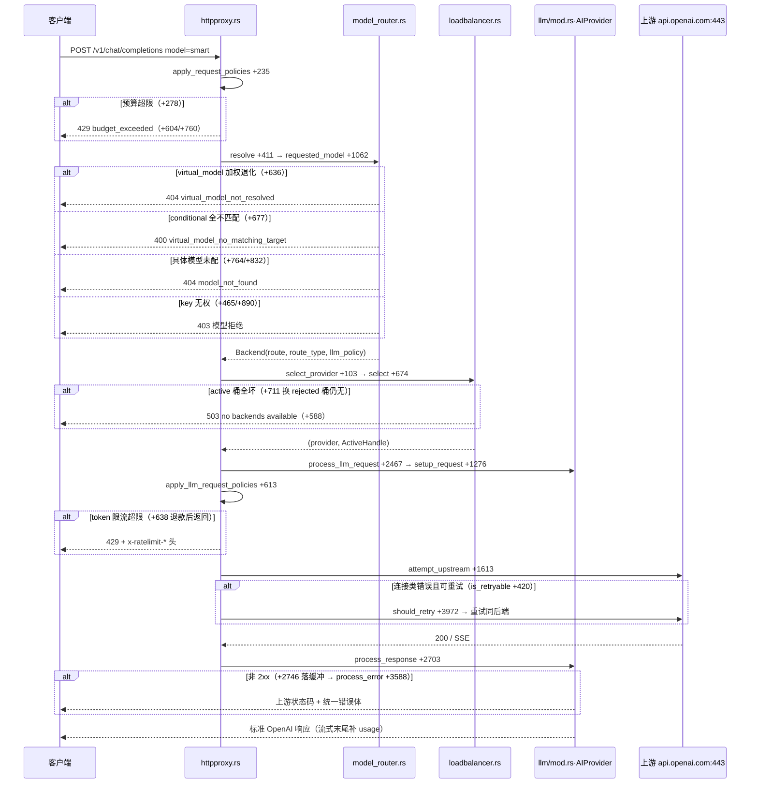
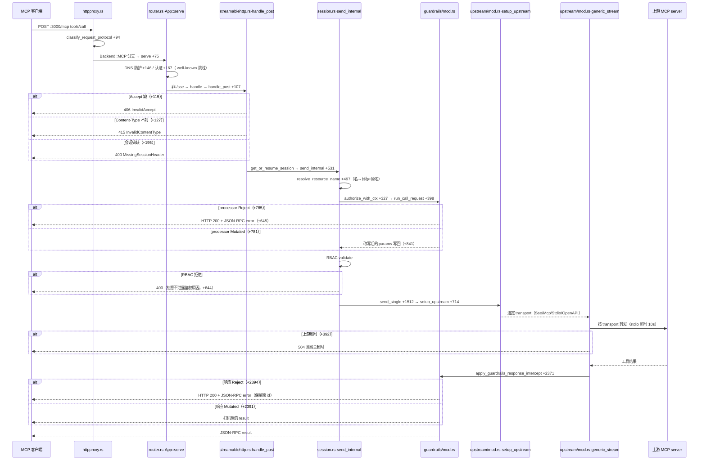
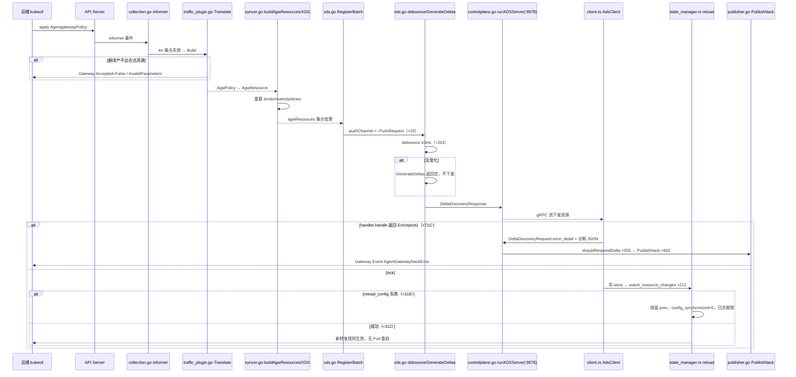

# 逐环节拆解（第三层：沿链路逐跳看谁调谁、错在哪断）

> 锚点约定见 `00-docs-style-guide.md`：Rust 写 `文件 · impl Type · 方法 +0`（`+0`=签名行），跨 impl 写明所属 impl；Go 写 `文件 · Receiver.Method +偏移`。
> 本篇是 L2 三篇的**下沉**：L2 讲「一次操作从头到尾的结果」，本篇沿**同一条链路**逐跳补「满足什么条件、参数怎么传、状态怎么变、错误怎么传播」。不重复 L2 已讲的概览。

## 代码基准

| 项 | 值 |
|---|---|
| 仓库 | `agentgateway/agentgateway`（本地 `~/workspace/16_AI/agentgateway`） |
| 分支 @ 完整 SHA | `adrian` @ `47ea6aa03434e24502ec502ea98d7082112e2699` |
| 工作区状态 | 干净；仅 `docs/` 为未跟踪新增 |
| 核实日期 | 2026-11-25 |
| 覆盖范围 | 三条主流程逐跳拆解：LLM 请求转发、MCP 工具调用、控制面 CR→xDS→数据面热加载。**不含** A2A、Helm 部署、`agctl` CLI。 |

**本篇小结**：三条链路在结构上是同一套套路——一个**固定顺序的策略闸门**在前（任一闸门 `Err` 就短路，请求根本不出网），一个**选择目标**的环节在中（选 provider / 选 target / 选网关），一段**翻译+转发**在后，最后**响应侧结算**收口。三条链路的差异只在「闸门装了什么」「按什么选目标」「错误怎么映射给客户端」。本篇每一跳都给出：谁触发（符号+偏移）、成立条件、参数去向、业务结果、失败后客户端/运维看到什么、错误如何向上传播。

---

## 一、LLM 链路逐跳拆解

### 1.1 生产视角：一条请求要过几道门

把 LLM 链路想成一条**七道门的走廊**：门 1 是「认路」（按路径选中 LLM 路由），门 2 是「准入」（鉴权+预算，固定顺序），门 3 是「认模型」（把 `model` 名解析成具体后端），门 4 是「挑副本」（同一后端多端点时按健康度/延迟挑一个），门 5 是「改写」（把请求改写成上游要的 host/path/密钥头/body），门 6 是「LLM 专属闸门」（token 限流、prompt guard），门 7 是「发上游+结算响应」。**前四道门任一失败都不会碰到上游**；门 6 失败也已经拿到了上游 host 但还没发出去；只有门 7 才真正出网。

### 1.2 开发视角：逐跳调用链

```text
Gateway::proxy +867  接受 TCP
  └─ HTTPProxy 请求入口
       ├─ select_route_chain +158 → select_best_route(route.rs +111)        门1 认路
       ├─ apply_request_policies +235（固定顺序，budget 在 +278）             门2 准入
       ├─ make_backend_call +2584
       │    └─ ModelRouter::resolve +411                                    门3 认模型
       │         ├─ requested_model +1062      读 body.model（会按需解 gzip）
       │         ├─ api_key_model_authorized +890   客户端 key 是否可用该模型
       │         ├─ resolve_virtual_model +619      虚拟模型四种路由
       │         └─ resolve_concrete_model +797     具体模型名匹配
       │    └─ AIBackend::select_provider +103 → EndpointSet::select +674   门4 挑副本
       ├─ resolve_llm_route_type +2448       定 RouteType
       ├─ process_llm_request +2467 → AIProvider::process_completions_request +1798
       │    └─ process_chat_request +2542 → chat_translation +1154          门5a 选翻译器
       │    └─ setup_request +1276（path→authority→鉴权头）                  门5b 改写
       ├─ apply_llm_request_policies +613                                   门6 LLM 闸门
       ├─ attempt_upstream +1613 → make_backend_call 发上游                  门7a 发出
       └─ AIProvider::process_response +2703（成功流式/非流式/错误三分支）    门7b 结算
```

### 1.3 生产步骤 ↔ 代码锚点 ↔ 分支/失败 对照表

| 生产步骤 | 代码锚点 | 关键分支 | 失败后客户端看到 |
|---|---|---|---|
| 1 认路 | `proxy/httpproxy.rs · select_route_chain +158` → `http/route.rs · select_best_route +111` | 按 host/path 选最佳路由；后端可能是 `LLMRouter` 也可能是直连 `AI(n)` | 404 `route not found`（`ProxyError::RouteNotFound`，`proxy/mod.rs +464`） |
| 2 准入 | `httpproxy.rs · apply_request_policies +235`（`budget` 分支 `+278`） | 固定顺序 cors→oidc→jwt→basic→api_key→**budget**→ext_authz→authorization；任一 `Err` 短路 | 预算超限：`429` + `budget_exceeded`（`proxy/mod.rs +604`、`+760`）；JWT 失败：401 类 |
| 3a 读模型名 | `llm/model_router.rs · impl ModelRouter · resolve +411` → `requested_model +1062` | 按需解 gzip 再读 `model`；`/v1/models` 走 `ModelDiscovery` 直接返回模型列表 | 解析失败：`ProxyError::ModelRouter`（`+444` 透传） |
| 3b API Key 授权 | `model_router.rs · api_key_model_authorized +890` | 客户端 key 无权用该模型 → `Error::ApiKeyModelDenied` | `403` 模型拒绝（`resolve +465`、`model_router.rs +890`） |
| 3c 虚拟模型 | `model_router.rs · impl ModelRouter · resolve_virtual_model +619` | weighted / failover / conditional / callout 四分支，见 §1.4 | weighted 选不出：`404 virtual_model_not_resolved`；conditional 无匹配：`400 virtual_model_no_matching_target`；callout fail-closed：`CalloutFailed` |
| 3d 具体模型 | `model_router.rs · impl ModelRouter · resolve_concrete_model +797` | `Ok(Some)`→`Backend`；`Ok(None)`→`NotFound`；`Err`→`Authorization` | 未配：`404 model_not_found`（`model_not_found_response +832`）；无权：`model_authorization_denied_response` |
| 4 挑副本 | `llm/mod.rs · impl AIBackend · select_provider +103` → `types/loadbalancer.rs · impl EndpointSet · select +674`；打分 `impl EndpointInfo · score +1034` | 无亲和键：两次随机采样取 `score×availability` 高者；有亲和键：rendezvous hash；桶序「active 桶→rejected 桶」 | 全部端点不可用：`503 no backends available`（`proxy/mod.rs +588`/`+472`） |
| 5 改写 | `llm/mod.rs · impl AIProvider · setup_request +1276`；host 来自 `default_connector_target +1258`；body 由 `chat_translation +1154`→`ChatTranslation::render_request +595` | path→authority→required fields（OpenAI 保留 `Authorization`，Anthropic 搬到 `x-api-key`） | 改写失败：`ProxyError::Processing`（`httpproxy.rs +3101`） |
| 6 LLM 闸门 | `httpproxy.rs · apply_llm_request_policies +613` | 本地 token 限流 `+628~+645`（超限会**退款**已扣规则）；远程限流 `+654~+663`；prompt guard `+665~+674` | token 超限：`429` + `x-ratelimit-*` 头；guard 拦截：`GuardrailRejected`（`request rejected by guardrail`，`proxy/mod.rs +458`） |
| 7a 发上游 | `httpproxy.rs · impl HTTPProxy · attempt_upstream +1613`；重试判据 `should_retry +3972` | `Ok(resp)`→响应段；`Err` 且 `is_retryable`→重试同后端 | 连接失败/超时：`502/504` 类；配了 `retry` 且 body 可缓冲则先重试 |
| 7b 结算响应 | `llm/mod.rs · impl AIProvider · process_response +2703` | 成功+流式→`process_streaming +3275`；成功+非流式→缓冲读 usage；非 2xx→`process_error +3588` | 上游 4xx/5xx 透传，错误体被翻译成统一 LLM 错误体 |

### 1.4 门 3 的四种虚拟模型路由：条件与失败（本篇定点补全）

L2 只列了四种路由的名字。本篇读 `resolve_virtual_model +619` 的循环体，把每种的条件与失败补全：

| 路由 | 选中条件 | 失败表现（`ResolveResult`） |
|---|---|---|
| `Weighted` | 按 `target.weight` 加权随机（`+632` `choose_weighted`） | 加权分布退化→`Rejected(ModelRouting)` + `404` 文案 `Virtual model {name} could not be resolved`，错误码 `virtual_model_not_resolved`（`+636~+643`） |
| `Failover` | 直接返回一个指向「按 priority 分桶的 `Backend::AI`」的 `ResolvedBackend`（`+661~+665`），真正的 failover 推迟到门 4 的多桶遍历 | 不在 resolve 阶段失败；`route_type` 由 `classify_route` 兜底成 `Passthrough`（`+663`） |
| `Conditional` | 按 `when` CEL 表达式取**第一个**满足的 target；无 `when` 视为恒真（`+669~+675`） | 全不满足→`Rejected(ModelRouting)` + `400` 文案 `did not match any conditional target`，错误码 `virtual_model_no_matching_target`（`+677~+689`） |
| `Callout` | 外部 callout 选模型（`+693`）；选中模型必须是路由器已知的（`+694` `has_model`） | callout 失败且 `failure_mode=FailClosed`→`Error::CalloutFailed`（`+707~+712`）；`Fallback(model)` 则用兜底模型继续（`+703~+706`） |

两个跨分支规则：① target 可以**自己又是虚拟模型**，循环继续解析，深度超 `MAX_VIRTUAL_MODEL_DEPTH` 则 `404 virtual_model_not_resolved`（`+742~+755`）；② 选中的 target 若在具体模型里找不到（`resolve_concrete_model` 返回 `Ok(None)`），`404` 文案 `selected target {target}, but no matching model was found`（`+764~+780`）。

### 1.5 门 4 的 failover 到底怎么触发（本篇定点补全）

「failover」在 LLM 链路里有**两层**，触发条件不同，不要混：

- **模型层 failover（换 provider 组）**：配置写成 `VirtualModelRouting::Failover` 时，`types/local.rs · LocalLLMVirtualRoutingStrategy::Failover +5229~+5260` 把 `failover.targets` 按 `priority` 排序再 `chunk_by(priority)` 分块，**每块变成一个 `EndpointSet` 的 bucket**，整体是一个 `Backend::AI`。因为 bucket 数 >1，`AIBackend::new +88~+93` 会自动挂上健康检查策略（`num_buckets() > 1` 才建）。运行期换组发生在 `EndpointSet::select +711`：桶遍历顺序是 `[false, true]`（先所有 active 桶，再所有 rejected 兜底桶），`+711~+743` 里逐桶 `find_map`，**当前桶挑不出可用端点才进下一桶**——这就是「低 priority 组全坏才换下一组」的实现。
- **副本层负载均衡（换端点）**：同一 provider 多端点时，`select_provider +103` 给 `EndpointSet::select` 传一个闭包，闭包里 `availability`（端点平均健康度）缩放 `score`；`select +674` 在无亲和键时**两次随机采样取高分**（`+684~+707`），有亲和键时用 rendezvous hash（会话粘住同一端点）。打分公式在 `score +1034~+1038`：`health / (1 + request_latency × (1 + pending_requests×0.1))`——健康度作分子，延迟和在途请求数作分母惩罚项。

**重试 vs failover 的分工**：连接类错误（`UpstreamCallFailed`/`UpstreamCallTimeout`/`DnsResolution`，`proxy/mod.rs · impl ProxyError · is_retryable +420~+427`）走 `should_retry +3972` 判定的**重试**（对同一后端重发，需配 `retry` 且 body 未超缓冲上限）；「这一组全坏」走上面 `select` 的**换桶**。两者是正交的两套机制。

### 1.6 门 6 的退款细节（本篇定点补全）

本地 token 限流在 `apply_llm_request_policies +628~+645`：对每条规则 `charge_tokens` 扣费，任一规则拒绝（`admitted` 为 `Err`）时，**把本次已扣费的其它规则逐个 `refund()`**（`+640~+642`）再返回错误——避免「请求被 A 规则拒了，却让 B 规则白扣一次额度」。这是 L2 表格里「已扣的其它规则会退款」的具体落点。

### 1.7 LLM 链路时序图（含错误传播）



图的前提与分支：`resolve` 之前模型目录（`inputs.model_catalog`）必须已就绪；`select_provider` 只在 `Backend::AI` 分支发生，配置直连单个 AI backend 时跳过 `resolve` 直接进挑副本；重试环画成自环，它在 `attempt_upstream` 外层的重试循环（`+1257~+1304`）里。

---

## 二、MCP 链路逐跳拆解

### 2.1 生产视角：一次工具调用要过几道门

MCP 链路同样是**走廊+门**，但门的性质和 LLM 不同：先由**后端类型**判定这是不是 MCP 流量（不是就走普通 HTTP 代理），再过**协议/头校验**（Accept、Content-Type、会话头），再**认工具**（把客户端视图的工具名反解回「目标+原名」），再过 **guardrails 请求阶段**（改写或拒绝），再过 **RBAC**（有没有权调这个工具），再按**目标配置的 transport** 转发上游，最后过 **guardrails 响应阶段**（打码/改写结果）回传。

最关键的一处差异：**guardrails 拒绝不会变成 HTTP 错误码**。它包成一个 JSON-RPC error 对象，HTTP 状态码仍是 `200`（`proxy/mod.rs · impl ProxyError · http_status +645`）。这是故意的——MCP 客户端按 JSON-RPC 语义读结果，HTTP 200 让它正常进入 error 分支。

### 2.2 开发视角：逐跳调用链

```text
httpproxy.classify_request_protocol +94        判定是不是 MCP
  └─ Backend::MCP 分支 +2892 → App::serve(router.rs +75)
       ├─ DNS rebinding 防护（+146）
       ├─ auth::enforce_authentication(auth.rs +63)   .well-known 跳过 token 校验
       └─ 路径 == "/sse" → LegacySSEService::handle    否则 StreamableHttpService::handle +84
            └─ handle_post +107（Accept +115 / Content-Type +127 / 会话 +172,+195）
                 └─ Session.send +65 → send_internal +531
                      ├─ ListToolsRequest 分支（扇出）
                      │    ├─ RelayInputs::build +381 → UpstreamGroup::new_for_request +554
                      │    │    └─ setup_upstream +714      ← transport 选择
                      │    ├─ run_call_request(guardrails, body=None)  请求阶段跑一次
                      │    └─ Relay::send_list +1719 → send_fanout_to +1788
                      │         └─ Upstream::generic_stream +335 → transport 分派 +379
                      │         └─ merge_tools +855          ← 改名+RBAC 过滤+去重
                      └─ CallToolRequest 分支 +660（单发）
                           ├─ resolve_resource_name +497     客户端名 → 目标+原名
                           ├─ authorize_with_ctx +327
                           │    ├─ maybe_run_guardrails_call_request +801 → run_guardrails_call_request +765
                           │    └─ RBAC validate
                           └─ Relay::send_single +1512 → generic_stream +335 → respond_with_guardrails +2071
                                └─ apply_guardrails_response_intercept +2371   响应阶段
```

### 2.3 生产步骤 ↔ 代码锚点 ↔ 分支/失败 对照表

| 生产步骤 | 代码锚点 | 关键分支 | 失败后客户端看到 |
|---|---|---|---|
| 1 判定 MCP | `proxy/httpproxy.rs · classify_request_protocol +94` | `Backend::MCP` + POST + 非 well-known + 非 gRPC → `RequestProtocol::Mcp` | 不是 MCP → 走普通 HTTP 代理 |
| 2 进 MCP 入口 | `httpproxy.rs · Backend::MCP 分支 +2892` → `mcp/router.rs · impl App · serve +75` | 组 `McpBackendGroup`、DNS 防护、认证、下游分流 | — |
| 3 DNS 防护 | `router.rs · serve +146` → `mcp/dns_rebinding.rs · reject_non_localhost` | 开启且非 localhost → 拒 | 直接拒绝 |
| 4 认证 | `router.rs · serve +167` → `mcp/auth.rs · enforce_authentication +63` | 配了 `mcpAuthentication` 才走；`is_well_known_endpoint` 跳过 token 校验 | token 无效 → 认证失败响应 |
| 5 下游分流 | `router.rs · serve +182`（`path == "/sse"`） | `/sse`→legacy SSE；其余 POST→Streamable | — |
| 6 协议/头校验 | `mcp/streamablehttp.rs · handle_post +107`（Accept `+115`、Content-Type `+127`、会话 `+172/+195`） | 逐项校验，失败即返回 `mcp::Error` | 406 `InvalidAccept`/`InvalidAcceptGet`（`proxy/mod.rs +616/+617`）；415 `InvalidContentType`（`+618`）；413 `PayloadTooLarge`（`+620`）；404 `UnknownSession`（`+622`）；400 `MissingSessionHeader`（`+623`）；405 `MethodNotAllowed`（`+614`） |
| 7 上游组构建 | `mcp/upstream/mod.rs · impl UpstreamGroup · new_for_request +554` | `targets.len() != 1` → `is_multiplexing`；条件不满足的 target 被剔除 | 无 target / 条件全不满足 → `503`（`NoBackends` `+639`、`Unavailable` `+642`） |
| 8 transport 选择 | `mcp/upstream/mod.rs · impl UpstreamGroup · setup_upstream +714` | `Sse +717`→`sse::Client`（path 缺省 `/sse`）；`Mcp +738`→`streamablehttp::Client`（缺省 `/mcp`）；`Stdio +763`→子进程；`OpenAPI +790`→`openapi::Handler` | stdio 启动失败 → `mcp::Error::Stdio` → `500`（`+637`）；MCP client 建 session id 失败 → `InvalidSessionIdHeader` → `400`（`+626`） |
| 9 名字反解（单发） | `mcp/session.rs · impl Session · send_internal +660`；`mcp/handler.rs · resolve_resource_name +497` | 客户端视图名 → `(service_name, 原名)`；单 target 非多路复用时前缀为空、名字不变 | 名字找不到 → `MethodNotFound` → `404`（`+632`） |
| 10 guardrails 请求阶段 | `mcp/session.rs · authorize_with_ctx +327` → `mcp/handler.rs · maybe_run_guardrails_call_request +801` → `run_guardrails_call_request +765` → `guardrails/mod.rs · run_call_request +398` | `runs_request(method)`（`+817`）为假直接跳过；阶段由 `guardrails/phase.rs · resolve +37`/`match_kind +68` 按方法名解析 | `Outcome::Reject` → `UpstreamError::McpGuardrails`（`+792`）→ **HTTP 200 + JSON-RPC error**（`http_status +645`） |
| 11 RBAC | `authorize_with_ctx +327` 内 `McpAuthorizationSet::validate` | 按「目标+工具名」验策略 | 拒绝 → `mcp::Error::Authorization` → **`400`**（`+644`，刻意不返回 401/403 以免泄露「因鉴权被拒」） |
| 12 转发上游 | `mcp/handler.rs · impl Relay · send_single +1512` / `send_fanout_to +1788` → `mcp/upstream/mod.rs · impl Upstream · generic_stream +335`（分派 `+379`） | `Stdio +380`（超时缺省 10s，`+381~+392`）/ `Sse +395` / `Streamable +402`（initialize 时抓 session id `+409~+416`）/ `OpenAPI +419` | 超时 → `ProxyError::UpstreamCallTimeout`（`+392`）；stdio/SSE 不支持 `subscriptions/listen` → `Unavailable` → `503`（`+369~+377`） |
| 13 guardrails 响应阶段 | `mcp/handler.rs · apply_guardrails_response_intercept +2371` → `guardrails/mod.rs · run_response +425` | 只对终态 `Response` 跑；`Pass`→原样（`+2390`）；`Mutated`→换 result（`+2391`）；`Reject`→换成 error（`+2394`） | `Reject` → JSON-RPC error，HTTP 仍 `200` |
| 14 合并回传（扇出） | `mcp/handler.rs · merge_tools +855` | 按「目标名前缀+原名」改名、逐工具 RBAC 过滤、去重 | — |

### 2.4 guardrails 拦截时的具体返回（本篇定点补全）

L2 说「guardrails 拒绝包成 JSON-RPC error 但 HTTP 仍是 200」，本篇把**错误对象怎么造出来**读全了：

- **请求阶段**：`run_guardrails_call_request +765` 里 `run_call_request` 返回 `Outcome`，三分支（`+780~+797`）：`Pass`→`Ok(None)`；`Mutated(p)`→`Ok(Some(p))`（改写后的 params 在 `+841~+848` 写回请求）；`Reject(rej)`→`Err(UpstreamError::McpGuardrails { rej, was_tool_call, downstream_modern })`。这个错误一路向上，被 `Session::handle_error` 收口成 `ProxyError::MCP(McpGuardrails)`，最终 `http_status +645` 映射成 `200`，body 是带 `rej.code`/`rej.message` 的 JSON-RPC error。
- **响应阶段**：`apply_guardrails_response_intercept +2371` 只在消息是终态 `Response` 时跑（`+2377` 非 Response 直接 `None`）；`Reject` 分支（`+2394`）把整条消息换成 `ServerJsonRpcMessage::error(rej, Some(resp.id.clone()))`——**保留原始请求 id**，客户端能把它对回自己那次调用。
- **阶段判定**：一个 processor 在请求阶段还是响应阶段跑，不是写死在调用点，而是它自带 `methods` 映射，运行时用 `phase::resolve +37` 按「精确 > 前缀通配 > 后缀通配 > `*`，同 kind 取更长，末位字母序」解析出 `Phase`，再由 `runs_request +20`/`runs_response +23` 决定是否参与。扇出方法（`tools/list`）的请求阶段在 `send_fanout_to +1285` 只跑**一次**，`body=None`（无单一可改写 body）。

### 2.5 MCP 链路时序图（含错误传播）



图的前提与分支：`tools/list` 与 `tools/call` 的分叉在第 7 步之后——扇出走 `send_list +1719`+`merge_tools +855`，单发走 `resolve_resource_name +497`+`send_single +1512`；两条路最终都汇到 `generic_stream +335` 的 transport 分派。图中错误终点全部由 `ProxyError::http_status +614` 统一映射，guardrails 例外（映射成 200）。

---

## 三、控制面 reconcile 逐跳拆解

### 3.1 生产视角：一个 CR 从提交到生效要过几站

用户 `kubectl apply` 一个 CR 后，配置要过**六站**才变成数据面的转发行为：① **watch**（控制面的 informer 盯到变更）→ ② **翻译**（把 CR 翻译成数据面中间表示 `AgwResource`）→ ③ **注册推送**（哪个网关的哪些资源变了，塞进推送队列）→ ④ **防抖**（攒一小段时间合并，默认 10ms）→ ⑤ **生成增量下发**（经 gRPC Delta-ADS 9978 推给数据面）→ ⑥ **热加载**（数据面把资源写进 store，订阅到变化就重载，**不重启进程**）。第 ⑥ 站若失败，还有一条**反向回路**：数据面回一个 NACK（拒绝确认），控制面把它写成 Kubernetes Event 写回 Gateway，运维在 `kubectl describe gateway` 里能看到原因。

### 3.2 开发视角：逐跳调用链

```text
API Server 变更事件
  └─ collection.go · NewAgwCollections +0（三个 informer：Policy/Backend/Model）
       └─ traffic_plugin.go · NewAgentPlugin +0（Build 闭包 +4）
            └─ TranslateAgentgatewayPolicy +0        ← CR → AgwPolicy
                 └─ syncer.go · buildAgwResources +0  ← 派生集合 join 出 AgwResource
                      └─ buildXDSCollection +0 → PerGatewayCollection(xds.go +0)
                           └─ RegisterBatch +29 → pushChannel <- PushRequest +33
                                └─ debounce +0（DebounceAfter 默认 10ms，+201）
                                     └─ GenerateDeltas +0（按 IsForGateway(gw) 过滤）
                                          └─ runXDSServer(controlplane.go +0) 经 gRPC :9978 下发
                                               └─ 数据面 client.rs：handler.handle → Err(rejects)?
                                                    ├─ Ack：写 store → watch_resource_changes +212
                                                    │        → reload_config_after_change +308 → reload_config +247
                                                    └─ Nack：DeltaDiscoveryRequest.error_detail 回传
                                                             → shouldRespondDelta +555 解析
                                                             → nackPublisher.PublishNack +602
                                                             → publisher.go · PublishNack → Gateway K8s Event
```

### 3.3 生产步骤 ↔ 代码锚点 ↔ 分支/失败 对照表

| 生产步骤 | 代码锚点 | 关键分支 | 失败后运维看到 |
|---|---|---|---|
| 1 watch | `controller/pkg/agentgateway/plugins/collection.go · NewAgwCollections +0`（`krt.NewFilteredInformer[*AgentgatewayPolicy]` 在 `+123`、Backend `+124`、Model `+125`） | informer 未 `WaitForCacheSync` 前事件排队不下发 | 启动初期 apply 不立即生效 |
| 2 翻译 CR | `controller/pkg/agentgateway/plugins/traffic_plugin.go · NewAgentPlugin +0`（Build 闭包 `+4`）→ `TranslateAgentgatewayPolicy +0` | 插件产不出合法资源 → 上层标 `Accepted=False / InvalidParameters` | `kubectl get gateway -o yaml` 里 condition 带 `InvalidParameters` + message |
| 3 组装 AgwResource | `controller/pkg/syncer/syncer.go · buildAgwResources +0` → `buildXDSCollection +0`（`Registrations` append `+8/+9`） | CR 没挂到受管 Gateway（`parentRefs`/`targetRefs` 名字对不上）→ 不进任何网关的资源集 | Gateway Events 无记录；`agctl` 看 xDS 资源里没有该对象 |
| 4 注册推送 | `controller/pkg/syncer/krtxds/xds.go · PerGatewayCollection +0`（`RegisterBatch +29`，`pushChannel <- PushRequest` `+33`） | gateway 归属由 `IsForGateway(gw)` 决定；归属错=推错网关 | 配置推到错误的数据面 |
| 5 防抖 | `xds.go · debounce +0`；`DebounceAfter +201`（默认 `10ms`，env `KGW_DEBOUNCE_AFTER`）；`DebounceMax +209`（默认 `1s`） | 静默期 `>= DebounceAfter` 或总延迟 `>= DebounceMax` 才推（`+1084`） | 突发变更被合并，最迟 1s 内必推一次 |
| 6 生成增量 | `xds.go · CollectionGenerator.GenerateDeltas +0` | 无变化→返回空不下发（`+1244` 一带） | 无推送，数据面配置不变 |
| 7 起 xDS 服务 | `controller/pkg/setup/controlplane.go · runXDSServer +0`（`Serve(lis)` `+25`）；端口 `controller/api/settings/settings.go:175` `AgentgatewayXdsServicePort` `default:"9978"` | xDS 认证失败 → 拦截器返回 `authentication failed`，连接被拒（`getGRPCServerOpts +10~+23`） | 数据面连不上 9978；控制面日志有 `starting server`（监听 0.0.0.0:9978）但无数据面连接 |
| 8 数据面收下发 | `crates/xds/src/client.rs`（`handler.handle(&mut self.state, response)` 在 `+701`） | `Ok`→Ack；`Err(rejects)`→Nack（`+710~+719`，`has_errors` 取 `RejectedConfigSeverity::Error`） | — |
| 9 热加载 | `crates/agentgateway/src/state_manager.rs · watch_resource_changes +212` → `reload_config_after_change +308` → `reload_config +247` | 重载成功→`config_synchronized=1`（`+312`）；失败→`config_synchronized=0` + `record_failure` + **保留上一个状态 `prev`**（`+316~+324`） | 数据面日志 `Failed to reload config: {e}`；流量按旧配置继续跑，不崩进程 |
| 10 NACK 反向回路 | `xds.go · shouldRespondDelta +555`（`PublishNack` 调用在 `+602`）→ `controller/pkg/syncer/nack/publisher.go · PublishNack +0`（Reason `AgentGatewayNackError` 在 `+23`） | `request.ErrorDetail != nil` 才进（`+561`）；`parseNackDiagnostics` 分出 error/warning（`+568~+574`）；warning→只发 warning 事件不算拒绝（`+575~+581`）；error→`xdsRejectsTotal.Inc()` + 记 `LastError`（`+588~+592`）+ `PublishNack` | Gateway 上出现 `AgentGatewayNackError` 事件，message 是数据面给的诊断 JSON |
| 11 Gateway 自身 reconcile | `controller/pkg/controller/gw_controller.go · gatewayReconciler.Reconcile +0` | 非 `agwControllerName` 直接 `return nil`（`+299`）；`ErrNoValidPorts`/`ErrUnsupportedRoutability`→`DeploymentFailed`（`+312/+322`）；非法参数→`InvalidParameters`（`+332/+337`） | Gateway condition 带 `DeploymentFailed` / `InvalidParameters` |

### 3.4 NACK 闭环的两端（本篇定点补全）

L2/04 篇讲了控制面怎么处理 NACK，本篇把**数据面怎么产生 NACK** 这一端读全了：

- **产生端（数据面）**：`crates/xds/src/client.rs` 收到 `DeltaDiscoveryResponse` 后调 `handler.handle(&mut self.state, response)`（`+699~+701`）。handler 返回 `Result<(), Vec<RejectedConfig>>`：`Err(rejects)` 时（`+711`）判 `has_errors`（`+712~+714`，任一 `RejectedConfigSeverity::Error`），把所有 rejects 格式化成 JSON（`RejectedConfig::format_json`，`+715`），结果记为 `XdsSignal::Nack`（`+716`）。随后构造 `DeltaDiscoveryRequest`，把这段 JSON 塞进 `error_detail.message`（`+737~+745`）回传控制面。
- **消费端（控制面）**：`shouldRespondDelta +555` 先判 `request.ErrorDetail != nil`（`+561`，且 `previousInfo == nil` 时返回 `InvalidArgument`，`+562~+563`）；用 `parseNackDiagnostics` 解析 message（`+568`），分出 `hasErrors`/`hasWarnings`（`+569~+574`）。**warning** 只 `PublishWarning` + `xdsWarningsTotal.Inc()`，不算拒绝（`+575~+581`）；**error** 才 `xdsRejectsTotal.Inc()`、把 message 记进 `WatchedResource.LastError`（`+589~+592`）、构造 `NackEvent` 并 `PublishNack`（`+594~+603`），最后返回 `(false, nil)`（`+604`）——「不响应」就是拒绝的语义。
- **落 K8s**：`publisher.go · PublishNack` 用常量 `ReasonNack = "AgentGatewayNackError"`（`+23`）把事件写到对应 Gateway，`+64` 的 `p.publish(event.Gateway, event.ErrorMsg, ReasonNack)` 是实际落点。

### 3.5 热加载失败为什么不会崩数据面（本篇定点补全）

`reload_config_after_change +308` 的失败分支（`+316~+324`）只做三件事：`config_synchronized` 置 0、`config_reload_status.record_failure(e.to_string())`、打 `error!` 日志，然后**返回 `prev`（上一个 `PreviousState`）**。这意味着：新配置解析/校验失败时，数据面**保持旧配置继续转发**，进程不重启也不退出；健康度上 `config_synchronized` 变 0 会让就绪探针暴露问题。注意这一段是**配置加载失败**；而**资源级拒绝**（某个 resource 本身非法）走的是上面 §3.4 的 NACK 通道，两者是不同失败面——前者数据面自己吞掉并保持旧态，后者回执给控制面写成 Event。

### 3.6 控制面时序图（含 NACK 回路）



图的前提与分支：整条翻译链是**响应式的**（krt 派生集合驱动），不在 `Reconcile()` 里跑；`Reconcile` 只管数据面工作负载生命周期，与配置下发**解耦**。xDS 下发的 Syncer 在所有副本都跑（`NeedLeaderElection()=false`），只有 Gateway reconciler 受 leader 选举约束。

---

## 四、验证与边界

### 4.1 三条链路的错误/状态码对照表

| 链路 | 失败点 | 状态码/表现 | 锚点 |
|---|---|---|---|
| LLM | 预算超限 | `429` + `budget_exceeded` + `retry-after` | `proxy/mod.rs · status +604`、错误体 `+749~+765` |
| LLM | 本地 token 限流 | `429` + `x-ratelimit-*` 头；已扣其它规则退款 | `httpproxy.rs · apply_llm_request_policies +638~+653` |
| LLM | 模型未配 / 虚拟模型退化 / 条件不匹配 | `404` / `404` / `400`（各自错误码见 §1.4） | `model_router.rs · resolve_virtual_model +619`、`model_not_found_response +832` |
| LLM | 客户端 key 无权用模型 | `403` | `model_router.rs +465~+467`、`api_key_model_authorized +890` |
| LLM | 全部端点不可用 | `503` `no backends available` | `proxy/mod.rs +588`/`+472` |
| LLM | 上游连接失败/超时 | `502`/`504` 类；配 `retry` 且可缓冲先重试 | `proxy/mod.rs · is_retryable +420`、`httpproxy.rs · should_retry +3972` |
| LLM | 上游返回 4xx/5xx | 上游状态码 + 翻译后错误体透传 | `llm/mod.rs · process_response +2746`、`process_error +3588` |
| MCP | Accept/Content-Type/会话/方法错 | `406`/`415`/`400`/`405` | `proxy/mod.rs · http_status +614~+627` |
| MCP | 无 target / 上游不可用 | `503` | `proxy/mod.rs +639`（`NoBackends`）/`+642`（`Unavailable`） |
| MCP | guardrails 拒绝（请求或响应阶段） | **HTTP `200`** + JSON-RPC error（响应阶段保留原 id） | `proxy/mod.rs +645`；`handler.rs +785`/`+2394` |
| MCP | RBAC 拒绝 | `400`（刻意不返回 401/403） | `proxy/mod.rs +643~+644` |
| 控制面 | 翻译产出非法参数 | Gateway `Accepted=False / InvalidParameters` | `gw_controller.go · Reconcile +332~+337` |
| 控制面 | 数据面部署失败 | Gateway `Programmed=False / DeploymentFailed` | `gw_controller.go +312~+322` |
| 控制面 | 数据面 NACK | Gateway Event `AgentGatewayNackError`，message=诊断 JSON | `xds.go · shouldRespondDelta +602`、`publisher.go +23/+64` |
| 控制面 | 数据面热加载失败 | 进程不崩，保持旧配置，`config_synchronized=0` | `state_manager.rs · reload_config_after_change +316~+324` |
| 控制面 | xDS 认证失败 | 连接被拒 `authentication failed` | `controlplane.go · getGRPCServerOpts +10~+23` |

### 4.2 三条链路的共性结论

1. **前向闸门都在出网之前**：LLM 的鉴权/预算/模型解析/挑副本、MCP 的协议校验/guardrails 请求阶段/RBAC，全部发生在真正发上游之前，失败即短路，不消耗上游配额。
2. **错误映射是单点的**：LLM 走 `ProxyError::status`/`external_message`，MCP 走 `ProxyError::http_status`（其中 guardrails 和 RBAC 是两处刻意偏离直觉的映射——一个 200、一个 400）。
3. **只有控制面有反向回路**：数据面转发失败只影响单次请求；配置下发失败会通过 NACK→K8s Event 回到运维视野，且数据面热加载失败时**保旧态不崩**。

### 4.3 本篇实际定点补全的细节（相对 L2）

- LLM：`resolve_virtual_model +619` 四种路由各自的选中条件与失败文案/错误码；虚拟模型嵌套深度上限行为（`+742~+755`）；failover 的**两层**分工与换桶触发条件（`loadbalancer.rs · select +711` 的 `[false, true]` 桶序）；打分公式（`score +1034~+1038`）；本地 token 限流的**退款**落点（`apply_llm_request_policies +640~+642`）。
- MCP：guardrails 请求/响应两阶段**拒绝对象的具体构造**（`run_guardrails_call_request +780~+797` 造 `UpstreamError::McpGuardrails`；`apply_guardrails_response_intercept +2394` 换成保留原 id 的 error）；`generic_stream +335` 的 transport 分派与 stdio 10s 超时、`subscriptions/listen` 在 stdio/SSE 上被拒（`+369~+377`）；`setup_upstream +714` 四分支各自的 path 缺省与失败类型。
- 控制面：NACK 的**产生端**（`client.rs +699~+745` 把 `RejectedConfig` 格式化成 `error_detail`）与**消费端**（`shouldRespondDelta +555~+605` 的 error/warning 分流）；热加载失败**保旧态**（`reload_config_after_change +316~+324`）；防抖默认 10ms、上限 1s（`DebounceAfter +201`、`DebounceMax +209`）。

### 4.4 未确认与边界

| 项 | 标记 | 说明 |
|---|---|---|
| 端到端时延、线上真实状态码分布 | `[待运行验证]` | 全篇静态核读，未起服务/集群实测 |
| `MAX_VIRTUAL_MODEL_DEPTH` 的具体数值 | `[源码未确认]` | 常量已确认存在并被 `resolve_virtual_model +743` 使用，本篇未定点读其定义行 |
| `SessionManager::get_or_resume_session` / `create_session` 内部 | `[源码未确认]` | 只核到调用点，未读函数体（与 `03` 篇一致） |
| 数据面 `reload_config` 内部把 xDS 资源转成转发规则的完整转换 | `[源码未确认]` | 只核到 `reload_config +247` 入口与失败分支，转换细节属 `02`/`03` 篇范围 |
| `parseNackDiagnostics` 的诊断 JSON 结构 | `[源码未确认]` | 已确认其在 `shouldRespondDelta +568` 被调用并分出 error/warning，未逐字段读其解析格式 |
| `PerGatewayCollection` gateway 归属（`IsForGateway`）判错的实际表现 | `[推断]` | 归属逻辑已确认存在，推错网关的运维表现基于 `GenerateDeltas` 的过滤语义推断 |

### 源码索引（便于跳转复核）

| 文件 | 符号 | 绝对行号 |
|---|---|---|
| `crates/agentgateway/src/llm/model_router.rs` | `resolve` / `resolve_virtual_model` / `resolve_concrete_model` / `model_not_found_response` / `api_key_model_authorized` / `requested_model` | 411 / 619 / 797 / 832 / 890 / 1062 |
| `crates/agentgateway/src/llm/mod.rs` | `AIBackend::new` / `select_provider` / `chat_translation` / `default_connector_target` / `setup_request` / `process_completions_request` / `process_chat_request` / `process_response` / `process_streaming` / `process_error` | 88 / 103 / 1154 / 1258 / 1276 / 1798 / 2542 / 2703 / 3275 / 3588 |
| `crates/agentgateway/src/types/loadbalancer.rs` | `EndpointSet::select` / `num_buckets` / `EndpointInfo::score` | 674 / 811 / 1034 |
| `crates/agentgateway/src/types/local.rs` | `LocalLLMVirtualRoutingStrategy::Failover` 分组构建 | 5229 |
| `crates/agentgateway/src/proxy/httpproxy.rs` | `classify_request_protocol` / `select_route_chain` / `apply_request_policies` / `apply_llm_request_policies` / `attempt_upstream` / `resolve_llm_route_type` / `process_llm_request` / `make_backend_call` / `should_retry` | 94 / 158 / 235 / 613 / 1613 / 2448 / 2467 / 2584 / 3972 |
| `crates/agentgateway/src/proxy/mod.rs` | `is_retryable` / `external_message` / `http_status` | 420 / 439 / 614 |
| `crates/agentgateway/src/mcp/handler.rs` | `resolve_resource_name` / `run_guardrails_call_request` / `maybe_run_guardrails_call_request` / `merge_tools` / `send_single` / `send_fanout` / `send_list` / `send_fanout_to` / `respond_with_guardrails` / `apply_guardrails_response_intercept` | 497 / 765 / 801 / 855 / 1512 / 1708 / 1719 / 1788 / 2071 / 2371 |
| `crates/agentgateway/src/mcp/session.rs` | `send` / `authorize_with_ctx` / `send_internal` | 65 / 327 / 531 |
| `crates/agentgateway/src/mcp/guardrails/mod.rs` | `Outcome` / `runs_request` / `call_request` / `response` / `run_call_request` / `run_response` | 67 / 132 / 353 / 379 / 398 / 425 |
| `crates/agentgateway/src/mcp/upstream/mod.rs` | `UpstreamGroup::new_for_request` / `setup_upstream` / `Upstream::generic_stream` | 554 / 714 / 335 |
| `crates/agentgateway/src/state_manager.rs` | `watch_resource_changes` / `reload_config` / `reload_config_after_change` | 212 / 247 / 308 |
| `crates/xds/src/client.rs` | handler 调用 / Nack 判定 / DeltaDiscoveryRequest 构造 | 699 / 710 / 737 |
| `controller/pkg/agentgateway/plugins/collection.go` | `NewAgwCollections` / 三个 agentgateway informer | 128 / 251-253 |
| `controller/pkg/agentgateway/plugins/traffic_plugin.go` | `NewAgentPlugin` / `TranslateAgentgatewayPolicy` | 108 / 189 |
| `controller/pkg/syncer/syncer.go` | `buildAgwResources` / `buildXDSCollection` | 599 / 962 |
| `controller/pkg/syncer/krtxds/xds.go` | `DebounceAfter` / `DebounceMax` / `shouldRespondDelta` / `GenerateDeltas` / `debounce` / `PerGatewayCollection` | 201 / 209 / 555 / 1195 / 1059 / 142 |
| `controller/pkg/syncer/nack/publisher.go` | `ReasonNack` / `PublishNack` | 23 / 63 |
| `controller/pkg/controller/gw_controller.go` | `gatewayReconciler.Reconcile` | 284 |
| `controller/pkg/setup/controlplane.go` | `runXDSServer` / `getGRPCServerOpts` | 56 / 89 |
| `controller/api/settings/settings.go` | `AgentgatewayXdsServicePort` | 175 |

