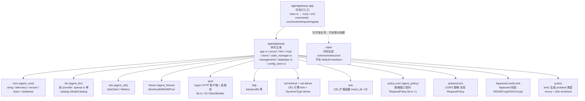
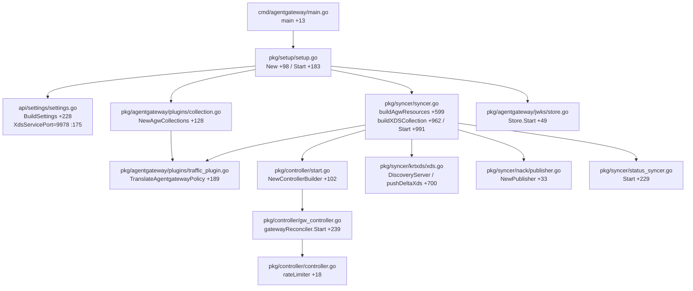
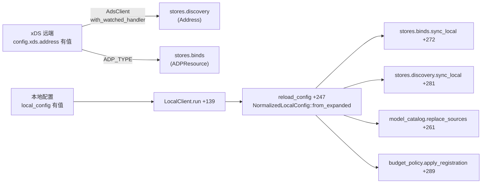

# 开发实现补齐（第四层：模块/API/配置/存储/并发/启动/测试）

> 代码基准：`adrian@47ea6aa03434e24502ec502ea98d7082112e2699`（工作区干净，仅 `docs/` 为本次新增未跟踪）；核实日期：2026-11-25。
> 锚点记法见 `00-docs-style-guide.md`：Rust 写 `文件 · impl Type · 方法 +0`（`+0`=签名行），跨 impl 写明所属 impl；Go 写 `文件 · Receiver.Method +偏移`。所有锚点均在本工作区逐条核实。

## 本篇小结

L1~L3 已讲清「系统由什么构成、一次操作怎么走、逐跳怎么传」。本篇**不再重讲链路**，只补齐开发时必须知道的横切面：crate/包的依赖关系、对外暴露的端口与路径、配置从哪来怎么变成内部状态、关键字段怎么一层层转换、状态存在哪、并发用什么模型、进程怎么走到就绪、测试与部署怎么组织。**每节先小结后细节**，锚点可直接跳转复核。

---

## 一、生产行为清单开场

下表概括**本层覆盖的现有能力、边界与运行约束**，并标明「L1~L3 已讲过 / 本层补什么」，避免与上游篇目重复。

| # | 能力/约束 | 现状（生产可观察） | L1~L3 讲过？ | 本层补什么 |
|---|---|---|---|---|
| 1 | LLM 网关转发 | 统一 OpenAI 兼容入口，路由到 OpenAI/Anthropic/Gemini/Bedrock，带预算/花费/限流/负载均衡/failover | L2/L3 逐跳已讲 | crate 依赖面、`Config` 字段→上游请求字段的转换链（§6） |
| 2 | MCP 网关 | stdio/HTTP/SSE/Streamable HTTP 传输、OpenAPI、OAuth、护栏 | L2/L3 已讲 | `mcp/` 内部模块关系与 session 并发（§7） |
| 3 | 管理端口三件套 | admin+UI `:15000`、指标 `:15020`、就绪 `:15021` | L1 已列端口 | 各端口**实际暴露的 HTTP 路径清单**（§3） |
| 4 | standalone 热加载 | 改配置文件/资源后**保旧态继续服务**，失败记 `config_synchronized=0` | L1 提到入口 | `reload_config_after_change` 的 `prev` 保旧态机制（§4、§8） |
| 5 | xDS 下发配置 | controller 把 K8s 资源翻译成 xDS 推给数据面 | L2/L4 已讲 reconcile | xDS 端口、CR→内部配置字段映射（§3、§5） |
| 6 | 预算/花费持久化 | 预算计数器周期刷库，重启不丢 | 未讲 | `database.rs` + `http/budget/database.rs` 的刷库与 reconcile（§6） |
| 7 | 请求日志库 | 可选 SQLite/Postgres，批量异步写 | 未讲 | `RequestLogStore` 单 worker + 背压丢弃边界（§6、§10） |
| 8 | 连接池复用 | 上游 HTTP 连接按 host 复用（HTTP/1 + HTTP/2） | 未讲 | `crates/pool` 的 checkout/wait 模型（§7） |
| 9 | 数据面并发模型 | 独立多线程 tokio runtime，可 per-core 绑核 | 未讲 | `new_data_plane_pool` + `ThreadingMode`（§7、§8） |
| 10 | 控制面并发模型 | krt 集合 + informer + workqueue 限速 | 未讲 | 速率限制器参数、cache sync 顺序（§7、§8） |
| 11 | UI 控制台 API | `/api/*` 读写配置、查日志、看预算 | 未讲 | 完整 `/api` 路由面 + 只读/hybrid 门控（§3） |
| 12 | 测试与部署 | cargo test / fuzz / Go conformance+e2e / Dockerfile / Tiltfile | 未讲 | 组织结构与入口（§9） |

**边界**：本篇不含 A2A 内部实现、Helm chart 细节、`agctl` 子命令全集（L1/L3 已声明不在范围）；生产实测（线上副本数、真实端口占用）未做，凡涉运行期取值均标 `[待运行验证]`。

---

## 二、结论速览

| 问题 | 结论 | 关键锚点 |
|---|---|---|
| 数据面用什么并发模型 | **两个独立 tokio runtime**：admin 用当前 runtime，数据面用 `new_data_plane_pool` 另起的多线程 runtime（线程名 `agentgateway-{id}`），可 per-core 各起单线程 runtime 绑核 | `app.rs · new_data_plane_pool +335`；`gateway.rs · run +185` |
| 配置有几个来源 | 三个：`--config`/`--file` 内联或文件、`LOCAL_XDS_PATH`、xDS 远端；三者可并存，本地与 xDS 同时配置时本地走 `LocalClient` | `config.rs · parse_config +110`；`state_manager.rs · new +34` |
| 状态存哪 | **默认全内存**（`Stores` = binds + discovery，`RwLock`）；数据库只在配了 `database` 时启用（请求日志、预算、hybrid 配置存储） | `store/mod.rs`；`database.rs · DatabasePool +31` |
| 热加载失败会怎样 | `reload_config_after_change` 失败返回 `prev`，**旧配置继续服务**，并置 `config_synchronized=0`、记 `config_reload_status` | `state_manager.rs · reload_config_after_change +308` |
| 有无「静默丢数据」 | 请求日志入队失败只 `warn!` 并丢弃该条（无重试/无背压阻塞） | `telemetry/log_store.rs · emit +29` |
| 控制面对外暴露什么 | xDS gRPC（默认 `:9978`，可 TLS/明文/两者）、K8s CRD、admin 服务、K8s Event（NACK） | `settings.go:175`；`setup.go +303~+314`；`nack/publisher.go +33` |

---

## 三、核心模块与 crate/包关系

**小结**：数据面是「`agentgateway-app`（可执行壳）依赖 `agentgateway`（网关主库），主库再依赖一票基础 crate」的单向分层；控制面是「`setup` 装配 → `syncer` 翻译 → `agentgateway/plugins` 提供 krt 集合 → `krtxds` 下发」的管线。

### 3.1 Rust workspace 依赖图

crate 职责依据 `Cargo.toml` 成员表 + 已核实的调用点 + 逐 crate 读 `lib.rs`（或 `main.rs`）头部模块声明；未读函数体内部的细节标 `[源码未确认]`。



- `xtask` 是唯一不在 `default-members` 的成员（`Cargo.toml +29`~`+45`），日常 `cargo build` 不编译它。
- `agentgateway-app` 对 `xtask` **无依赖**，虚线表示「同 workspace 但运行时无关」。
- 图中各 crate 职责已逐个读 `lib.rs`（或 `main.rs`）头部模块声明 + `ls src/` 核实（`pool` 为 hyper 客户端/连接池 `lib.rs +15`；`celx` 注册 CEL 扩展函数 `insert_all +19`；`policy-core` 为策略接口契约 `lib.rs +1`；`policies/cors` 实现 `RequestPolicy`；`htpasswd-verify-fork` 校验 htpasswd `lib.rs +1`~`+3`；`protos` 为 tonic 生成类型 `lib.rs +3/+39`；`xtask` 为 `schema/metrics/cel` 代码生成 `main.rs +26`~`+32`），非仅凭目录名。

### 3.2 Go controller 包关系



- `setup.New`（`setup.go +98`）只构造 `setup` 结构体；真正的装配在 `Start`（`setup.go +183`）。
- `buildSyncer`（`setup.go +352`）内调 `controller.NewControllerBuilder(...).Build()`（`setup.go +372`、`+400`），返回 `Syncer`。
- `nack` 包把数据面回的 NACK 转成 K8s Event，reason 为 `AgentGatewayNackError` / `AgentGatewayConfigWarning`（`nack/publisher.go +24`~`+27`）。

---

## 四、API 面

**小结**：数据面四个端口各管一摊，路径固定；控制面对外是 xDS gRPC + CRD + admin + K8s Event。

### 4.1 数据面（Rust）

| 端口 | 默认地址 | 路径 | 方法 | 锚点 |
|---|---|---|---|---|
| admin+UI | `localhost:15000` | `/config_dump`、`/logging`(POST)、`/memory`、`/debug/pprof/heap`、`/debug/tasks`、`/debug/trace`(POST)、`/quitquitquit`(POST)、`/debug/pprof/profile`(仅 Linux) | GET/POST | `management/admin.rs · admin_router +189` |
| admin（UI 子路由） | 同 admin 端口 `localhost:15000` | `/api/runtime`、`/api/config`(GET/POST)、`/api/config/raw`(GET/POST)、`/api/config/effective`、`/api/config/resources[/{kind}[/{id}]]`、`/api/cel`(POST)、`/api/logs/search|get|tail`、`/api/logs/analytics/summary`、`/api/costs/models`、`/api/costs/refresh-base`(POST)、`/api/budgets/status`、`/api/auth/login`、`/ui/*` | GET/POST/PUT/DELETE | `ui.rs · router +78` |
| 指标 | `0.0.0.0:15020` | `/metrics`、`/stats/prometheus`，其余 404 | GET | `management/metrics_server.rs · MetricsService::handle +55` |
| 就绪 | `0.0.0.0:15021` | `/healthz/ready`（GET 就绪 200 / 未就绪 503 + pending 列表；其它方法 405），其余 404 | GET | `management/readiness_server.rs · Server::spawn +57`、`handle_ready +67` |

业务监听端口**不在进程级写死**，由配置/xDS 下发的 `Bind`/`Listener` 决定，实际绑定在 `store/binds.rs · impl StoreUpdater · sync_local +2243`（L1 已述 `bind_listeners`）。

UI 只写接口有门控：`storage.mode == ReadOnly` 时写配置返回 403；非 `Hybrid` 时配置资源接口返回 403（`ui.rs · App::ensure_writable +52`、`App::config_resource_store +62`）。`/cel` 是 legacy 路径，与 `/api/cel` 同指向 `handle_cel`（`ui.rs +116`~`+117`）。

### 4.2 控制面（Go）

| 面 | 端口/载体 | 说明 | 锚点 |
|---|---|---|---|
| xDS gRPC | `0.0.0.0:9978`（`AGW_…XdsServicePort` 默认 9978） | TLS 与明文可经 cmux 复用同端口，或二选一 | `settings.go:175`；`setup.go +303~+314`；`newXDSListener +347` |
| K8s CRD | API Server | `AgentgatewayPolicy / AgentgatewayBackend / AgentgatewayModel / AgentgatewayParameters` | `controller/api/v1alpha1/agentgateway/` |
| admin 服务 | `admin.RunAdminServer` | `setup.go +319` 启动 | `setup.go +319` |
| K8s Event | API Server | NACK/警告事件，reason `AgentGatewayNackError`/`AgentGatewayConfigWarning` | `nack/publisher.go · NewPublisher +33` |

xDS 数据面侧的三个 watched type 是 `Address`、`ADPResource`（`type.googleapis.com/agentgateway.dev.resource.Resource`）、`Authorization`（后者当前被注释掉，未启用，`state_manager.rs +74`~`+76`）。

---

## 五、配置体系

**小结**：配置进来有三条路，最终都汇成 `Config`（进程级，`Arc` 共享）+ `Stores`（数据面转发态）。本地配置改动能热加载，xDS 下发走另一条 `AdsClient` 通道。

### 5.1 配置来源与优先级

`config.rs · parse_config +74` 的解析顺序（每项都是「环境变量 → YAML 字段 → 默认值」三级）：

1. 先 `shellexpand::full` 做变量展开，并把 `# yaml-language-server: $schema` 行替换成普通注释（`config.rs +79`~`+80`）。
2. 解析成 `NestedRawConfig` → 取 `.config`（`config.rs +81`~`+82`）。
3. **本地配置源** `local_config`：`LOCAL_XDS_PATH` → `raw.local_xds_path` → `--config`/`--file` 传入的 `local_config_source`（`config.rs +110`~`+113`），统一成 `ConfigSource::File`。
4. **xDS**：`XDS_ADDRESS`/`raw.xds_address`（`config.rs +137`）。配了 xDS 地址则 `NAMESPACE`/`GATEWAY` 必填（`config.rs +142`~`+150`），否则都取 `"default"`（`config.rs +152`）。xDS 认证令牌默认探测 `./var/run/secrets/xds-tokens/xds-token`（`config.rs +159`），根证书默认 `./var/run/secrets/xds/root-cert.pem`（`config.rs +176`~`+179`）。
5. worker 线程数：`WORKER_THREADS` → `raw.worker_threads` → 默认 `get_cpu_count()`；支持 `"50%"` 百分比写法（按 CPU 数向上取整，最小 1）（`config.rs · parse_worker_threads +871`、`+895`）。

> 注意 `config.rs +139`~`+141` 有一段被注释掉的「file 或 XDS 必填」校验——真正的「K8s 里必须给配置」检查在 `lib.rs · read_config_contents +196`~`+200`（L1 已述）。

### 5.2 关键配置结构

`lib.rs · Config +742` 是进程级配置总入口，关键字段：

| 字段 | 类型/含义 | 锚点 |
|---|---|---|
| `admin_addr` / `stats_addr` / `readiness_addr` | 三个管理端口 `Address` | `lib.rs +754`~`+757` |
| `xds` | `XDSConfig`：address/auth/ca_cert/headers/namespace/gateway/local_config | `lib.rs +762`；`XDSConfig +915` |
| `database` | `Option<DatabaseConfig>`（url + max_connections） | `lib.rs +770`；`database.rs · DatabaseConfig +13` |
| `storage` | `StorageConfig { mode }`，mode ∈ file/hybrid/readOnly | `lib.rs +771`；`StorageConfig +812` |
| `threading_mode` | `ThreadingMode`，含 `ThreadPerCore` | `lib.rs +778`；`ThreadingMode +906` |
| `num_worker_threads` | 数据面 runtime 线程数 | `lib.rs +753` |
| `budget_policy` | 进程级预算策略（`#[serde(skip)]`，运行时构造） | `lib.rs +790` |
| `config_reload_status` | standalone 重载成败状态，供 `/api/runtime` 上报 | `lib.rs +795` |
| `mcp` | `McpConfig { session_ttl }` | `lib.rs +799`；`McpConfig +860` |

`Config` 及多数子结构带 `deny_unknown_fields`（`lib.rs +741` 等），未知键会**启动即报错**——这是配置拼错的兜底。

### 5.3 xDS 如何变成数据面内部配置

两条通道在 `StateManager::new`（`state_manager.rs · new +34`）里分流：



- `ADP_TYPE` = `type.googleapis.com/agentgateway.dev.resource.Resource`（`state_manager.rs +30`）。
- `reload_config`（`state_manager.rs · LocalClient::reload_config +247`）是本地路径的核心：读配置内容（hybrid 模式下先 `materialize_hybrid_config`，否则 `expand_env`，`config_content +299`）→ 归一化 → 先同步 discovery、再同步 binds（注释明确「即使新 bind 打不开也要跑 discovery 同步」，`+270`~`+272`）→ 应用预算注册。
- 失败路径：`reload_config_after_change`（`+308`）在 `Err` 时置 `config_synchronized=0`、`record_failure`，**返回 `prev`**，旧态继续服务（`+316`~`+324`）。

---

## 六、字段与数据流

**小结**：一条 LLM 请求的字段经历「客户端请求 → 内部归一化 → 上游请求」三次换形；控制面侧经历「CR 字段 → xDS `Resource` → 内部 `Bind`/`Route`」两次换形。

### 6.1 请求日志字段（落库形态）

`telemetry/log_store.rs · StoredRequestLog +393` 是请求日志的最小落库单元，关键字段：

| 字段 | 含义 | 来源链（LLM 链路） |
|---|---|---|
| `gen_ai_request_model` / `gen_ai_response_model` | 请求/响应模型名 | 客户端 `body.model`（`model_router.rs · requested_model +1062` 读，按需解 gzip）→ 解析成具体后端（`resolve +411`） |
| `input_tokens` / `output_tokens` / `total_tokens` | token 用量 | 上游响应 usage（`process_response +2703` 结算） |
| `cost` | 花费 | 模型目录单价 × token |
| `http_status` / `error` | 状态与错误 | `resolve_response`（`httpproxy.rs · proxy +741`） |
| `agentgateway_user` / `agentgateway_group` | 归因主体 | `config.logging.standard_attributes`（CEL 求值，热加载可改，`state_manager.rs +264`~`+267`） |
| `payload` | 可选 prompt/completion 原文 | `maybe_buffer_request_body`/`maybe_buffer_response_body`（`cel/mod.rs +137`/`+150`） |

`PendingRequestLog`（`log_store.rs +385`）刻意保留原始形态到 worker 才做归一化/JSON 序列化（注释：「对大 prompt/completion 代价高」）。

### 6.2 CR → 内部配置 → 上游请求

以 LLM 为例的三段转换：

| 阶段 | 输入 | 输出 | 锚点 |
|---|---|---|---|
| 控制面翻译 | `AgentgatewayPolicy`（含 AI 策略） | xDS `Resource`（ADP） | `traffic_plugin.go · TranslateAgentgatewayPolicy +189` → `syncer.go · buildAgwResources +599` → `buildXDSCollection +962` |
| 数据面落地 | xDS `ADPResource` / 本地 YAML | `Bind` + `Route` + `Backend`（`types/agent.rs`） | `state_manager.rs · reload_config +247` / xDS `Handler<ADPResource>::handle`（`binds.rs +2367`） |
| 转发改写 | 内部 `Backend::AI` + 客户端请求 | 上游 HTTP 请求（host/path/鉴权头/body） | `llm/mod.rs · AIProvider::setup_request +1276`；`chat_translation +1154`（L3 已逐跳讲） |

---

## 七、存储与状态

**小结**：**默认零数据库、全内存**；数据库是可选增强，服务三件事——请求日志、预算持久化、hybrid 配置存储。

### 7.1 内存态

- `Stores` = `binds` + `discovery`，各是 `Arc<RwLock<…>>`，读用带深度的 `ReadGuard`（`store/binds.rs · StoreUpdater::read +2148`、`store/discovery.rs · StoreUpdater::read +635`）。
- `PreviousState`（`state_manager.rs +329`；`binds.rs +2357`；`discovery.rs +760`）记录上次同步成功的键集合，热加载时用于差量增删。
- `ModelCatalog`（`llm/catalog`）是模型目录的内存缓存，热加载会 `replace_sources`（`state_manager.rs +261`）。

### 7.2 数据库

`database.rs · DatabasePool +31` 是统一连接池枚举：URL 以 `postgres://`/`postgresql://` 开头走 Postgres，否则当 SQLite（`is_postgres_url +27`）。默认 `max_connections = 5`（`DEFAULT_MAX_CONNECTIONS +38`）；SQLite 强制 WAL + `synchronous=Normal` + `busy_timeout=5s` + `create_if_missing`（`connect_with_max_connections +63`~`+69`）。请求日志与配置存储若数据库设置一致会**共享同一个池**（`DatabaseConfig.max_connections` 文档注释，`database.rs +18`~`+20`）。

| 用途 | 实现 | 关键常量 | 锚点 |
|---|---|---|---|
| 请求日志 | `RequestLogStore` 单 worker 线程 + `UnboundedSender` 队列，批量写 | 批大小默认 16384，可用 `REQUEST_LOG_STORE_BATCH_SIZE` 覆盖 | `log_store.rs +20`~`+21`、`+151`~`+152`、`worker_thread +200` |
| 预算持久化 | `BudgetPolicy::initialize` 迁移建表 + 预加载计数器 + 周期 flush | flush 间隔 5s；Postgres 迁移锁 `lock_timeout=10s` | `http/budget/database.rs +15`、`+22`、`initialize +27`、`flush +153` |
| hybrid 配置存储 | `ConfigResourceStore`（SQLite/Postgres upsert） | — | `config_store.rs · pool +289`、`subscribe_changes +293` |

预算刷库语义（`flush +153`）：快照非零增量 → 事务内原子自增 → 只减去成功刷入的部分 → 再 `read_persisted` + `reconcile` 合并并发 worker 写入的总量（`+250`~`+254`）。**预算计数器在内存（`dashmap`），数据库是持久化副本**，重启时 `read_persisted` 预加载（`initialize +67`），并删除过期窗口行（`+50`、`+60`）。

---

## 八、并发模型

**小结**：数据面是「admin runtime + 数据面专用多线程 runtime」双 runtime，业务请求跑在后者；连接池做上游复用；控制面靠 informer + workqueue 限速。

### 8.1 Rust 侧

- **双 runtime**：`run_with_ui_assets` 先 `new_data_plane_pool(config.num_worker_threads)`（`app.rs +28`）另起一个多线程 tokio runtime（线程名 `agentgateway-{id}`，`app.rs +346`~`+350`），admin/指标/就绪服务跑在调用方 runtime，业务转发跑在数据面 runtime。`DataPlaneTask { block_shutdown }` 决定任务是否阻塞关停（`app.rs +330`、`+362`~`+368`）。
- **per-core 模式**：`ThreadingMode::ThreadPerCore` 下，每个 listener 每核起一个 `std::thread` + 单线程 runtime，并 `core_affinity::set_for_current(core_id)` 绑核（`gateway.rs · run +224`~`+248`）。绑核失败会 `panic!`（`+234`）。
- **Gateway 事件循环**：`Gateway::run`（`gateway.rs · run +185`）订阅 binds 变更（`subscribe`），按 `BindEvent::Add/Update/Remove` 增删活跃 bind 任务，`drain` 触发后排空 JoinSet（`+253`~`+269`）。
- **连接池**（`crates/pool`）：`Client` 是「cheap to clone、共享底层池」（`pool/src/client.rs +38`~`+48`）。`one_connection_for`（`client.rs +360`）先 `checkout_or_register_waker`，命中直接用；未命中按需连接并把 waiter 挂到池上（注释强调「等任意连接而非必须自己那条，保证公平」，`+376`~`+379`）。`connection_for`（`+344`）对 `CheckoutIsClosed` 会重试，对 `Normal` 错误直接返回。
- **请求日志**：独立 OS 线程 + 自建 current-thread runtime（`log_store.rs · work +207`），与数据面 runtime 隔离。
- **MCP session**：会话空闲 TTL 默认 30 分钟，清理间隔 30s（`mcp/mod.rs · DEFAULT_SESSION_IDLE_TTL +57`；`mcp/session.rs · SESSION_REAP_INTERVAL +61`）。

### 8.2 Go 侧

- **informer/krt 集合**：`NewAgwCollections`（`collection.go +128`）为 Gateway/GatewayClass/ListenerSet/ConfigMap/ClusterTrustBundle 等建 krt 集合，XBackend 视 `settings.EnableXBackend` 才建（`+143`）。
- **workqueue 限速**：`controller.go +18`~`+21` 用 `MaxOf` 组合「指数失败退避 500ms→10s」与「桶限速 10/s、burst 100」。
- **cache sync 顺序**：`buildSyncer` 里 `RunAndWait` 必须在所有 Informer client 创建之后（`setup.go +405`~`+409`）；Status Syncer 单独等一长串 `HasSynced`（`status_syncer.go · Start +229`，`+235`~`+267`）。
- **jwks store**：`Store.Start`（`jwks/store.go +49`）加载持久化 keyset → 注册事件处理器 → 后台 `go jwksFetcher.Run` → `WaitUntilSynced` → 清孤儿 → `close(ready)` → 阻塞到 ctx 结束（`+94`~`+105`）。
- **防抖**：未发现 controller 侧显式 debounce/throttle 代码；并发抑制靠上述 workqueue 速率限制器 + krt 事件合并 `[推断]`（依据 workqueue 限速器与 krt 派生集合语义，未通读 krt 内部）。

---

## 九、启动生命周期

**小结**：数据面是「进程初始化 → 解析配置 → 建池/库 → 起四个服务 → 数据面 worker 循环 → 阻塞等终止」；控制面是「建 manager → 等 cache sync → 建 syncer → 起 xDS/admin → mgr.Start 阻塞」。

### 9.1 数据面：从 `run()` 到就绪

```mermaid
stateDiagram-v2
  [*] --> 进程初始化: run() +141
  进程初始化 --> 解析CLI: 关大页+146 / 选分配器+148~158 / crypto::init+161
  解析CLI --> 读配置: 无子命令 → commands::run::execute
  读配置 --> 建库与池: parse_config / 可选 database / hybrid store / 请求日志
  建库与池 --> 起服务: run_with_ui_assets app.rs+21
  起服务 --> 等首批xDS: 就绪探针+45 / StateManager+125 / admin+148 / 指标+165
  等首批xDS --> 转发循环: xDS 模式等首批状态 app.rs+139~144
  转发循环 --> [*]: wait_termination run.rs+211
```

要点：

1. `run()`（`lib.rs +141`）做完进程级初始化后 `Cli::parse()`（`+162`）分发；默认子命令进 `commands::run::execute`（`run.rs +12`）。
2. `execute` 里顺序是：读配置（`read_config_contents`）→ `parse_config`（`run.rs +41`）→ 可选连库（`+57`~`+69`）→ hybrid 建 `ConfigResourceStore`（`+70`~`+81`）→ 可选请求日志库（`+88`~`+104`，失败记 `failed to initialize request log database` 并返回）→ 进 `proxy()`（`run.rs +204`）。
3. `run_with_ui_assets`（`app.rs +21`）先 `warn_if_key_log_enabled` + `install_policy_trace`（`+26`~`+27`），再建数据面池（`+28`），然后起就绪探针（`+45`）、`StateManager`（`+125`）、admin（`+148`）、指标（`+165`），构造 `Gateway` 并 `gw.run()`（`+188`/`+198`），返回 `Bound`（`+210`）。
4. **就绪判据**：xDS 模式下要等首批 xDS 状态才放行就绪（`app.rs +139`~`+144`）；`/healthz/ready` 无 pending 任务才返 200（`readiness_server.rs · handle_ready +70`~`+73`）。
5. standalone 自我身份解析：`start_self_workload_resolution`（`state_manager.rs +341`），`Static` 同步设并 rebucket，`Wds` 注册就绪任务并阻塞到 WDS 交付或超时（`SELF_WORKLOAD_TIMEOUT=60s`，`+335`）。
6. 回到 `proxy()` 后 `spawn_readiness`（设 `READY_FD` 时经文件描述符通知父进程，用于 Oneshot）→ `bound.wait_termination().await` 阻塞常驻（`run.rs +210`~`+211`）。

### 9.2 控制面：从 `Start` 到就绪

`setup.go · (s *setup) Start +183` 的顺序：建 `ctrl.NewManager`（`+191`）→ 建 krt 集合 `agwplugins.NewAgwCollections`（`+224`，失败记 `error creating agw collections`）→ 建 jwks store（`buildJwksStore`，失败记 `error creating jwks store`）→ `buildSyncer`（`+293`，内部等 cache sync）→ 起 xDS 监听（`newXDSListener +347`，绑 `0.0.0.0` + `AgentgatewayXdsServicePort`）→ TLS/明文经 cmux 复用或二选一（`+298`~`+315`）→ `admin.RunAdminServer`（`+319`）→ `mgr.Start(ctx)` 阻塞（`+322`）。任一步失败都经 `main.go +37`~`+39` 的 `log.Fatal` 退出。

xDS 服务端「就绪」判据是所有 registration 都 `HasSynced`（`krtxds/xds.go · DiscoveryServer.IsServerReady +747`）。

---

## 十、测试与部署

**小结**：Rust 侧单元测试内联在各模块 + `tests/` 集成 + `fuzz/`；Go 侧单元测试内联 + `controller/test/` 分 conformance/e2e/helm；部署有 Dockerfile（多架构）+ Makefile + Tiltfile。

| 类别 | 位置 | 内容 | 锚点/证据 |
|---|---|---|---|
| Rust 单元测试 | 各 crate 内 `#[cfg(test)] mod tests` | 如 `state_manager.rs +611` 文件重命名/替换热加载、`+698` 拒绝重载记错并恢复；`pool.rs` 连接池竞态/取消/空闲逐出 | `state_manager.rs +611`/`+698`；`pool.rs +1747` |
| Rust 集成测试 | `crates/agentgateway/tests/` | `integration.rs`、`fips.rs`、`fips_jwt_init_order.rs`、`validate_examples.rs` + `common/`、`tests/` | `crates/agentgateway/tests/` |
| 导入快照测试 | `crates/agentgateway/src/tests/import/` | litellm 等格式的 `*.yaml` + `*.snap` | `src/tests/import/` |
| Fuzz | `fuzz/` | `fuzz_targets/`、`corpus/`，独立 `Cargo.toml` | `fuzz/` |
| Go 单元测试 | 各包内 `*_test.go`（151 个文件） | 如 `nack/publisher_test.go`、`krtxds/xds_internal_test.go` | `find controller -name '*_test.go'` |
| Go 集成/端到端 | `controller/test/` | `conformance/`、`e2e/`、`helm/`、`deployer/`、`setup/`、`gomega/`、`helpers/`、`testutils/` | `controller/test/` |
| 容器构建 | `Dockerfile`（默认）、`Dockerfile.s390x`、`Dockerfile.windows` | 多阶段：node 构 UI → rust musl 构建 → 运行镜像 | `Dockerfile +6`~`+19` |
| 开发任务 | `Makefile` | `build`/`test`/`lint`/`clippy`/`gen`(=generate-apis+generate-schema+format)/`docker*`/`refresh-model-catalog` 等 | `Makefile` |
| 本地联调 | `Tiltfile` | Tilt 编排 | `Tiltfile` |
| 清单 | `manifests/` | `grafana.json`、`jwt/`、`localhost-config.json` | `manifests/` |

> Helm chart 在本工作区 `find -name Chart.yaml`（深度 3）未命中，但 `controller/test/helm/` 存在 helm 相关测试；chart 的确切位置本篇未核实，标 `[源码未确认]`。

---

## 十一、隐式知识清单

**小结**：下面是源码里没写进文档、但会影响行为或运维判断的点。逐条给锚点，并判断该不该外置成配置。

### 11.1 硬编码值

| 值 | 含义 | 锚点 | 该不该外置 |
|---|---|---|---|
| `15000` / `15020` / `15021` | admin/指标/就绪默认端口 | `config.rs +396`/`+403`/`+410` | **已可外置**（`ADMIN_ADDR`/`STATS_ADDR`/`READINESS_ADDR` 或对应 config 字段覆盖），默认值写死合理 |
| 6 个 CORS 允许源 `0.0.0.0/localhost/127.0.0.1 × :3000/:19000` | admin API 跨域白名单 | `management/admin.rs · add_cors_layer +214`（`+217`~`+225`） | **建议外置**：这是前端开发端口写死，生产若从其它源访问 UI API 会被 CORS 拦 |
| `5` | 数据库连接池默认上限 | `database.rs · DEFAULT_MAX_CONNECTIONS +38` | 已可外置（`maxConnections`），默认合理 |
| `16384` | 请求日志批量写大小 | `log_store.rs · DEFAULT_LOG_STORE_BATCH_SIZE +151` | **已可外置**（`REQUEST_LOG_STORE_BATCH_SIZE`） |
| `5s` / `10s` | SQLite busy_timeout / Postgres 迁移 lock_timeout | `database.rs +69`；`http/budget/database.rs · POSTGRES_SCHEMA_LOCK_TIMEOUT +22` | 建议外置成预算库配置；现为常量 |
| `5s` | 预算刷库间隔 | `http/budget/database.rs · FLUSH_INTERVAL +15` | 建议外置；重启窗口内最多丢 5s 增量（内存仍有，进程崩溃才丢） |
| `30min` / `30s` | MCP 会话空闲 TTL / 清理间隔 | `mcp/mod.rs +57`；`mcp/session.rs +61` | `session_ttl` 已在 `McpConfig` 可配；清理间隔写死 |
| `10s` | router callout 默认超时 | `llm/router_callout.rs · DEFAULT_TIMEOUT +22` | 建议外置成 callout 配置 |
| `60s` | 自我 workload 解析超时 | `state_manager.rs · SELF_WORKLOAD_TIMEOUT +335` | 边界值写死；WDS 慢时会卡就绪 |
| `5s` / `10s` | proxy-protocol 握手超时 / 连接最长存活宽限 | `gateway.rs +1376`；`gateway.rs · MAX_CONNECTION_DURATION_GRACE +1886` | 边界值写死 |
| `5ms`/`100ms` | bind 任务重试退避初值/上限 | `gateway.rs · BACKOFF_INITIAL/MAX +368`~`+369` | 写死合理（内部退避） |
| `15min`/`24h`/`15min`/`15s`/`60s` | JWKS/OpenAPI/通用 TTL、失败刷新、HTTP 最小刷新 | `resource_manager.rs +22`~`+26` | 建议外置成资源刷新配置 |
| `5s`/`1h` | debug trace 跟踪默认/最大时长 | `management/admin.rs · TRACE_FOLLOW_DEFAULT/MAX_DURATION +50`~`+51` | 写死合理（调试用） |
| `300s`/`15s`/`10s` | OAuth 缓存 TTL/安全边距/token 端点超时 | `http/auth/oauth/cache.rs +13`/`+16`；`transport.rs +29` | 建议外置 |
| `86400s` | CA secret TTL | `config.rs +270` | 写死 |
| `1000` | pprof 最大采样频率（仅 Linux） | `management/admin.rs · PPROF_MAX_FREQUENCY +61` | 写死合理 |
| `9978` | 控制面 xDS 端口 | `controller/api/settings/settings.go:175` | **已可外置**（envconfig，`AGW_` 前缀，`BuildSettings +228`） |
| `500ms→10s`、`10/s burst 100` | controller workqueue 退避与限速 | `controller.go +18`~`+21` | 建议外置；现为编译期常量 |
| `./var/run/secrets/xds-tokens/xds-token`、`./var/run/secrets/xds/root-cert.pem`、`./var/run/secrets/tokens/istio-token`、`./var/run/secrets/istio/root-cert.pem` | K8s 内默认令牌/根证书路径 | `config.rs +159`/`+176`/`+223`/`+241` | 部分可外置（`XDS_AUTH_TOKEN`/`XDS_ROOT_CA`/`CA_AUTH_TOKEN`/`CA_ROOT_CA`）；**注意是相对路径**，隐含「进程 cwd 在容器根」 |
| `"Kubernetes"` | cluster_id 默认值 | `config.rs +135` | 已可外置（`CLUSTER_ID`） |

### 11.2 未处理/弱处理失败模式

| 现象 | 锚点 | 影响 |
|---|---|---|
| 请求日志入队失败只 `warn!` 并**丢弃该条**，无重试/无背压 | `telemetry/log_store.rs · emit +29`~`+34` | 队列满/worker 停时该请求日志永久丢失，业务请求不受影响（属有意取舍，但运维需知日志可能缺） |
| 文件监听重建失败只 `warn!` 并 `break`，**退出监听循环** | `state_manager.rs · watch_config_file +176`~`+181` | 一次 re-watch 失败后该配置文件**不再被监听**，后续改动不触发热加载，直到重启 |
| 绑核失败 `panic!` | `gateway.rs +232`~`+235` | per-core 模式下 `set_for_current` 返回假即 panic，会拖垮整个数据面 runtime 线程 |
| IPv6 localhost 探测失败只 `warn!` 并按 `true` 继续 | `config.rs +96`~`+101` | 探测失败时仍按「localhost 支持 IPv6」处理，可能导致本地 bind 失败 |
| JWKS 持久化/状态加载失败只 `Error` 日志，**不返回错误**继续启动 | `jwks/store.go +56`~`+62` | 控制面带空 JWKS 缓存启动，JWT 校验在下次成功 fetch 前可能失败 |
| 上游连接复用时对 `Retryable` 错误**无重试上限**循环 | `pool/src/client.rs · send_request +178`~`+201` | 靠「非复用连接不重试」自然终止（`+187`~`+191` `if !connection_reused` 即 `return Err`）；已读 `send_request` 函数体确认：`loop` 体 `+178`~`+201` 无任何计数器/上限变量，终止**仅**取决于 `connection_reused` 标志 |
| 配置未知字段直接启动报错 | `lib.rs · Config deny_unknown_fields +741` | 属**有意严格**（防拼错），但新增字段时旧配置会启动失败 |

### 11.3 隐含前提

- **crypto 必须先 init**：`run() +161` 的 `agentgateway::crypto::init()` 在任何 TLS/加密使用之前，顺序不能动（`lib.rs +161`）。
- **`RunAndWait` 必须在所有 Informer client 创建之后**：`setup.go +405` 有注释明确此约束，提前会漏 cache sync。
- **预算库初始化先于首次 reload**：`reload_config` 会 `budget_policy.apply_registration`（`state_manager.rs +289`），而 `initialize` 负责预加载持久化计数器——顺序颠倒会用到空计数器 `[推断]`。
- **`max_connections` 必须 > 0**：`connect_with_max_connections +50` 用 `anyhow::ensure!` 校验，配 0 直接起不来。
- **相对 secret 路径依赖 cwd**：见 §11.1 末行，非容器环境 cwd 不同则默认令牌探测失败、回落 `AuthSource::None`（`config.rs +164`）。
- **`NAMESPACE`/`GATEWAY` 在配了 xDS 时必填**：`config.rs +142`~`+150` 会 `ctx` 报错；不配 xDS 时静默取 `"default"`。
- **per-core 需要 `core_affinity` 可用**：绑核依赖平台支持，失败即 panic（§11.2）。

### 11.4 死代码 / 退役痕迹

| 痕迹 | 锚点 | 判断 |
|---|---|---|
| `pub tracing: Option<trc::DeprecatedConfig>` | `lib.rs +767` | 字段名带 Deprecated，tracing 配置已退役但字段仍保留解析 `[推断]` |
| `AUTHORIZATION_TYPE` 的 watched handler 被注释掉 | `state_manager.rs +76` | xDS Authorization 类型预留未启用 |
| `/cel` legacy 路径 | `ui.rs +116`（注释「Legacy path」） | 旧路径保留，与 `/api/cel` 等价 |
| xDS「file 或 XDS 必填」校验被注释 | `config.rs +139`~`+141` |该校验被移到 `read_config_contents`，此处为退役残留 |
| `resource` 结构体的 `Result` 字段（仅写响应） | `controller/pkg/cli/standalone/cmd.go +60` | 非 dead code，是字段语义说明，列出仅备查 |

> 本篇未发现「整段无人调用的函数级死代码」；上述均为字段/路径/校验级的退役痕迹。更大范围的死代码需全量静态分析，本篇未做，标 `[源码未确认]`。

---

## 源码索引（便于跳转复核）

| 主题 | 文件:符号:绝对行 |
|---|---|
| 数据面双 runtime | crates/agentgateway/src/app.rs:new_data_plane_pool:335 |
| 热加载保旧态 | crates/agentgateway/src/state_manager.rs:reload_config_after_change:308 |
| 配置解析入口 | crates/agentgateway/src/config.rs:parse_config:74 |
| 数据库连接池 | crates/agentgateway/src/database.rs:DatabasePool:31 |
| 预算刷库 | crates/agentgateway/src/http/budget/database.rs:flush:153 |
| 请求日志 worker | crates/agentgateway/src/telemetry/log_store.rs:setup_with_pool:55 |
| admin 路由面 | crates/agentgateway/src/management/admin.rs:admin_router:189 |
| UI API 路由 | crates/agentgateway/src/ui.rs:router:78 |
| 连接池 checkout | crates/pool/src/client.rs:one_connection_for:360 |
| Gateway 事件循环 | crates/agentgateway/src/proxy/gateway.rs:run:185 |
| 控制面装配 | controller/pkg/setup/setup.go:Start:183 |
| xDS 端口 | controller/api/settings/settings.go:175 |
| 策略翻译 | controller/pkg/agentgateway/plugins/traffic_plugin.go:TranslateAgentgatewayPolicy:189 |
| xDS 集合构建 | controller/pkg/syncer/syncer.go:buildXDSCollection:962 |
| NACK 事件 | controller/pkg/syncer/nack/publisher.go:NewPublisher:33 |
| workqueue 限速 | controller/pkg/controller/controller.go:rateLimiter:18 |