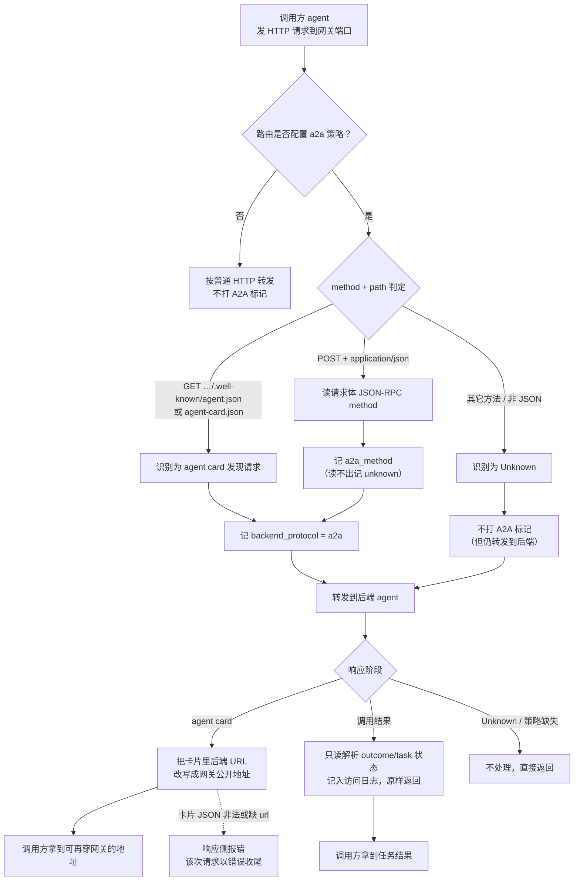
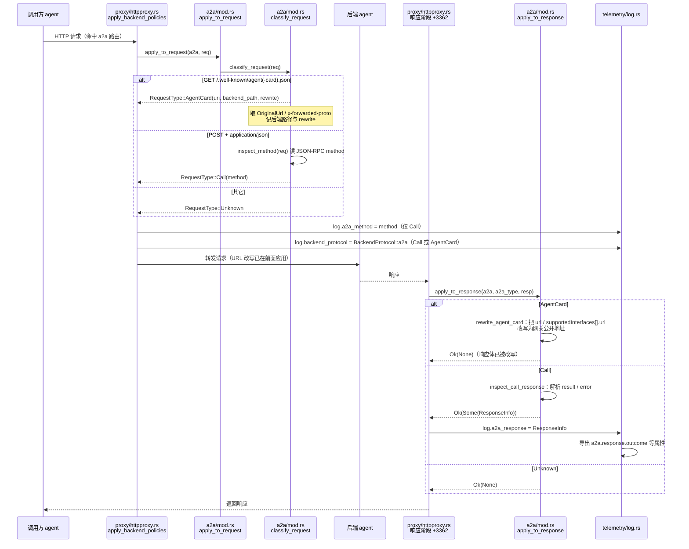

# A2A Gateway · 一次 agent-to-agent 请求在网关里怎么被识别、治理、转发

> 代码基准：`adrian@47ea6aa03434e24502ec502ea98d7082112e2699`（工作区无源码改动；仅 `docs/` 为本篇新增）；核实日期：2026-11-25。
> 范围：A2A（Agent-to-Agent，Google 提出的 agent 互操作协议，让一个 agent 发现并调用另一个 agent）流量在数据面 Rust 进程里的**识别、打标、转发与响应侧处理**。不覆盖控制面 CR→xDS 的翻译细节（见 `04-控制面reconcile.md`），也不复述 A2A 协议本身的 wire format（本仓库代码只体现到本篇引用的部分）。

## 0. 结论速览

### 0.1 这项能力现在能做什么

A2A 里最关键的两个动作是「**发现**」和「**调用**」：调用方先 `GET /.well-known/agent-card.json`（新版）或 `agent.json`（旧版）拿到一张 **agent card**（描述某个 agent 在哪、支持什么能力的元数据卡片），再 `POST` 一条 JSON-RPC 消息去真正发起一次任务。Agentgateway 作为中间代理，在请求侧把进来的流量**判定为 A2A 并打上协议标记与方法名**，在响应侧把 agent card 里的后端地址**改写成调用方能再次穿过网关的公开地址**，同时对每一次调用**记录成功/失败与任务状态**这类可观测信息。它不替 agent 执行任务，也不改写调用的业务载荷。

### 0.2 关键结论

| # | 结论 | 依据 |
|---|---|---|
| 1 | 判定完全基于 `HTTP 方法 + 路径 + Content-Type`，不看请求体内容做归类 | `a2a/mod.rs` · `classify_request +17` |
| 2 | `RequestType` 只有三种变体：`Unknown` / `AgentCard(Uri, String, Option<AppliedUrlRewrite>)` / `Call(Strng)` | `a2a/mod.rs` · `enum RequestType +65` |
| 3 | `Call` 的方法名取自请求体 JSON-RPC 的 `method` 字段；读不出时记字面量 `"unknown"`，但**仍是 `Call`，不会被降级成 `Unknown`** | `a2a/mod.rs` · `inspect_method +272`；测试 `tests.rs · test_classify_request_returns_unknown_method_on_invalid_json +158` |
| 4 | 只有 `Call` 和 `AgentCard` 才会被标记为 A2A 协议；`Unknown` 请求不打标，走普通 HTTP 路径 | `proxy/httpproxy.rs` · `apply_backend_policies +499~506` |
| 5 | `A2aPolicy` 是一个**没有任何字段**的空结构体，起「开关 + 标记」作用；它挂在**路由的 policies** 上（`a2a: {}`） | `types/agent.rs` · `struct A2aPolicy +3060`；`examples/traffic-a2a/config.yaml:21` |
| 6 | 响应侧只做两件事：agent card 的 URL 改写 + 调用结果的**只读观测**；`Call` 响应体不被改写（原样返回） | `a2a/mod.rs` · `apply_to_response +157`；`inspect_call_response +242` |
| 7 | `ResponseOutcome` 只有三种：`Success` / `Error` / `Unknown` | `a2a/mod.rs` · `enum ResponseOutcome +141` |

## 1. 生产视角：实际怎么用、会得到什么

### 1.1 参与者、真实入口与前置条件

| 角色 | 是谁 | 做什么 |
|---|---|---|
| 调用方 agent | 外部 agent / SDK 客户端 | 先取 agent card 发现对端，再 POST 一条 JSON-RPC 消息发起任务 |
| 数据面网关 | Rust 常驻服务（如 `examples/traffic-a2a/config.yaml` 里的 `:3000` 端口） | 识别 A2A、打标、转发、改写 agent card、记录观测信息 |
| 后端 agent | 上游真实 agent 服务（例子里是 `localhost:9999`） | 返回 agent card 或任务结果 |

**真实入口**：HTTP 监听端口上的两条路径形态——`GET …/.well-known/agent.json` 或 `…/.well-known/agent-card.json`（发现），以及任意路径上的 `POST` + `application/json`（调用）。**前置条件**（缺一即不按 A2A 处理）：该请求命中的路由必须配置了 `a2a: {}` 策略；否则 `apply_to_response` 第一步就返回 `None`，请求按普通 HTTP 走。

### 1.2 生产主流程图

**图的读法**：
- **前置**：请求必须命中配了 `a2a: {}` 的路由，否则从 `B` 直接走 `Z1`。
- **判定分支**：`C` 的三分支对应 `RequestType` 的三个变体；`F`（Unknown）不打标但仍会被转发——网关只少记观测信息，不拦请求。
- **失败终点**：`Q` 是唯一会让请求以错误收尾的响应侧路径（agent card 改写失败）；调用结果的解析失败是**静默降级**（少记日志，不改响应）。

### 1.3 生产条件与结果对照

| 入口条件 | 网关判为 | 打的标记 | 响应侧做什么 | 用户可见结果 |
|---|---|---|---|---|
| `GET` + 路径以 `/.well-known/agent.json` 或 `/.well-known/agent-card.json` 结尾 | `AgentCard` | `backend_protocol = a2a`；**不记 `a2a_method`** | 改写卡片 URL（v1.0 `supportedInterfaces[].url` 或 v0.3 顶层 `url`） | 调用方拿到指向网关的 agent card |
| `POST` + `Content-Type: application/json` | `Call(method)` | `a2a_method = <JSON-RPC method>`；`backend_protocol = a2a` | 只读解析结果，记 outcome / error_code / result_kind / task_state / context_id，**响应体不改** | 调用方拿到原样任务结果 |
| `POST` + 非 JSON Content-Type | `Call("unknown")` | `a2a_method = "unknown"`；`backend_protocol = a2a` | 非 JSON 响应直接跳过观测 | 请求照常转发 |
| 其它（如 `PUT`、`DELETE`、非 well-known 的 `GET`） | `Unknown` | 两个标记都不打 | 不处理 | 等同普通 HTTP 请求 |

### 1.4 分支、异常与边界

- **方法名读不出不报错**：请求体非法 JSON、或 Content-Type 不是 JSON，`a2a_method` 记字面量 `"unknown"`，请求仍按 `Call` 处理并转发。这是一个**静默降级**设计：日志里能看到 `a2a.method=unknown`，但不会拦截请求。
- **调用结果的观测是尽力而为**：响应非 JSON、流式响应只读到部分、或响应体检查出错，`inspect_call_response` 一律返回 `None`，即这条调用**不产生 A2A 观测记录**，但响应本身照常返回给调用方。
- **agent card 改写是硬失败**：卡片不是合法 JSON、或既没有 `url` 也没有 `supportedInterfaces` 字段，`rewrite_agent_card` 会 `bail!`，该错误沿 `ProxyError::Processing` 上抛，这次请求以错误收尾。
- **重复请求幂等**：agent card 改写是逐请求独立计算，同一卡片多次获取会得到同样的改写结果；调用转发不做去重。

### 1.5 一次真实操作示例（脱敏）

以「调用方发现一个天气 agent，然后发起一次任务」为例：

1. **发现**：调用方请求 `GET https://gw.example.com/api/.well-known/agent-card.json`。网关命中配了 `a2a: {}` 的路由，判为 `AgentCard`，`backend_protocol` 记为 `a2a`，转发到后端（假设后端在 `http://backend.internal/`）。
2. **卡片改写**：后端返回的卡片里 `supportedInterfaces[0].url = "http://backend.internal/a2a"`。网关把网关侧基址算出来（`https://gw.example.com/api`），再把接口路径的相对部分锚到这个基址上，改写成 `https://gw.example.com/api/a2a` 回给调用方。
3. **调用**：调用方 `POST https://gw.example.com/api/a2a`，body 为 `{"jsonrpc":"2.0","id":"1","method":"tasks/send","params":{…}}`。网关判为 `Call`，记 `a2a_method = "tasks/send"`、`backend_protocol = a2a`，转发到后端。
4. **结果观测**：后端返回 `{"jsonrpc":"2.0","id":"1","result":{"kind":"task","contextId":"ctx","status":{"state":"completed"}}}`。网关解析出 `outcome=success`、`result_kind=task`、`task_state=completed`、`context_id=ctx`，写进访问日志（`a2a.response.outcome` / `a2a.result.kind` / `a2a.task.state` / `a2a.context.id`），**响应体原样返回**。
5. **失败样例**：若第 3 步 body 里的 `method` 字段缺失或 JSON 非法，日志里 `a2a.method` 会是 `unknown`，但请求仍被转发；若后端返回 JSON-RPC `error`，日志里 `a2a.response.outcome=error`、`a2a.response.error_code` 记该错误码。

## 2. 开发视角：当前代码怎样实现

### 2.1 实现地图

A2A 逻辑集中在 `crates/agentgateway/src/a2a/`，接线点在 `proxy/httpproxy.rs`：

| 文件 | 符号 | 职责 |
|---|---|---|
| `a2a/mod.rs` | `apply_to_request +11` | 请求侧总入口，委托给 `classify_request` |
| `a2a/mod.rs` | `classify_request +17` | 按 method+path+Content-Type 判定 `RequestType` |
| `a2a/mod.rs` | `inspect_method +272` | 读请求体取 JSON-RPC `method` |
| `a2a/mod.rs` | `apply_to_response +157` | 响应侧总入口 |
| `a2a/mod.rs` | `rewrite_agent_card +184` | agent card URL 改写 |
| `a2a/mod.rs` | `inspect_call_response +242` | 调用结果的只读观测 |
| `a2a/mod.rs` | `ResponseInfo::from_json +82` | 从响应 JSON 抽 outcome/task 字段 |
| `proxy/httpproxy.rs` | `apply_backend_policies +492~508` | 请求侧接线：打 `a2a_method` 与 `backend_protocol` |
| `proxy/httpproxy.rs` | 响应阶段调用点 `+3362` | 响应侧接线：把 `ResponseInfo` 写进日志 |
| `types/agent.rs` | `struct A2aPolicy +3060` | 空策略类型 |
| `types/local.rs` | `+3055~3057` | 把 `a2a` 字段装进 `BackendTrafficPolicy::A2a` |
| `telemetry/log.rs` | `a2a_method +1432`、`a2a_response +1433` | 日志字段 |
| `telemetry/log.rs` | `+1942~1979` | 导出成 CEL/访问日志属性 |
| `a2a/tests.rs` | 908 行测试 | 覆盖分类、改写、观测全部分支 |

### 2.2 真实调用链

### 2.3 关键源码逻辑

**判定逻辑**（`a2a/mod.rs` · `classify_request +17~+61`）：`match (req.method(), req.uri().path())` 三分支。第一分支用守卫 `m == GET && (path.ends_with("/.well-known/agent.json") || path.ends_with("/.well-known/agent-card.json"))`；命中后优先用扩展里的 `filters::OriginalUrl`（URL 改写前原始地址），再经 `x_headers::apply_forwarded_scheme` 补 scheme，同时记下**改写后**的 `backend_path` 和 `AppliedUrlRewrite`，打包成 `AgentCard(uri, backend_path, rewrite)`。第二分支 `m == POST`：按 Content-Type 分流，JSON 走 `inspect_method` 读 `method`，非 JSON 记 `"unknown"`，统一返回 `Call(method)`。第三分支兜底返回 `Unknown`。

**接线**（`proxy/httpproxy.rs` · `apply_backend_policies +492~508`）：这段在 URL 改写（`+482`）、请求重定向（`+486`）之后执行，所以 agent card 拿到的是改写后的路径。`if let RequestType::Call(method)` 才写 `l.a2a_method`；`matches!(a2a_type, Call(_) | AgentCard(_,_,_))` 才写 `l.backend_protocol = Some(cel::BackendProtocol::a2a)`；最后 `rp.a2a_type = a2a_type` 存进响应策略，供转发完成后使用。`BackendProtocol` 枚举取值 `http/tcp/a2a/mcp/llm`（`cel/types.rs +494`），这个值会进入 CEL 上下文，供后续策略表达式判断协议类型。

**响应侧**（`a2a/mod.rs` · `apply_to_response +157~+181`）：策略为 `None` 直接返回 `Ok(None)`。`AgentCard` 分支按响应缓冲上限调 `rewrite_agent_card` 改写响应体，返回 `Ok(None)`（卡片改写不产生观测记录）。`Call` 分支返回 `inspect_call_response` 的结果。`Unknown` 返回 `Ok(None)`。

**agent card 改写**（`rewrite_agent_card +184~+240`）：优先处理 v1.0 的 `supportedInterfaces` 数组，逐项改写 `url`；没有该数组则回退到 v0.3 顶层 `url`；两者都缺则 `bail!`。改写时用 `strip_agent_card_suffix` 去掉 well-known 后缀得到 agent 基址，再把接口路径里**相对后端基址**的部分锚到**网关基址**上（`public_interface_url +292`），并在有前缀改写时按 `PathRedirect::Prefix` + `PathMatch::PathPrefix` 还原匹配段（`+299~+310`）。注释明确只按**完整路径段**匹配，避免 `/internal/weather` 误匹配 `/internal/weather-v2`。

**调用观测**（`ResponseInfo::from_json +82~+137`）：`error` 非空 → `Error`；否则 `result` 非空 → `Success`；两者都无 → `Unknown`。`error_code` 取 `error.code` 的 i64。`result_kind` 优先取 v0.3 平铺的 `result.kind`，否则按 v1.0 的 `oneof` 判断 `result.task` / `result.message` 存在性命名为 `"task"`/`"message"`。`task_state` 取 `result.status.state`，回退到 v1.0 的 `result.task.status.state`。`context_id` 依次尝试 `result.contextId` / `result.task.contextId` / `result.message.contextId`。

### 2.4 配置来源与字段

`A2aPolicy` 定义为 `pub struct A2aPolicy {}`（`types/agent.rs +3059~+3060`），**没有任何字段**，因此 YAML 里只能写 `a2a: {}`（见 `examples/traffic-a2a/config.yaml:21`、`controller/pkg/agentgateway/translator/testdata/backends/a2a-backend.yaml`）。它以 `Option<A2aPolicy>` 形式作为路由策略的一部分（`types/local.rs +3214`），在构造后端策略集合时被装进 `BackendTrafficPolicy::A2a`（`types/local.rs +3055`）；控制面经 xDS 下发时由 `types/agent_xds.rs +2575` 从 `Some(bps::Kind::A2a(_))` 还原成 `BackendTrafficPolicy::A2a(A2aPolicy {})`；网关 store 侧的字段定义在 `store/binds.rs +271`。**所以当前 A2A 策略没有任何可调参数**——它本质是「这条路由按 A2A 处理」的开关与标记。

### 2.5 生产步骤 ↔ 源码映射

| 生产步骤 | 文件 · 符号 | 输入 | 输出 / 副作用 |
|---|---|---|---|
| 判定请求类别 | `a2a/mod.rs` · `classify_request +17` | method / path / headers | `RequestType` |
| 取调用方法名 | `a2a/mod.rs` · `inspect_method +272` | 请求体 JSON | `Strng`（失败为 `"unknown"`） |
| 记 a2a_method | `proxy/httpproxy.rs` · `+494~497` | `Call(method)` | `log.a2a_method` |
| 记协议标记 | `proxy/httpproxy.rs` · `+499~505` | `Call` / `AgentCard` | `log.backend_protocol = a2a` |
| 暂存类型供响应用 | `proxy/httpproxy.rs` · `+507` | `a2a_type` | `response_policies.a2a_type` |
| 响应侧入口 | `proxy/httpproxy.rs` · `+3362` → `a2a/mod.rs` · `apply_to_response +157` | 策略 + 类型 + 响应 | 改写卡片 / `ResponseInfo` |
| 改写 agent card | `a2a/mod.rs` · `rewrite_agent_card +184` | 卡片 JSON + 网关/后端基址 | 改写后的响应体 |
| 观测调用结果 | `a2a/mod.rs` · `inspect_call_response +242` → `ResponseInfo::from_json +82` | 响应 JSON | `ResponseInfo` |
| 写入日志 | `proxy/httpproxy.rs` · `+3370~3372` → `telemetry/log.rs` · `+3370` | `ResponseInfo` | `log.a2a_response` |
| 导出观测属性 | `telemetry/log.rs` · `+1942~1979` | `a2a_method` + `a2a_response` | `a2a.method` / `a2a.response.outcome` / `a2a.response.error_code` / `a2a.result.kind` / `a2a.task.state` / `a2a.context.id` |

### 2.6 测试交叉验证

`a2a/tests.rs` 覆盖了本篇的每个判定分支，可作行为证据：`test_classify_request_extracts_method_and_preserves_body +59`（`tasks/send` 被正确抽取且请求体不被消费）、`test_classify_request_uses_original_url_for_agent_card +84`（改写场景下用原始 URL）、`test_classify_request_uses_x_forwarded_proto_for_agent_card +128`、`test_classify_request_returns_unknown_method_on_invalid_json +158`（非法 JSON 仍为 `Call("unknown")`）；响应侧 `test_apply_to_response_records_success_call_telemetry +398`、`test_apply_to_response_records_error_call_telemetry +435`、`test_apply_to_response_records_unknown_size_json_call_telemetry +465`、`test_apply_to_response_skips_non_json_call_telemetry +544`、`test_apply_to_response_records_v1_nested_task_telemetry +835` / `…_v1_nested_message_telemetry +873`（v1.0 嵌套形态）、以及一组改写路径测试 `+595` / `+641` / `+682` / `+734` / `+774`。

### 2.7 隐式知识

| 类别 | 内容 | 依据 |
|---|---|---|
| 硬编码值 | agent card 只认两个 well-known 后缀：`/.well-known/agent.json`（旧版）与 `/.well-known/agent-card.json`（v0.3.0+） | `classify_request +23~26` 注释 |
| 硬编码值 | 方法名读取失败时的哨兵字符串 `"unknown"` | `classify_request +50` / `+55` |
| 静默降级 | 调用结果观测在读不到完整响应体、非 JSON、解析失败时返回 `None`，只 `debug!` 一条，不告警不改响应 | `inspect_call_response +242~+265` |
| 隐含前提 | agent card 改写假设 agent 就托管在 agent card 所在基址下（`build_agent_path +276` 注释：「this won't work in the case they are hosting their agent in other locations」） | `a2a/mod.rs +276~+281` |
| 设计特性 | `A2aPolicy` 目前是空策略，无任何可配字段；所有行为固定 | `types/agent.rs +3060` |

## 3. 验证、缺口与后续修改

### 3.1 已回核 / 待验证

- **已回核（当前工作区源码）**：`RequestType` 与 `ResponseOutcome` 的全部变体、`classify_request` 判定逻辑、`apply_to_response` 两个分支、`A2aPolicy` 空结构体、接线点 `+492~508` 与响应调用点 `+3362`、日志字段与导出属性、`BackendProtocol` 取值、示例配置。
- **未实测**：本机未起网关发真实 A2A 流量，所有生产行为结论均来自代码与测试阅读，标注为代码已确认而非生产实测。生产端口的实际监听值、真实 agent card 形态属运行期事实 `[待运行验证]`。

### 3.2 已知缺口

| 缺口 | 性质 | 依据 |
|---|---|---|
| A2A 协议 wire format（JSON-RPC 2.0 之外的规范细节、任务生命周期）在本仓库只以字段名出现，无协议实现 | `[源码未确认]` | 代码只引用 `method` / `result.kind` / `status.state` / `contextId` 等字段 |
| agent card 托管在非 card 基址下时改写会错（代码注释已自认） | 设计特性 / 风险 | `build_agent_path +276` 注释 |
| `a2a_method` 只在请求侧记一次，SSE/流式调用的中间事件不会被单独观测 | 设计特性 | `inspect_call_response` 只处理 `BodyInspection::Complete` |
| 未发现 A2A 专用的限流、鉴权或预算治理逻辑（这些走通用 gateway/authorization 策略） | `[源码未找到]`（在 `a2a/` 目录范围内） | `a2a/mod.rs` 全文仅识别/改写/观测 |

### 3.3 修改联动与源码索引

动这块前必查：
- 改判定规则 → `a2a/mod.rs` · `classify_request`，同步看 `tests.rs` 的四个 `test_classify_request_*`。
- 改 agent card 改写 → `rewrite_agent_card` / `public_interface_url` / `strip_complete_path_prefix`，注意「完整路径段匹配」这一约束有专门测试 `+682`。
- 改观测字段 → `ResponseInfo::from_json`，并同步 `telemetry/log.rs +1942~1979` 的属性名与 `log.rs +4302` 的 `a2a_response_span_attributes` 测试。
- 加策略字段 → `types/agent.rs` · `A2aPolicy`，需评估 `agent_xds.rs +2575` 的还原逻辑与 CRD schema（`controller/install/helm/agentgateway-crds/.../agentgatewaybackends.yaml`）。

**源码索引（跳转用）**：`crates/agentgateway/src/a2a/mod.rs:11` `apply_to_request`；`a2a/mod.rs:17` `classify_request`；`a2a/mod.rs:65` `RequestType`；`a2a/mod.rs:73` `ResponseInfo`；`a2a/mod.rs:141` `ResponseOutcome`；`a2a/mod.rs:157` `apply_to_response`；`a2a/mod.rs:184` `rewrite_agent_card`；`a2a/mod.rs:242` `inspect_call_response`；`a2a/mod.rs:272` `inspect_method`；`crates/agentgateway/src/proxy/httpproxy.rs:492` 请求接线；`httpproxy.rs:3362` 响应接线；`crates/agentgateway/src/types/agent.rs:3060` `A2aPolicy`；`crates/agentgateway/src/types/local.rs:3055` 装配；`crates/agentgateway/src/telemetry/log.rs:1943` 观测属性导出。

**关联文档**：`01-系统骨架.md`（两进程构成）、`03-一次MCP调用.md`（同为协议网关的 MCP 侧对照）、`04-控制面reconcile.md`（`a2a: {}` 如何经 CR→xDS 到达数据面）、`06-开发实现补齐.md`（crate 关系与配置体系）。