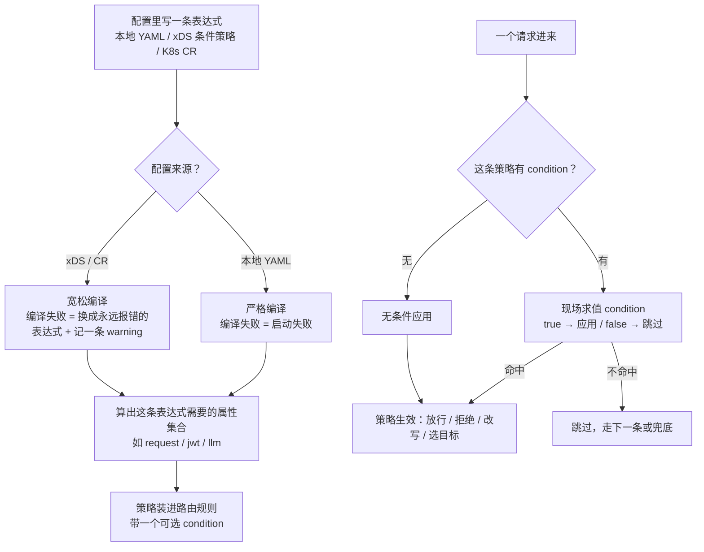
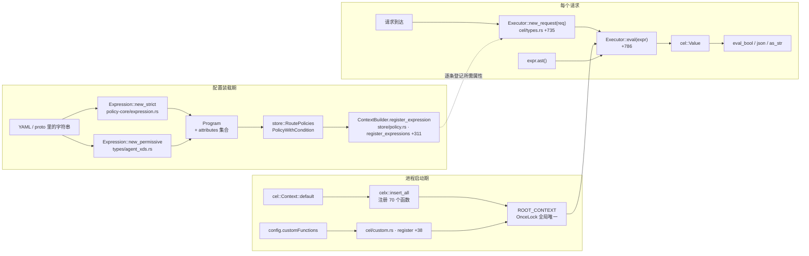
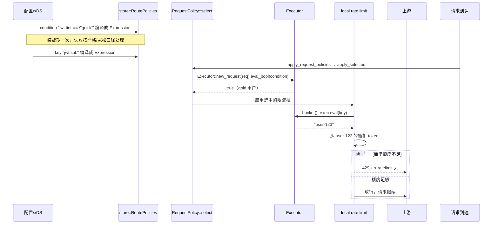

# 08 · CEL 策略引擎

> 代码基准：`adrian@47ea6aa03434e24502ec502ea98d7082112e2699`（工作区在写本篇时另有文档改动，本篇只读代码不改代码）；核实日期：2026-11-25。
> 本篇讲清一件事：一条 CEL 策略表达式，怎么从配置走到运行时求值，以及在请求链路的哪几处生效。

## 代码基准表

| 角色 | 路径 | 本篇用到的面 |
|---|---|---|
| CEL 引擎 fork | `crates/cel-fork/cel` | `Program::compile_with_optimizer`、`Context`、`Value::resolve`（只读调用面，不通读） |
| 扩展函数注册 | `crates/celx/src/{lib,general,strings,math,cidr,optimize,flatten}.rs` | `insert_all` 逐个注册的函数名 |
| 策略共享契约 | `crates/policy-core/src/{policy,expression}.rs`（crate 名 `agent_policy`） | `RequestPolicy`/`RequestAction`/`PolicyContext`/`PolicyCel`/`Expression` |
| 一个具体策略 | `crates/policies/cors/src/lib.rs` | `impl RequestPolicy for Cors` |
| 网关侧集成 | `crates/agentgateway/src/cel/{mod,types,custom}.rs` | `ROOT_CONTEXT`、`Executor`、自定义函数注册 |
| 运行时调用点 | `crates/agentgateway/src/proxy/{httpproxy,policy_host}.rs`、`crates/agentgateway/src/store/policy.rs`、`crates/agentgateway/src/mcp/**`、`crates/agentgateway/src/llm/**` | 求值发生的位置 |

## 0. 结论速览

agentgateway 不把「这个请求放不放过、改哪个头、路由到哪个模型」写成硬编码 if-else，而是让配置里写一条**表达式**（CEL，Google 的通用表达式语言），网关在运行时把请求现场喂进去算出一个值，用这个值做决策。表达式是数据、不是代码，所以新增一条规则只是改配置，不用改网关、不用重新编译。

| # | 结论 | 证据锚点 |
|---|---|---|
| 1 | 表达式以字符串形式来自配置（本地 YAML 或 xDS/CR），在**配置装载期**编译成 `Program`，失败时按「本地严格 / xDS 宽松」两种口径处理 | `types/local.rs · new_strict +269`、`types/agent_xds.rs · permissive_cel_expression +239`、`types/agent_xds.rs · conditional_policy_from_proto +4115` |
| 2 | 编译时就顺带算出这条表达式**需要哪些请求属性**，运行期只按需抓取，避免无谓地缓冲 body | `policy-core/src/expression.rs · new_strict +152`、`attributes_for +191` |
| 3 | 引擎函数表是**全局一份**：启动时 `celx::insert_all` 把 6 组扩展函数注册进一个 `OnceLock` 的 `Context`，之后所有求值共用 | `cel/mod.rs · context +24`、`celx/src/lib.rs · insert_all +19` |
| 4 | 求值统一走 `Executor::eval`：每次求值新建一个 `Executor` 绑定当前请求，再用 `Value::resolve(ast, context, resolver)` 算出 `Value` | `cel/types.rs · impl Executor · eval +786`、`new_request +735` |
| 5 | 求值结果通过 `eval_bool` / `eval` 两个出口影响请求：**选不选这条策略**（条件不满足就跳过）、**算出一个值用于改写或路由** | `store/policy.rs · select +263`、`http/localratelimit.rs · impl RateLimit · bucket +177`、`llm/model_router.rs · select_model +667` |
| 6 | `celx` 共注册 **70 个** agentgateway 专有函数（general 33 + strings 12 + math 18 + cidr 3 + optimize 1 + flatten 3），清单见 §5 | `celx/src/{general:22,strings:9,math:9,cidr:12,optimize:8,flatten:6}` 的 `insert_all` |

### 0.1 为什么用 CEL 而不是硬编码

- **规则是运营侧的东西，变动频繁**：限流键用 `jwt.sub + "/" + llm.requestModel` 还是 `jwt.sub`、按哪个 header 选模型，都属于「随时想调」。写成表达式就是改一行配置；写成 if-else 就得改代码、重编译、重新发版。证据：`local_tests/keyed_rate_limit_config.yaml` 的 `key: jwt.sub + "/" + llm.requestModel`、`examples/llm-cost-routing/config.yaml` 的 `when:`。
- **同一个判断要在多处复用**：`jwt.tier == "gold"` 这类判断可能同时决定限流档位、路由目标、鉴权放行。表达式可以作为**条件**挂在任何策略上（`PolicyWithCondition.condition`），网关用同一套求值机制处理，不用为每种策略各写一套判断逻辑。证据：`store/policy.rs:159`、`store/policy.rs · select +266`。
- **失败要可控**：配置写错了不能让网关起不来（xDS 侧）也不能静默放行（本地侧）。网关在编译期就把错误拦下来，两种口径见 §4。

## 1. 生产视角：一条策略表达式的一生

先看真实链路上发生了什么，再看代码。



图的前提与分支：
- 两个编译口径的差异在 §4 展开，这是「本地自建」与「控制面下发」的根本区别。
- `condition` 求值发生在**策略选择阶段**，不是策略内部；一次选择可能评估多条 condition，第一条命中的胜出（§3.1）。
- 最终结果只有四种形态：放行（默认）、拒绝（返回错误响应）、改写（改头/改 body/改目标）、仅记录（log 表达式）。

## 2. 开发视角：编译、注册、求值三段



图的说明：
- 装载期决定「这条表达式成不成立、需要什么」，启动期决定「有哪些函数可用」，请求期才真正算值。三段是三个不同的时间点，别混。
- 自定义函数（`config.customFunctions`）必须在任何表达式求值**之前**注册，否则 `ROOT_CONTEXT` 已初始化会直接报错（`cel/custom.rs:45`）。

### 2.1 编译：表达式怎么变成可执行的东西

`Expression` 是策略侧唯一的表达式载体（`policy-core/src/expression.rs:32`），里面存三样：`attributes`（需要的属性集合）、`expression`（编译后的 `Program`）、`original_expression`（原文，用于报错和日志）。

- 严格口径 `new_strict`（`expression.rs · new_strict +152`）：调 `Program::compile_with_optimizer(&expr, agent_celx::DefaultOptimizer)`，失败就返回 `Err`。本地 YAML 反序列化走的就是它（`Expression` 的 `Deserialize` 实现在 `expression.rs:47`），所以本地配置写错表达式会**启动失败**。
- 宽松口径 `new_permissive`（`expression.rs · new_permissive +129`）：同样先试 `new_strict`，失败则把原表达式**替换成 `fail("the expression ... could not be compiled")`**，并返回编译错误给调用方。xDS 侧用 `permissive_cel_expression`（`types/agent_xds.rs · permissive_cel_expression +239`）包一层，把错误变成一条 `diagnostics.add_warning`，请求走到这条策略时会因 `fail()` 抛错而失败——**不会静默放行**。
- 编译时同时算属性：`new_strict` 调 `attributes_for`（`expression.rs · attributes_for +191`），按 AST 里出现的顶层 token 映射到 `Attributes` flagset。例如出现 `request.body` 就置 `Request | RequestBody`，出现 `llm.prompt` 就置 `Llm | LlmPrompt`，出现 `jwt` 就置 `Jwt`。若表达式引用了 `variables()` 函数，直接置满 `FlagSet::full()`（`expression.rs:162`）。
- 优化器 `DefaultOptimizer`（`celx/src/optimize.rs · impl cel::Optimizer for DefaultOptimizer +87`）在编译期做三件改写：`json(data).field` → `jsonField(data, "field")`（`specialize_member +14`）；字面量参数的 `cidr("…")`/`ip("…")` 直接解析成内联对象（`specialize_call +43`/`+51`）；`x.matches("regex")` 反转成 `precompiled_matches` 并把正则**预编译**成对象（`specialize_call +59`）。这三条都是省掉每次请求的重复解析开销。

### 2.2 注册：`celx::insert_all` 往 Context 里放了什么

`ROOT_CONTEXT` 是一个 `OnceLock<RootContext>`（`cel/mod.rs:22`），第一次被用到时才初始化：新建 `Context::default()`，调 `agent_celx::insert_all(&mut ctx)`，然后永久复用（`cel/mod.rs · context +24`）。`celx/src/lib.rs · insert_all +19` 依次调 6 个子模块的 `insert_all`，完整清单见 §5。

自定义函数走另一条路：`config.rs:83` 在解析配置时调 `cel::register_custom_functions` → `cel/custom.rs · register +38`。它要求 `ROOT_CONTEXT` 尚未初始化（`custom.rs:45`），否则报「custom CEL functions must be registered before CEL is used」；注册时会再建一个临时 `Context` 调 `insert_all` 来检测与内置函数的名字冲突（`custom.rs:56`→`reject_builtin_collisions +85`），最后把自定义函数连同 `ROOT_CONTEXT` 一起安装，并把每个自定义函数**传递引用的属性**登记进 `install_custom_function_attributes`（`custom.rs:63`，对应 `expression.rs · install_custom_function_attributes +275`），这样调用自定义函数的表达式也能正确算出属性集合。

### 2.3 求值：`Executor::eval` 一处入口

每次求值都新建一个 `Executor`（`cel/types.rs · new_request +735`），它在 `set_request`（`types.rs +577`）/`set_request_extensions`（`+585`）里把当前请求能提供的所有视图装好：`jwt`、`api_key`、`basic_auth`、`llm`（优先 `LLMContext`，退回 `RequestModel`）、`mcp`、`extauthz`、`extproc`、`metadata`、`backend`、`proxy`、`source`、`destination`。响应侧另有 `new_response`/`set_response`（`types.rs +620`）。

真正的求值在 `eval`（`types.rs · impl Executor · eval +786`）：构造 `ExecutorResolver`（`types.rs:503`，实现 `VariableResolver`，负责把 `request`/`jwt`/`llm` 这些标识符解析成值），然后 `Value::resolve(expr.ast(), context(), &resolver)`。求值耗时和结果通过 `dtrace::trace` 打点（`types.rs:790`），失败会打一条 `target: "cel"` 的 TRACE 事件并返回 `Err`（`types.rs:805`）。

便捷出口：
- `eval_bool`（`types.rs:816`）：非 bool 结果视为 false，用于条件判断。
- `eval_rng`：log 表达式用，`telemetry/log.rs:547`。
- `policy-core` 侧的 `PolicyCel` trait（`expression.rs · trait PolicyCel +299`）只暴露 `eval_request`/`eval_response` 两个方法，网关的实现是 `GatewayCel`（`proxy/policy_host.rs · impl agent_policy::PolicyCel for GatewayCel +14`），内部就是 `Executor::new_request(req).eval(expression)`。这个窄接口让策略 crate（如 `cors`）能求值 CEL 而不依赖网关的日志/快照实现。

## 3. 求值在请求链路的哪几处生效

### 3.1 策略条件选择：`RequestPolicy::select`

`store/policy.rs` 把每条策略包成 `PolicyWithCondition`（`store/policy.rs:157`），带一个 `condition: Option<Arc<Expression>>`。条件从哪来：xDS 的 `ConditionalPolicy`（`proto::agent::ConditionalPolicy`）经 `conditional_policy_from_proto`（`types/agent_xds.rs +4115`）→ `conditional_traffic_policy_to_policy`（`+4166`）把 condition 挂到每个 policy inner 上，再用 `RequestPolicy::from_policy_inners`（`store/policy.rs:208`）组装。

选择逻辑在 `select`（`store/policy.rs · impl RequestPolicy · select +263`）：遍历候选策略，**有 condition 就新建一个 `Executor::new_request(req)` 求 `eval_bool`**；条件为假记一条 `Skip` trace 并看下一条；条件为真记 `Apply` 并返回；遇到无条件的兜底策略也直接返回。返回 `None` 表示这条策略整体不适用。

选中的策略由 `apply_internal`（`store/policy.rs:360`）执行：先 `select`，再调策略的 `apply`。网关侧的 `RequestPolicyTrait`（`store/policy.rs:36`）通过一个 blanket impl（`store/policy.rs:52`）桥接到 `agent_policy::RequestPolicy`，构造 `PolicyContext::new(&GatewayCel)`（`store/policy.rs:64`）传进去——策略内部想要 CEL 求值就拿 `ctx.cel.eval_request(...)`。

`apply_request_policies`（`proxy/httpproxy.rs · apply_request_policies +235`）是请求侧策略的总调度，按固定顺序跑 cors → oidc → jwt → basic_auth → api_key → budget → ext_authz → authorization → substrate → compression → rate limit → buffer → ext_proc → transformation → csrf → header modifier → url rewrite → redirect → delay → direct_response。其中需要条件选择的（local/remote rate limit、compression、ext_proc、response header modifier）会触发 §3.1 的求值；其余无条件策略不经过 `select` 的 CEL 求值。响应侧 `apply_response_policies`（`httpproxy.rs:5184` 起）同理，条件已在请求侧求过、不再重算（`store/policy.rs:378`）。

### 3.2 LLM 链路：`apply_llm_request_policies` + 虚拟模型路由

- `apply_llm_request_policies`（`proxy/httpproxy.rs · apply_llm_request_policies +613`）在**已解析出 token 数**之后运行：先构造 `cel::Executor::new_request(req)`（`+629`），对每条 local rate limit 调 `charge_tokens(llm_req.input_tokens, &exec)` 计费；被拒则把已计费的桶 `refund()` 并返回错误（`+640`）。remote rate limit 走 `check_llm`（`+659`）。
- 限流计费前的**键计算**也走 CEL：`http/localratelimit.rs · impl RateLimit · bucket +177` 对 `spec.key` 表达式调 `exec.eval`，取字符串作为分桶键；求不出字符串就用共享桶（`+183`）。
- 虚拟模型的条件路由在 `llm/model_router.rs` 的 `VirtualModelRouting::Conditional` 分支（`resolve_virtual_model` 内，`model_router.rs · resolve_virtual_model +667`，函数签名行 `+619`）：新建 `Executor::new_request(req)`，对 `targets` 找**第一条 `when` 为真**（或没有 `when`）的目标；全不匹配返回 400 `virtual_model_no_matching_target`（`+678`）。
- LLM 策略内的**变换表达式**：`llm/policy/mod.rs` 的 `Policy` 持有 `transformations`/`final_transformations`（`llm/policy/mod.rs:184`/`188`）和 prompt guard 的 header 表达式（`+2317`），求值入口是 `eval_transformation_expression`（`llm/policy/mod.rs · eval_transformation_expression +930`，`exec.eval(expression).ok()?.json().ok()`）。这些表达式都通过 `impl HasExpressions for Policy`（`llm/policy/mod.rs:231`）登记到 `ContextBuilder`。
- prompt guard 的 webhook / bedrock guardrails 子策略见 `llm/policy/webhook.rs`、`llm/policy/bedrock_guardrails.rs`；本篇只确认它们持有 `cel::Expression` 并走同一 `Executor` 求值 [源码未确认：其内部是否还有 CEL 之外的决策分支未逐行展开]。

### 3.3 MCP 链路：target 选择 + guardrails + RBAC

- **target 路由**：每个 `McpTarget` 带可选 `condition`（`mcp/router.rs:271`，来自 xDS 的 `mcp_target_from_proto`，`types/agent_xds.rs:2385`）。运行期 `mcp/upstream/mod.rs · target_condition_passes +513` 用 `ctx.clone().with_mcp_target(&target.name).executor().eval_bool(condition)` 判断这个请求该路由到哪个 target；全部 target 都被条件排除会置 `all_targets_conditioned_out`（`upstream/mod.rs:538`）。
- **guardrails 表达式处理器**：`mcp/guardrails/expression.rs · check +16` → `evaluate +52`。它先按方向给 executor 叠加 MCP 参数或结果（`+60`~`+68`），然后：有 `condition` 时求值，`true` 继续、`false` 直接 `Pass`、求值出错按**内部错误拒绝**（fail closed，`+73`）；condition 过了再看 action，`Reject` 返回 `PERMISSION_DENIED`（`+79`），`Transform` 求值出新 JSON 就改写 body（`+83`~`+90`）。求值出错与「配置成拒绝」在这里是两种不同的失败，前者是 `INTERNAL_ERROR`。
- **RBAC**：`mcp/rbac.rs · validate +53` 把资源名/方法名塞进 `MCPInfo` 再构造 executor（`+60`），规则集里的 CEL 条件据此求值。

### 3.4 通用 http 侧与其它

- **动态后端目标**：`Backend::Dynamic(_, expr)` 的目标是 CEL 算出来的。`proxy/httpproxy.rs · evaluate_dynamic_backend_target +2233` 对表达式求值，要求结果是 `host:port` 字符串，否则报错；入口 `resolve_dynamic_backend_target +2220` 的优先级是「进程内结果 > CEL 表达式 > 协议兜底」。CONNECT/substrate 路径同样走这里（`httpproxy.rs:3501`）。
- **网络授权**：`proxy/gateway.rs:931` 用 `cel::Executor::new_tcp(Some(&src), &dst)` 求 network authorization；`proxy/tcpproxy.rs:122` 同理。
- **日志表达式**：`telemetry/log.rs:547` 用 `eval_rng` 求 log 专用表达式；`RequestLog` 的 `cel_context` 在绑定装载时通过 `store/binds.rs · register_cel_expressions +367` 逐个 `register_expression`/`register_log_expression` 登记所需属性（`+724` 起）。
- **CORS 具体策略**：`crates/policies/cors/src/lib.rs · impl RequestPolicy for Cors +177`。注意它**不使用 CEL**：`apply` 只看 `Origin` 头和方法（`+190`/`+198`），origin 不匹配的 preflight 直接返回本地 200 无 CORS 头的响应（`+220`）。它实现的是 `policy-core` 的 `RequestPolicy` 契约（`PolicyContext` 参数被 `_ctx` 忽略），说明**契约允许策略不求值 CEL**，CEL 是可选能力不是强制。

### 3.5 生产流程图：一个带条件的限流策略



前提与分支：
- 非 gold 用户会命中第二条**无条件**档（`keyed_rate_limit_config.yaml:32` 的 `maxTokens: 60`），因为 `select` 遇到无条件策略直接返回。
- 求值发生在**策略选择**和**分桶键计算**两个不同时刻，用两次 `Executor::new_request`，不是一次。

## 4. 一个真实例子：从配置到命中/不命中

取 `crates/agentgateway/src/types/local_tests/keyed_rate_limit_config.yaml:27` 的真实配置（脱敏：把 key 从真实用户字段改成通用占位）：

```yaml
localRateLimit:
  conditional:
  - condition: jwt.tier == "gold"        # CEL 条件
    maxTokens: 600
    tokensPerFill: 600
    fillInterval: 60s
    key: jwt.sub                          # CEL 求分桶键
  - maxTokens: 60                         # 无条件兜底档
    tokensPerFill: 60
    fillInterval: 60s
    key: jwt.sub
```

走一遍全流程：

1. **来源**：本地 YAML 装载。`RequestPolicy::from_policies`（`store/policy.rs:227`）把两条档位连同各自的 condition 组装成 `RequestPolicy<LocalRateLimit>`（`Multiple` 变体，`store/policy.rs:217`）。
2. **编译**：condition 字符串 `jwt.tier == "gold"` 经 `Expression::new_strict`（`policy-core/expression.rs · new_strict +152`）调 `Program::compile_with_optimizer`。编译期 `attributes_for`（`+191`）看到顶层 token `jwt`，置 `Attributes::Jwt`。原文存进 `original_expression`。若写错（比如 `jwt.tier ==`），本地口径直接返回 `Err`，启动失败。
3. **登记**：`register_cel_expressions`（`store/binds.rs · register_cel_expressions +367`）→ `RequestPolicy::register_expressions`（`store/policy.rs:311`）把 condition 和策略自带的 `expressions()` 都登记进 `ContextBuilder.request_attributes`（`cel/mod.rs · register_expression +62`）。运行期 `Executor` 据此决定要不要把 jwt 视图准备好。
4. **函数表就绪**：进程启动时 `celx::insert_all` 已把函数注册进 `ROOT_CONTEXT`（`cel/mod.rs · context +24`）。本例用到的 `==` 是 CEL 内建比较，不依赖扩展函数。
5. **请求期求值①（选档）**：`apply_request_policies`（`httpproxy.rs:330`）走到 local rate limit，调 `apply_selected` → `apply_internal`（`store/policy.rs:360`）→ `select`（`+263`）。
   - 第一条档有 condition：`Executor::new_request(req).eval_bool(cond)`。`set_request_extensions`（`cel/types.rs +585`）把 `self.jwt` 绑到请求 extensions 里的 JWT 上下文。
   - **命中**（JWT 里 `tier` 字段确实是 `"gold"`）：`eval_bool` 返回 true，`select` 记 `Apply` trace 并返回这条档。
   - **不命中**（`tier` 是 `"silver"` 或没有 JWT）：`eval_bool` 返回 false，记 `Skip` trace，`continue` 看第二条；第二条无 condition，直接返回作为兜底。
6. **请求期求值②（算键）**：选中档位后 `charge_tokens`（`http/localratelimit.rs · charge_tokens +235`）→ `bucket`（`impl RateLimit · bucket +177`）对 `key` 表达式 `jwt.sub` 调 `exec.eval(expr)`，结果转字符串作为分桶键；键为空或非字符串则退回共享桶（`+183`）。
7. **结果影响请求**：额度够 → 请求放行继续走后续策略；额度不够 → `take`（`+203`）返回 `RateLimitStatus`，转成 `ProxyError::RateLimitExceeded`（`+166`），由 `apply_llm_request_policies`（`httpproxy.rs +628`）在计费路径上把请求拒掉并 `refund` 已扣的桶，同时通过 `set_ratelimit_headers`（`httpproxy.rs:647`）写 `x-ratelimit-*` 响应头。

一句话：同一条策略里 condition 决定「用不用这条规则」，key 决定「记在哪个桶上」，两次独立求值，都在请求期、都在 `Executor::eval` 这一个入口里完成。

## 5. `celx` 注册的扩展函数清单

`celx/src/lib.rs · insert_all +19` 调 6 个子模块，共 **70 个**函数名（含兼容别名与限定名）。下表按子模块列出，函数名即 CEL 里直接可用的名字。

### 5.1 general（`celx/src/general.rs · insert_all +20`，33 个）

| CEL 函数名 | 作用（据实现） | 锚点 |
|---|---|---|
| `json(v)` | 把 string/bytes 解析成 CEL 值 | `general.rs · json_parse +364` |
| `jsonField(v, k)` | 只提取 JSON 里某一个字段（流式反序列化，省整包解析） | `general.rs · json_parse_field +533` |
| `unvalidatedJwtPayload(s)` | 拆 JWT 三段取 payload，base64 解码成 map（**不校验签名**） | `general.rs · unvalidated_jwt_payload +375` |
| `to_json(v)` / `toJson(v)` | CEL 值序列化成 JSON 字符串（新旓名并存） | `general.rs · to_json +396` |
| `with(this, ident, expr)` | 把 `this` 绑成变量 `ident` 再求 `expr` | `general.rs · with +222` |
| `mapValues(map, ident, expr)` | 对 map 每个值求 `expr`（值绑成 `ident`），返回新 map | `general.rs · map_values +245` |
| `filterKeys(map, ident, expr)` | 按 `expr`（返回 bool）保留 map 的键 | `general.rs · filter_keys +272` |
| `merge(a, b)` | 合并两个 map（后者覆盖同键） | `general.rs · map_merge +305` |
| `recurse(this, field)` | 沿 `field` 反复下钻，返回途经的所有节点链 | `general.rs · recurse +326` |
| `variables()` | 返回当前求值上下文的变量 map（引用它的表达式会触发全属性收集） | `general.rs · variables +237` |
| `random()` | 返回 0.0~1.0 随机数 | `general.rs · random +446` |
| `default(exp, d)` | `exp` 为 null / key 不存在 / 未声明时取 `d` | `general.rs · default +450` |
| `coalesce(...)` | 返回第一个非 null 的参数 | `general.rs · coalesce +469` |
| `regexReplace(this, regex, replacement)` | 正则替换（首个匹配） | `general.rs · regex_replace +404` |
| `regexReplaceAll(this, regex, replacement)` | 正则替换（全部匹配） | `general.rs · regex_replace_all +423` |
| `fail(msg)` | 无条件抛错（宽松编译的失败占位就用它） | `general.rs · fail +359` |
| `uuid()` | 生成 v4 UUID 字符串 | `general.rs · uuid_generate +442` |
| `base64Encode(v)` / `base64Decode(v)` | base64 编解码（接受 string 或 bytes） | `general.rs · base64_encode +56` / `base64_decode +80` |
| `base64.encode(v)` / `base64.decode(v)` | 与 `base64Encode`/`base64Decode` 相同实现，仅限定名形式 | `general.rs · insert_all +45`/`+46` |
| `url.encode(v)` / `url.decode(v)` | URL 编解码 | `general.rs · url_encode +121` / `url_decode +130` |
| `form.decode(v)` / `form.encode(v)` | 表单（application/x-www-form-urlencoded）编解码 | `general.rs · form_decode +161` / `form_encode +190` |
| `sha1.encode(v)` / `sha256.encode(v)` / `md5.encode(v)` | 三种哈希的十六进制编码 | `general.rs · sha1_encode +153` / `sha256_encode +149` / `md5_encode +157` |

### 5.2 strings（`celx/src/strings.rs · insert_all +9`，12 个）

来源是 Kuadrant wasm-shim 的 strings 扩展（`strings.rs:1` 注释，Apache 2.0），对应 cel-go `ext#Strings`。

| CEL 函数名 | 作用 |
|---|---|
| `charAt(s, i)` | 取第 i 个字符（越界报错） |
| `indexOf(s, sub)` / `lastIndexOf(s, sub)` | 子串首次/末次出现位置 |
| `join(list, sep)` | 列表用分隔符拼成字符串 |
| `lowerAscii(s)` / `upperAscii(s)` | ASCII 大小写转换 |
| `stripPrefix(s, p)` / `stripSuffix(s, p)` | 去掉前缀/后缀 |
| `trim(s)` | 去首尾空白 |
| `replace(s, old, new)` | 子串替换 |
| `split(s, sep)` | 按分隔符拆成列表 |
| `substring(s, start[, end])` | 取子串 |

锚点：`strings.rs:10`~`strings.rs:21` 的 `add_function` 逐条注册，实现在 `strings.rs:24` 起（`char_at +24` 等）。

### 5.3 math（`celx/src/math.rs · insert_all +9`，18 个，全部是 `math.` 限定名）

对应 cel-go `ext#Math`。`MAX_BYTES_BIT_OP_LEN` 为 32（`math.rs:7`，位运算的字节长度上限）。

| CEL 函数名 | 作用 |
|---|---|
| `math.least(...)` / `math.greatest(...)` | 取极值 |
| `math.ceil` / `math.floor` / `math.round` / `math.trunc` | 取整族 |
| `math.isInf` / `math.isNaN` / `math.isFinite` | 浮点判定 |
| `math.abs` / `math.sign` / `math.sqrt` | 绝对值 / 符号 / 平方根 |
| `math.bitAnd` / `math.bitOr` / `math.bitXor` / `math.bitNot` | 按位与/或/异或/非 |
| `math.bitShiftLeft` / `math.bitShiftRight` | 按位移位 |

锚点：`math.rs:10`~`math.rs:27` 逐条 `add_qualified_function`，实现在 `math.rs:30` 起。

### 5.4 cidr（`celx/src/cidr.rs · insert_all +12`，3 个）

对应 Kubernetes CEL 的 CIDR / IP 库（`lib.rs:28` 注释）。

| CEL 函数名 | 作用 | 锚点 |
|---|---|---|
| `cidr(s)` | 解析 CIDR 成 opaque 对象，方法：`ip` / `masked` / `prefixLength` / `containsIP` / `containsCIDR` | `cidr.rs · impl Cidr · impl_functions +23` |
| `ip(s)` | 解析 IP 成 opaque 对象，方法：`family` / `isUnspecified` / `isLoopback` / `isLinkLocalMulticast` / `isLinkLocalUnicast` / `isGlobalUnicast` | `cidr.rs · impl IP · impl_functions +88` |
| `isIP(s)` | 判断字符串是否合法 IP | `cidr.rs · is_ip +82` |

### 5.5 optimize（`celx/src/optimize.rs · insert_all +8`，1 个）

| CEL 函数名 | 作用 | 锚点 |
|---|---|---|
| `precompiled_matches(s)` | 接收预编译正则对象做匹配；正常不手写，由 `DefaultOptimizer` 把 `x.matches("re")` 自动改写成它 | `optimize.rs · PrecompileRegex · precompiled_matches +117` |

### 5.6 flatten（`celx/src/flatten.rs · insert_all +6`，3 个）

| CEL 函数名 | 作用 | 锚点 |
|---|---|---|
| `flatten(v)` | 把嵌套 map/list 拍平一层 | `flatten.rs · flatten`（注册于 `flatten.rs:7`） |
| `flatten_recursive(v)` / `flattenRecursive(v)` | 递归拍平（新旓名并存） | `flatten.rs:9`/`flatten.rs:10` |

实现细节：拍平结果通过 `FlattenSignal`（`flatten.rs · enum FlattenSignal +19`）和 `$_meta_flatten_*` 哨兵键（`flatten.rs:13`~`16`）传递。

### 5.7 计数核对

| 子模块 | 函数名个数 | 备注 |
|---|---|---|
| general | 33 | 含 `to_json`/`toJson`、`base64*` 新旧名、6 个限定名 |
| strings | 12 | |
| math | 18 | 全为 `math.` 限定名 |
| cidr | 3 | 含 2 个 `add_function_direct` |
| optimize | 1 | |
| flatten | 3 | 含 `flatten_recursive`/`flattenRecursive` 两个兼容名 |
| **合计** | **70** | 与 `lib.rs · insert_all +19` 的 6 次调用对应 |

> 除上表 70 个外，CEL 自带的运算符与内建函数（`==`、`&&`、`in`、`size()`、`matches()` 等）由 `cel-fork` 引擎本身提供，不属于 `celx` 注册范围 [推断：CEL 语言通用语义，未逐个核对本 fork 的内建清单]。

## 6. 开发源码映射表

| 关心的问题 | 看哪里 | 符号 |
|---|---|---|
| 表达式怎么编译 | `crates/policy-core/src/expression.rs` | `Expression::new_strict +152`、`new_permissive +129` |
| 表达式需要哪些属性 | `crates/policy-core/src/expression.rs` | `attributes_for +191` |
| xDS 宽松编译与 warning | `crates/agentgateway/src/types/agent_xds.rs` | `permissive_cel_expression +239`、`conditional_policy_from_proto +4115` |
| 扩展函数注册 | `crates/celx/src/lib.rs` 及各子模块 | `insert_all +19` |
| 自定义函数注册 | `crates/agentgateway/src/cel/custom.rs` | `register +38`、`reject_builtin_collisions +85` |
| 全局 Context | `crates/agentgateway/src/cel/mod.rs` | `context +24`、`ROOT_CONTEXT`（`Struct：RootContext`） |
| 求值入口 | `crates/agentgateway/src/cel/types.rs` | `impl Executor · new_request +735`、`eval +786`、`eval_bool +816` |
| 策略条件选择 | `crates/agentgateway/src/store/policy.rs` | `select +263`、`apply_internal +360` |
| 策略契约 | `crates/policy-core/src/policy.rs` | `trait RequestPolicy +88`、`struct RequestAction +56`、`trait PolicyCel`（`expression.rs +299`） |
| CEL 在策略内的实现 | `crates/agentgateway/src/proxy/policy_host.rs` | `GatewayCel +12` |
| 请求侧调度 | `crates/agentgateway/src/proxy/httpproxy.rs` | `apply_request_policies +235`、`apply_llm_request_policies +613` |
| 动态后端 | `crates/agentgateway/src/proxy/httpproxy.rs` | `evaluate_dynamic_backend_target +2233` |
| MCP target / guardrails / RBAC | `crates/agentgateway/src/mcp/{upstream/mod,guardrails/expression,rbac}.rs` | `target_condition_passes +513`、`check +16`、`validate +53` |
| LLM 路由 / 变换 | `crates/agentgateway/src/llm/{model_router,policy/mod}.rs` | `Conditional 分支 +667`、`eval_transformation_expression +930` |
| 限流键 | `crates/agentgateway/src/http/localratelimit.rs` | `impl RateLimit · bucket +177` |
| 属性登记 | `crates/agentgateway/src/store/binds.rs` | `register_cel_expressions +367` |

## 7. 未确认与边界

- prompt guard 的 webhook / bedrock 子策略内部是否还有 CEL 之外的决策分支，本篇只确认它们持有 `cel::Expression` 并经同一 `Executor` 求值 [源码未确认]。
- CEL 语言本身的通用语义（运算符优先级、内建函数全集、类型转换规则）属语言规范范畴，本篇未逐项核对本 fork 的实现，文中仅按需说明 [推断]。
- `Executor::eval` 的耗时打点与 TRACE 事件是否在生产日志配置下可见，取决于运行期日志级别 [待运行验证]。
- 本篇工作区 HEAD 为 `03188af`（在指定基准 `47ea6aa0` 之上多一个纯文档提交），所引代码行未受影响；行号会随重构漂移，正文一律用符号+偏移。