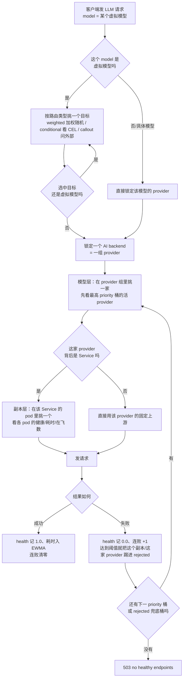
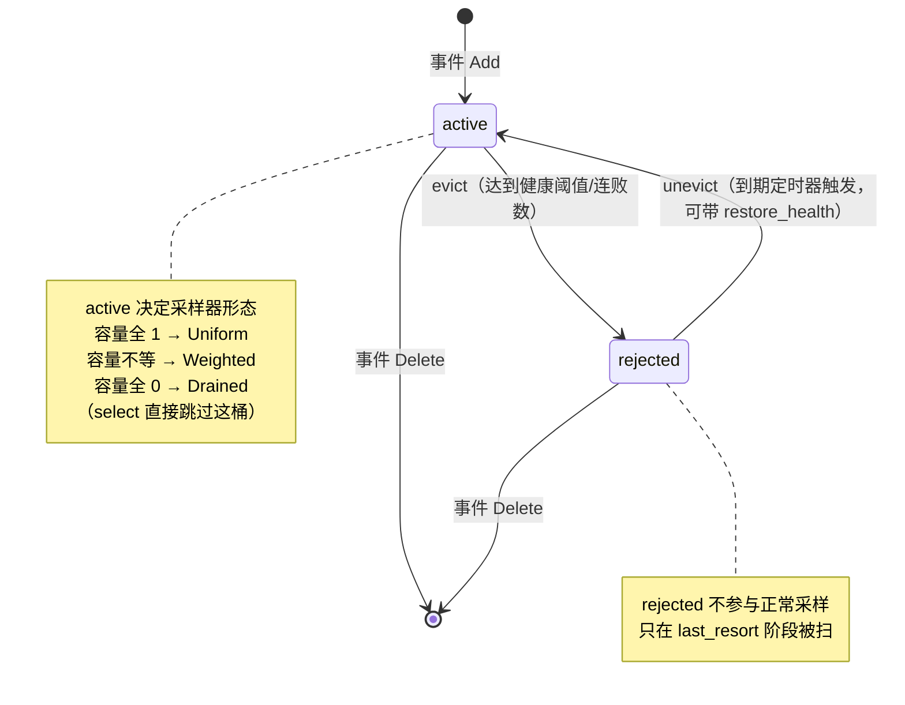
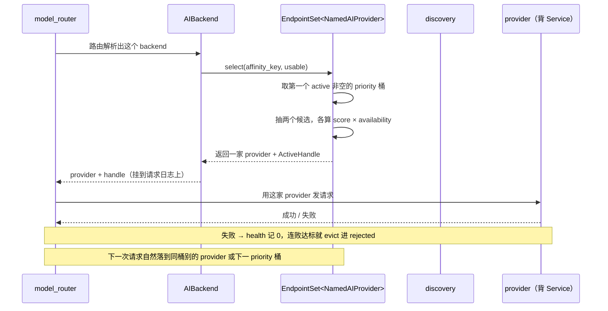

# 09 · 负载均衡与 failover

> 代码基准：`adrian`（当前工作区 HEAD `03188af593c919ead050344c84446c2a3b394ef5`，其它篇目有未提交改动，本篇所引源码均以当前工作区内容为准）；核实日期：2026-11-25。
> 本篇只讲一件事：**一个 upstream 背后挂了多个副本 / 多个 provider 时，网关怎么挑一个，挑中的坏了怎么换。**

## 0. 代码基准与结论速览

### 0.1 代码基准表

| 对象 | 位置 | 本篇用它讲什么 |
|---|---|---|
| `impl EndpointSet<T> · select` | `crates/agentgateway/src/types/loadbalancer.rs · impl EndpointSet · select +674` | 副本/provider 的统一挑选入口：两次随机采样 + 桶序兜底 |
| 桶序 `[false, true]` | `loadbalancer.rs · select +711` | 「先 active 各桶 → 都不行才进 rejected 兜底桶」 |
| `impl EndpointInfo · score` | `loadbalancer.rs · impl EndpointInfo · score +1034` | 单个副本好不好用的打分公式 |
| `finish_request` | `loadbalancer.rs · impl ActiveHandle · finish_request +1116` | health / latency / 连败计数在这里回写 |
| `impl EndpointGroup · evict/unevict` | `loadbalancer.rs · impl EndpointGroup · evict +154` / `unevict +164` | 副本在 active 与 rejected 之间搬移 |
| `ActiveEndpointsIter · is_active_phase` | `loadbalancer.rs · impl ActiveEndpointsIter · is_active_phase +1224` | 「这一桶还有没有活副本」的判据 |
| `select_provider` | `crates/agentgateway/src/llm/mod.rs · impl AIBackend · select_provider +103` | LLM 链路把 `select` 接到 provider 上，乘上 `availability` |
| 调用方 | `crates/agentgateway/src/proxy/httpproxy.rs +2704~+2714` | provider 背后是 Service 时用该 Service 端点平均健康度当 `availability` |
| 模型层分桶 | `crates/agentgateway/src/types/local.rs · Failover 分支 +5229~+5273` | 按 `priority` 把 targets 分桶塞进一个 `AIBackend` |
| 四种虚拟模型路由 | `crates/agentgateway/src/llm/model_router.rs · impl ModelRouter · resolve_virtual_model +619` | weighted / failover / conditional / callout 的换路条件与失败码 |
| 嵌套深度上限 | `model_router.rs · Const：MAX_VIRTUAL_MODEL_DEPTH +353` | 防环，超深 404 |
| 重试判定 | `crates/agentgateway/src/proxy/mod.rs · impl ProxyError · is_retryable +420`；`httpproxy.rs · fn should_retry +3972` | 哪些错误才重试 |
| 重试循环 | `httpproxy.rs +1192~+1200`（上限与退避）、`+1257`（`for n in 0..=max_retries`） | 重试几次、每次是否重挑 provider |

> 锚点核对说明：任务书把 `is_retryable` 记在 `llm/mod.rs`、`should_retry` 记在 `llm/mod.rs`，实际二者分别在 `proxy/mod.rs` 与 `proxy/httpproxy.rs`（行号与任务书一致）。本文按实际位置引用。

### 0.2 结论速览

负载均衡分**两层**，都在 LLM 链路上，但解决的是两个不同问题：

| 层 | 大白话 | 谁来实现 | 「换」的单位 |
|---|---|---|---|
| **模型层（provider 组之间）** | 这个虚拟模型背后有好几家 provider，先挑一家 | `AIBackend` 里那个 `EndpointSet<NamedAIProvider>`，每个 `priority` 一桶 | **换 provider 组**（可能换厂商、换凭证） |
| **副本层（同 provider 多端点）** | 选中的 provider 背后是个 Service，Service 有好几个 pod | 该 Service 自己的 `EndpointSet<Endpoint>`（discovery 驱动） | **换端点**（同一家厂商的另一个 pod） |

要点：

1. **两层共用同一套挑选算法**。`select_provider` 的文档原话是「Selects a provider the same way service endpoints are selected」——provider 组和普通 Service 端点走的是同一个 `EndpointSet::select`，公式、桶序、兜底全部一致（`llm/mod.rs · select_provider +100~+111`）。
2. **挑副本 = 两次随机采样取高分**。无亲和键时从最优桶里按容量加权抽两个（有放回），各算一次 `score × availability`，分高的那个赢；有放回是为了不让最差的副本彻底喝不到流量（`select +667~+707`）。
3. **分数公式**：`score = health / (1 + latency × (1 + pending × 0.1))`。health 是成功/失败 EWMA，latency 是耗时 EWMA，pending 是此刻在这副本上在飞的请求数。
4. **换桶顺序是「先 active 全扫一遍，再 rejected 兜底」**，由 `[false, true].into_iter().find_map(...)` 表达；兜底阶段会把 `availability` 强行当成 `1.0`，等于「宁可要一个被踢出去的，也不要直接失败」（`select +711`、`select_provider +109`）。
5. **failover 主要不是靠重试堆出来的，而是靠 priority 分桶**。多个 `priority` 组会自动给这个 AI backend 打开默认健康策略，坏副本被踢进 rejected、下一桶顶上；重试只负责「连接类失败再打一发」，二者正交（`llm/mod.rs · AIBackend::new +89~+93`、`proxy/mod.rs · is_retryable +420`）。
6. **四种虚拟模型路由的失败码各不相同**：weighted 抽不出目标 / 嵌套超深 → 404；conditional 全不匹配 → 400；callout fail-closed → 503 `virtual_model_callout_failed`；failover 不在这一层做选择，直接把请求交给 provider 组去挑。

---

## 1. 生产视角：一次请求是怎么被「挑中一个上游」的

### 1.1 生产流程图



图的前提与分支：

- 「两层」只在 **provider 背后挂了 Service** 时才真的叠起来；provider 是直连厂商域名时只有模型层那一跳（`httpproxy.rs +2706~+2712`，`provider_backend` 为 `Some(Service)` 才去查 Service 端点平均健康度，否则 `availability` 直接是 `1.0`）。
- 「踢进 rejected」不是永久拉黑：被踢副本有个到期时间，到期由后台 worker 搬回 active，可配 `restore_health` 让它带着一个低分慢慢回血（`loadbalancer.rs · worker +906~+921`）。
- 客户端能看到的最终失败只有两种形态：路由层给一个带 `code` 的 JSON 错误（400/404/503），或上游全灭时给 503 `NoHealthyEndpoints`（`proxy/mod.rs +588`）。

### 1.2 生产条件与结果表

| 场景 | 网关实际做什么 | 客户端看到什么 |
|---|---|---|
| 虚拟模型 weighted，随机抽中一个目标 | 加权随机选一个 model，继续解析 | 正常转发，无感 |
| weighted 所有 target 权重都抽不出来 | 返回 404 `virtual_model_not_resolved` | 404 |
| conditional，没有任何 `when` 条件命中 | 返回 400 `virtual_model_no_matching_target` | 400 |
| callout 外部选择器失败，且策略是 fail-closed | 返回 503 `virtual_model_callout_failed` | 503 |
| callout 失败，但策略配了 fallback 模型 | 退到 fallback 模型继续 | 正常转发 |
| 嵌套虚拟模型超过 4 层 | 返回 404 `virtual_model_not_resolved` | 404 |
| 最高 priority 桶全被踢，下一桶有活的 | 换到下一桶的 provider | 换厂商，请求成功，无感 |
| 所有桶 active 全空，但 rejected 里有 | 进兜底阶段，把 `availability` 当 1.0 再试一次 | 可能成功，也可能失败 |
| active 和 rejected 都没有可用 | 503 `NoHealthyEndpoints` | 503 |

---

## 2. 开发视角（一）：副本怎么挑

### 2.1 `select` 的两条路径

`select` 签名带一个闭包 `usable(&EndpointWithInfo<T>, bool) -> Option<(f64, C)>`，返回 `None` 表示「这个副本现在不能用」。它有两条互斥路径：

**路径 A —— 无亲和键（`affinity_key.is_none()`，`select +679~+709`）**

1. `iter()` 取「最优桶」：`best_bucket()` 返回**第一个 active 非空的桶**（`select +606~+617`）。
2. 取该桶的 `sampler`：
   - `Weighted(dist)`（各副本容量不同）→ `dist.sample()` 抽两次；
   - `Uniform`（容量全为默认 1）→ `random_range(0..len)` 抽两次；
   - `Drained`（有副本但容量全 0）→ 直接 `None`，跳过（`Sampler +72~+88`、`build_sampler +90~+114`）。
3. 两个候选各自过一遍 `usable` 算分，`max_by` 取分高的（`+699~+703`）。注意是**有放回**抽样：`a != b` 才有第二个候选，注释明说这是为了「keeps the worst endpoint reachable instead of starving it of traffic」。
4. 这里 `last_resort = !iter.is_active_phase()`：若最优桶 active 为空（`is_active_phase` 就是 `!active.is_empty()`，`+1224~+1226`），说明 `iter()` 实际给的是 rejected 集，此时 `last_resort = true`。

**路径 B —— 有亲和键，或路径 A 没抽到（`select +711~+769`）**

```rust
[false, true].into_iter().find_map(|last_resort| {
    self.buckets.iter().find_map(|bucket| { ... })
})
```

这就是**桶序**：外层 `[false, true]` 是「阶段」，内层 `self.buckets.iter()` 是「桶」。阶段 `false` = active 阶段，阶段 `true` = 兜底阶段。遍历顺序逐字对应文档注释里的列表（`find_endpoint +771~+780`）：

```
active in bucket 0 → active in bucket 1 → rejected in bucket 0 → rejected in bucket 1
```

每个 `(阶段, 桶)` 里：

- 阶段 false 只看 `group.active`；阶段 true 才把 `group.rejected` 接在后面（`+717~+720`）。
- 过滤掉 `capacity == 0` 的副本（已 drained，`+722`）。
- `usable(ewi, last_resort)` 返回 `None` 的跳过（`+724`）。
- 无亲和键：从候选里随机抽两个取分高（`+728~+742`）。
- 有亲和键：rendezvous hash 定一个赢家，容量全为 1 时用未加权哈希，否则用按容量加权的分数（`+744~+763`）。
- `find_map` 找到第一个「有可用候选」的 `(阶段, 桶)` 就停，**所以 active 桶永远优先于 rejected 桶，无论桶号大小**。

### 2.2 `score × availability` 逐项拆解

LLM 链路的 `usable` 闭包只有两行（`llm/mod.rs · select_provider +108~+111`）：

```rust
let availability = availability(&e.endpoint).or(last_resort.then_some(1.0))?;
Some((e.info.score() * availability, ()))
```

而 `score`（`loadbalancer.rs · impl EndpointInfo · score +1034`，源码上方还留着一行 `// Todo: fine-tune the algorithm here`）：

```
score = health / (1 + latency_penalty)
latency_penalty = request_latency × (1 + pending × 0.1)
```

即 `score = health / (1 + latency × (1 + pending × 0.1))`。逐项：

| 项 | 含义 | 怎么采集 | 取值 |
|---|---|---|---|
| `health` | 这个副本最近好不好用 | 每次请求收尾 `finish_request`：成功 `health.record(1.0)`，失败 `health.record(0.0)`；EWMA 平滑系数 `ALPHA = 0.3`（`finish_request +1123~+1138`、`Ewma::record +1070~+1079`、`Const：ALPHA +980`） | 0.0 ~ 1.0，`health_score()` 直接读这个值 |
| `request_latency` | 这个副本最近的响应耗时 | 请求成功且有耗时数据时 `request_latency.record(latency.as_secs_f64())`；TCP 连接类后端不算（`finish_request +1124~+1126`、`telemetry/log.rs +1268~+1270`） | 秒，EWMA |
| `pending` | 此刻有多少请求正在这个副本上飞 | `start_request` 时 `total_requests` 自增并挂一个 `ActiveCounter`（`Arc<()>` 强引用计数），`countf()` = 强引用数 − 1；handle drop 即减一 | 非负整数，`ActiveCounter · countf +1181` |
| `availability` | 0~1 的可用度乘子，LLM 里 = provider 背后 Service 的端点平均健康度 | `httpproxy.rs +2706~+2711`：provider 挂了 Service 就取 `svc.endpoints.mean_health()`，否则 `1.0` | 0.0 ~ 1.0；兜底阶段若原本是 `None` 则当 `1.0` |

读法：`health` 是分子，越健康分越高；分母里 `latency` 越大越扣分，且 `pending` 会**放大** latency 的惩罚（在飞越多，每秒延迟的代价越高）。所以一个「有点慢 + 有点忙」的副本，扣分比「只慢不忙」重得多。注意分母恒 ≥ 1，`score` 永远 ≤ `health`，不会因为快就超过满血副本。

`[待运行验证]` 各副本 health / latency / pending 的**实际运行期数值与分布**（比如真实流量下三个副本的分数差距有多大、EWMA 收敛要多快）需要跑起来观测，源码只能给出公式与采集点。

### 2.3 副本状态机：active ↔ rejected



- 搬移动作都在 `EndpointGroup` 里，且 `add` 会先 `swap_remove` 掉 rejected 里的同名条目、`unevict` 反之（`+138~+174`），保证一个副本同一时刻只在一个池里。
- eviction 判定在 `http/health.rs`：`unhealthy` 的默认口径是 5xx、服务端 gRPC 失败或连接失败（`Policy +52~+55`）；踢人时长 = 显式 `duration`，否则 `Retry-After`，否则 retry backoff，否则默认 **3 秒**（`Const：DEFAULT_EVICTION_SECS +64`、`eviction_decision +95~+131`）。
- 重复被踢会**指数加长**：`base_duration × (times_ejected + 1)`，且**故意不设上限**——注释的理由是「全踢光时兜底扫 rejected 比一个不均匀的硬上限更好」（`+120~+125`）。
- `consecutive_failures` 在 unevict 时**故意不清零**，测试里有专门断言，避免「反复横跳」的副本每次都从 0 连败重新算（`unevict +916~+919` 只恢复 health；测试 `consecutive_failures_not_reset_by_uneviction +1651`）。

---

## 3. 开发视角（二）：模型层的 failover 是怎么搭出来的

### 3.1 模型层时序



### 3.2 priority 怎么变成桶

`local.rs` 的 Failover 分支（`+5229~+5273`）把 `failover.targets` 按 `priority` 排序后 `chunk_by(priority)`，**每个 priority 一个 `Vec`**，最后 `EndpointSet::new(provider_groups)` —— `EndpointSet::new` 的入参正是 `Vec<Vec<(EndpointKey, T)>>`，外层下标就是桶号（`loadbalancer.rs · EndpointSet::new +541`）。同一 priority 内的多个 target 落进**同一个桶**，靠分数互相竞争；不同 priority 落进不同桶，靠桶序做 failover。

关键联动（`llm/mod.rs · AIBackend::new +89~+93`）：

```rust
// Multiple priority groups explicitly opt into failover.
let default_health = (providers.num_buckets() > 1).then(|| http::health::Policy {
    eviction: Some(http::health::Eviction::default()),
    ..Default::default()
});
```

也就是说：**只有配了多于一个 priority 组，这个 AI backend 才会自动带上默认 eviction 策略**；单桶（纯负载均衡、不做 failover）时 `default_health` 是 `None`，不会自动踢副本。这是一个很容易漏看的隐式行为：你想让网关「坏了换一家」，就必须真的写成多 priority。

Failover 分支产出的 `VirtualModelRouting::Failover { backend, targets }` 里，`targets` 只是**描述用**（`model_router.rs +238~+240` 的字段注释：「used only to describe the virtual model」），`resolve_virtual_model` 的 Failover 分支 `+647~+666` 只读 `backend`、`..` 丢掉 `targets`，直接 `return ResolveResult::Backend(...)`。**换路的活儿完全交给那个 backend 里的 `EndpointSet` 去做**——这是「模型层 failover」和「虚拟模型路由」的分工边界。

### 3.3 四种虚拟模型路由：换路条件与失败码

都在 `model_router.rs · impl ModelRouter · resolve_virtual_model +619` 的 `loop` 里，逐分支：

| 模式 | 换路条件 | 失败条件 | 状态码 | error code / 文案 |
|---|---|---|---|---|
| **Weighted** `+631~+645` | `targets.choose_weighted` 按 `weight` 加权随机抽一个 | `choose_weighted` 出错（实际是权重和为 0 之类抽样失败） | **404** | `virtual_model_not_resolved` / `Virtual model {name} could not be resolved` |
| **Failover** `+647~+666` | 不在本层挑，直接把 `backend`（内含按 priority 分桶的 provider 组）交出去 | 只有「链路前段 callout 留下的字段改写失败」会拒绝，reason = `InvalidRequest` | 改写失败时非本分支定义 | 改写失败走 `InvalidRequest` |
| **Conditional** `+667~+690` | 按 `when`（CEL）顺序找第一个命中的 target；`when` 为 `None` 视为恒命中 | 全都不命中 | **400** | `virtual_model_no_matching_target` / `Virtual model {name} did not match any conditional target` |
| **Callout** `+692~+714` | `callout.select()` 问外部选择器；成功且模型已知则用之 | 失败且 `failure_mode = FailClosed` | **503** | `virtual_model_callout_failed` / `Virtual model {name} callout failed`；reason = `ModelRouting`（`PolicyError for Error +322~+347`，`StatusCode::SERVICE_UNAVAILABLE +326`） |
| **Callout**（失败但 `failure_mode = Fallback(model)`） | 外部选择器失败时退到配置指定的 fallback 模型 `+703~+706` | 不报错，按 fallback 模型继续解析 | 无 | — |

两个**跨模式共用**的失败出口：

- **选中了 `invalid` 目标**（XDS 侧标记未解析/无效，`+716~+733`）：404 `virtual_model_target_not_found` / `Virtual model {name} selected invalid target {target}`。注意这个 `invalid` 字段是 XDS 专有状态，本地配置 `local.rs` 构造时一律写 `invalid: false`（`+5206`、`+5219`）。
- **嵌套超深**（`+742~+755`）：目标本身又是虚拟模型就继续 `loop`，`depth` 自增，`depth >= MAX_VIRTUAL_MODEL_DEPTH`（**4**，`Const +353`，注释：「Bounds virtual model nesting so a cycle cannot loop forever」）时 404 `virtual_model_not_resolved` / `Virtual model {name} exceeded the maximum nesting depth`。自引用（target 名 == 自己的名字）被视为「指自己遮蔽的那个具体模型」，不算环、直接 break（`+735~+741`）。

`ApiKeyModelDenied` 也走同一个 `Error` 枚举，但它是 **403** `model_not_allowed`，属于鉴权不属于 failover，列出仅为完整性（`+307`、`+325`）。

---

## 4. 开发视角（三）：重试与换桶的关系

### 4.1 哪些错误才重试

`proxy/mod.rs · impl ProxyError · is_retryable +420~+427`，白名单只有三条：

| 错误 | 可重试 |
|---|---|
| `UpstreamCallFailed(_)` | 是 |
| `UpstreamCallTimeout` | 是 |
| `DnsResolution` | 是 |
| 其余一切（含 `NoHealthyEndpoints`、AI 请求/响应解析错、限流、鉴权失败…） | 否 |

也就是说**只有「连接类」失败才自动重试**——连不上、连超时、DNS 解析失败。上游已经返回了 4xx/5xx 这种「应用层失败」不走这条白名单，除非 retry policy 的 `codes`/`condition` 显式点名（`should_retry +3972~+3980`：`Ok(resp)` 交给 `pol.matches_response`，`Err(e)` 才看 `is_retryable`）。`retry::Policy` 的响应侧判据是「状态码在 `codes` 里 或 `condition` CEL 为真」（`http/retry/mod.rs · matches_response +53~+62`）。

### 4.2 重试几次、和换副本怎么配合

重试循环在 `httpproxy.rs`：

- 上限：`substrate_default_retry` 为真时 `max_retries = 2`，否则取 retry policy 的 `attempts`（默认 **1**，`http/retry/mod.rs · default_attempts +88`），没配就是 0（`+1192~+1196`）。
- 退避：显式 `backoff`，否则 substrate 默认 **100ms**（`+1197~+1200`）。
- 循环体：`for n in 0..=max_retries`，`last = (n == max_retries)`，`retryable = !last && should_retry(...)`（`+1257~+1315`）。
- 前置门槛：请求体必须能缓冲重放（`<= max_buffered_bytes`），太大直接禁用重试并打 `initial body is too large to retry`（`+1206~+1220`）。retry policy 还能配 `precondition`（按请求判，比如只 GET 才重试）来省掉缓冲开销（`retry/mod.rs +30~+39`）。

**与换副本/换桶的配合是隐式的、正交的**：每次重试都重新调 `attempt_upstream`，而 `attempt_upstream` 内部会重新走 `select_provider` → `select`。所以：

- 连接失败重试时，**会重新抽一次副本**（两次随机采样），天然有机会换到另一个 pod；但算法不保证一定换——`score` 没变（失败结果此刻还没回写完）、采样是随机的，可能还抽中同一个。
- 真正**确定性**的「换一家 provider」来自 priority 桶序：当前桶被 `evict` 空了，`best_bucket()` 才会挪到下一桶。这个过程是**后续请求**受益，不是同一个请求内的重试直接换桶。
- `NoHealthyEndpoints` 本身**不可重试**（不在 `is_retryable` 白名单），所以「全灭」不会触发无谓的再打一发。

`[推断]` 因此「重试」和「failover」在生产上是两层兜底：重试吸收瞬时抖动（连接抖、超时），failover（priority 桶 + eviction）吸收持续性劣化（某家 provider 整体不可用）。前者同一请求内、靠随机重抽碰运气；后者跨请求、靠健康状态改变桶内可用集。

### 4.3 一个容易误解的点：provider 背后是 Service 时健康度别算两遍

当 provider 挂在 Service 上，provider 自己的失败会喂给这个 aggregate Service 健康，此时**不再**对 provider 本身再罚一次（`telemetry/log.rs · finish_delegated_provider_handle_with_attempt +1274~+1291`，注释：「Do not also penalize the provider for the same failure」，用 `endpoint_selected` 区分）。这条避免了「一次失败把两层健康度都打下去」的放大效应。

---

## 5. 一个真实例子（脱敏）

配置：一个虚拟模型 `smart-router` 用 failover 策略，两个 priority 组，`priority: 1` 是 `openai/gpt-x`（背后挂一个 3 副本的 Service `openai-pool`），`priority: 2` 是 `anthropic/claude-y`（直连厂商）。

**第 1 次请求**：

1. `smart-router` 命中 Failover 分支，直接把 backend（内含 2 个 priority 桶的 `EndpointSet<NamedAIProvider>`）交出去。
2. 模型层 `select_provider`：`best_bucket()` 取桶 0（priority 1），里面只有一家 `openai/gpt-x`。
3. `availability` = Service `openai-pool` 的 `mean_health()`。副本层再走一遍 `select`，从 3 个 pod 里抽两个，算 `score × availability` 取高分者，假设选中 pod-2。
4. 请求发到 pod-2，成功 → pod-2 的 `health.record(1.0)`、耗时入 EWMA、连败清零。

**pod-2 开始劣化**：连续 5xx。

- 每次失败：pod-2 `health.record(0.0)`、`consecutive_failures` +1。达到 eviction 阈值（默认策略下单次 unhealthy 即可触发）→ `evict(pod-2)`，搬进 rejected，踢出时长 = 默认 3s ×（`times_ejected+1`），`times_ejected` +1。
- 之后请求的副本层 `select`：桶 0 的 `active` 少了 pod-2，采样只会在 pod-1 / pod-3 之间；若这俩也被踢光，`active` 空 → `is_active_phase()` 为 false → `iter()` 给的是 rejected 集，`last_resort = true`，兜底扫 pod-1/2/3，`availability` 强制当 1.0 再给一次机会。
- 若 Service 整体 `mean_health()` 掉到很低，模型层 `availability` 变小，`openai/gpt-x` 的 `score × availability` 被压低——但只要桶 0 还有 active，`find_map` **不会**因为分数低就跳到桶 1（桶序优先于分数）。这是「priority 是硬优先级、分数只在同桶内竞争」的直接体现。

**整组 openai 真挂了**：

- Service 3 个 pod 全进 rejected、`sampler` 变 `Drained` → 副本层 `select` 直接 `None`；模型层 `select_provider` 里桶 0 的 `active` 空 → `best_bucket()` 挪到桶 1（priority 2）→ 选中 `anthropic/claude-y`。**这就是 failover 真正发生的那一刻**：换的是 provider 组，客户端无感。
- 若两层全空：`select_provider` 返回 `None` → `ProxyError::NoHealthyEndpoints` → 503。这个错误不可重试，不会在同一个请求里空转。

**如果配置只写了一个 priority 组**：`num_buckets() == 1` → `default_health` 为 `None` → 不会自动 eviction，副本劣化只会反映在 `score` 上（分低被抽中的概率变小，因为两次采样取高分），但**不会被踢进 rejected、也不会有兜底扫**，直到 discovery 侧把它删掉。想要「坏了换」，必须写成多 priority。

---

## 6. 源码索引（便于跳转复核）

| 结论 | 锚点 |
|---|---|
| 两次随机采样、有放回、取高分 | `loadbalancer.rs · impl EndpointSet · select +674`，采样 `+683~+691`，取分 `+699~+703` |
| 桶序 `[false, true]`、rejected 兜底、capacity 过滤 | `select +711~+769` |
| best_bucket = 第一个 active 非空桶 | `select +606~+617` |
| `is_active_phase` = `!active.is_empty()` | `loadbalancer.rs · impl ActiveEndpointsIter · is_active_phase +1224` |
| `score = health / (1 + latency × (1 + pending × 0.1))` | `loadbalancer.rs · impl EndpointInfo · score +1034` |
| EWMA 系数 0.3、成功记 1.0 / 失败记 0.0 | `Const：ALPHA +980`、`Ewma::record +1070`、`impl ActiveHandle · finish_request +1116` |
| evict / unevict / 连败不重置 | `impl EndpointGroup · evict +154`、`unevict +164`、worker `+906~+921` |
| 踢出时长默认 3s、指数加长不封顶 | `crates/agentgateway/src/http/health.rs · Const：DEFAULT_EVICTION_SECS +64`、`eviction_decision +95~+131` |
| provider 选择 + availability 来源 | `llm/mod.rs · impl AIBackend · select_provider +103`；调用方 `httpproxy.rs +2704~+2714` |
| 多 priority 才自动开 eviction | `llm/mod.rs · impl AIBackend · new +89~+93` |
| failover 按 priority 分桶 | `local.rs · Failover 分支 +5229~+5273`；`EndpointSet::new +541` |
| 四种路由 + 失败码 | `model_router.rs · impl ModelRouter · resolve_virtual_model +619`（weighted `+631`、failover `+647`、conditional `+667`、callout `+692`） |
| 嵌套深度上限 4 | `model_router.rs · Const：MAX_VIRTUAL_MODEL_DEPTH +353`、判定 `+742~+755` |
| callout fail-closed → 503 | `model_router.rs · impl PolicyError for Error · status +323`、`external_message +330`、`into_response +337` |
| 可重试错误白名单 | `proxy/mod.rs · impl ProxyError · is_retryable +420` |
| 重试上限 / 退避 / 循环 | `httpproxy.rs +1192~+1200`、`+1257`、`should_retry +3972`；`retry/mod.rs · default_attempts +88` |
| provider 背 Service 不双重惩罚 | `telemetry/log.rs · finish_delegated_provider_handle_with_attempt +1274` |

## 7. 标记与未决项

- `[待运行验证]` 三副本在真实流量下的 `health` / `request_latency` / `pending` 实际取值、`score` 分布、EWMA 收敛速度——需要跑起来观测，源码只给公式与采集点。
- `[推断]` 「重试吸收瞬时抖动、priority 桶吸收持续性劣化」是两层兜底的分工——由 `is_retryable` 白名单只含连接类错误、以及换桶只在 active 空时发生这两条代码事实推出，源码未写成一句明文。
- 锚点位置与任务书差异：`is_retryable` 实际在 `proxy/mod.rs`（非 `llm/mod.rs`），`should_retry` 实际在 `proxy/httpproxy.rs`（非 `llm/mod.rs`），行号与任务书一致。
- callout fail-closed 的状态码是 **503**（`StatusCode::SERVICE_UNAVAILABLE`），非 404；weighted 抽样失败与嵌套超深才是 404。