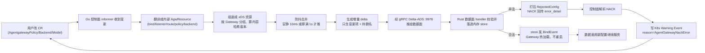
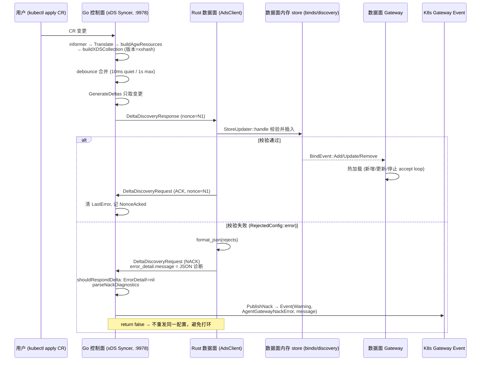

# xDS 配置下发：控制面怎么推、数据面怎么热加载、NACK 怎么回环

> 代码基准：分支 `adrian`，本地 HEAD `03188af593c919ead050344c84446c2a3b394ef5`。工作区有 6 个**文档文件**的未提交改动（`docs/sourceReader/01~06`），**本篇涉及的 Go/Rust 应用源码无未提交改动**，故源码结论等价于 HEAD。核实日期 2026-11-25。任务卡给的 SHA `47ea6aa0…` 在本机 `adrian` 上不存在（本机 `git rev-parse adrian` = `03188af5…`），正文一律以本机实际读到的代码为准。
>
> 范围：覆盖「K8s CR 变更 → 控制面翻译 → xDS 增量推送 → 数据面热加载 → NACK 回环」全链路。不覆盖数据面收到配置后如何真正建连转发（那是 `03-一次MCP调用` 的范围），也不覆盖 Gateway 部署/证书签发。

## 0. 结论速览

### 0.1 这套机制现在能做什么

agentgateway 是**控制面 + 数据面分离**的架构：控制面是跑在 K8s 里的 Go 控制器，数据面是每个 Gateway 对应的 Rust 进程。两者之间用 **xDS（xDS = Envoy 的「发现服务」协议族，大白话：控制面把配置"推"给数据面、数据面不用重启就能换配置的一条 gRPC 长连接协议）**通信。

用户改一个 `AgentgatewayPolicy` / `AgentgatewayBackend` / `AgentgatewayModel` 这类 CR（自定义资源），到数据面真正用上新配置，全程**不需要重启任何 Pod**。而且数据面要是觉得配置有问题，会**把错误反推回控制面、再写成一个 K8s Event 挂在 Gateway 上**，用户 `kubectl describe gateway` 就能看到"哪条配置被拒了、为什么"。

### 0.2 关键结论

| # | 结论 | 证据锚点 |
|---|---|---|
| 1 | xDS 服务端口默认 **9978**，来自一个可配置的 Settings 字段，不是写死的 | `controller/api/settings/settings.go · AgentgatewayXdsServicePort +175`（`default:"9978"`） |
| 2 | xDS Syncer 在**所有控制器副本上都跑**，不做选主；多副本靠资源**版本号内容哈希**保证一致 | `controller/pkg/syncer/syncer.go · Syncer.NeedLeaderElection +1014`（返回 `false`）；`krtxds/xds.go · PerGatewayCollection +142`（`Version: strconv.FormatUint(xxhash.Sum64(...),16)`，注释 `Content hashes remain stable across controller replicas`） |
| 3 | 推送前有**防抖合并**：默认「安静 10ms 就推、事件不停则最多等 1s 强推」，两个阈值都能用环境变量覆盖 | `krtxds/xds.go · debounce +1059`（`eventDelay >= opts.DebounceMax \|\| quietTime >= opts.DebounceAfter` 在 `+1084`）；`req.Merge(r)` 在 `+1125`；默认值 `DebounceAfter/DebounceMax +201/+209`（10ms / 1s，env `KGW_DEBOUNCE_AFTER` / `KGW_DEBOUNCE_MAX`） |
| 4 | 下发是 **Delta-ADS（增量 xDS）**，只推「变了的资源 + 该删的名字」，且按 Gateway 过滤 | `krtxds/xds.go · CollectionGenerator.GenerateDeltas +1195`；`DiscoveryServer.DeltaAggregatedResources +331` |
| 5 | 数据面**热加载不重启**：xDS 资源经 handler 落进内存 store，store 发事件唤醒 Gateway，Gateway 增删监听/accept 循环 | `crates/agentgateway/src/store/binds.rs · impl agent_xds::Handler<ADPResource> for StoreUpdater · handle +2367`；`binds.rs · StoreUpdater · notify_listener_changed +745`；`proxy/gateway.rs · Gateway.run +184`（`binds.subscribe()` → `BindEvent::Add/Update/Remove`） |
| 6 | **NACK 是双向闭环**：数据面把被拒资源格式化成 JSON 塞进 `error_detail` 回传；控制面解析后写成一个 K8s Warning Event | 数据面 `crates/xds/src/client.rs · impl AdsClient · handle_stream_event +699`（`RejectedConfig::format_json` → `error_detail`）；控制面 `krtxds/xds.go · shouldRespondDelta +555`（`PublishNack` 在 `+637`）→ `nack/publisher.go · Publisher.PublishNack +80`（reason=`AgentGatewayNackError`） |
| 7 | **重要纠偏**：任务卡把 `watch_resource_changes → reload_config_after_change → reload_config` 当成 xDS 热加载链，实际这三跳属于**本地配置文件 / ConfigResourceStore 那条路径**（`LocalClient`，代码注释自称"a local file reader alternative for XDS. This is intended for testing"）。xDS 路径的热加载不走这三个函数，走的是第 5 条那条 store 事件链 | `crates/agentgateway/src/state_manager.rs · LocalClient.run +139`（`+142` 文件路径 / `+144` 才调 `watch_resource_changes`）；`StateManager.run +116`（xDS 模式只 `xds.run()`，不调 reload）；`state_manager.rs` 顶部 `/// LocalClient serves as a local file reader alternative for XDS.` |

## 1. 生产视角：实际怎么用、会看到什么

### 1.1 谁在哪一步做什么

| 角色 | 做什么 | 在哪里做 |
|---|---|---|
| 平台用户 | 写/改 `AgentgatewayPolicy`、`AgentgatewayBackend`、`AgentgatewayModel` 等 CR | `kubectl apply` |
| Go 控制面（每副本都跑） | watch 这些 CR → 翻译成内部资源 → 组装 xDS 资源 → 防抖 → 增量推给数据面 | 控制器 Deployment，监听 9978 |
| Rust 数据面（每 Gateway 一个） | 连上 9978，订阅两类资源，收到推送就热加载进内存，配置非法就 NACK | Gateway Pod |
| Gateway CR 的 Event | 承载 NACK 结果，用户 `kubectl describe gateway` 可见 | K8s API |

前置条件：控制面已部署且 Gateway 已就绪；xDS 模式（TLS / plaintext / both）由 Settings 决定，两种模式都在同一端口上（TLS+plaintext 共存时用 cmux 在同一个 listener 上按是否 TLS 分流，见 `controller/pkg/setup/setup.go · +303/+304`）。实际集群里的 xdsMode 取值与副本数属运行期事实，未实测 `[待运行验证]`。

### 1.2 生产主流程图



前提：控制面与数据面之间 9978 连通、xDS 鉴权通过。分支：H 合法走热加载、非法走 NACK；NACK 里又分「错误」和「警告」两档，警告不阻断但也会写成 Event。终点：合法配置数据面继续服务；非法配置**数据面保留上一版配置继续跑**（不是崩掉），同时用户在 Gateway Event 上看到原因。

### 1.3 一次真实操作从头到尾

假设用户给某个 Gateway 上的一个 Agent 加了一条 `AgentgatewayPolicy`，但里面引用了一个不存在的后端：

1. `kubectl apply` 提交 CR → 控制面 informer 立刻收到（`collection.go · NewAgwCollections +128` 注册的 `AgentgatewayPolicies` informer，`+251`）。
2. 控制面把它翻译成内部策略对象（`traffic_plugin.go · NewAgentPlugin +108` 里 `ContributesPolicies[AgentgatewayPolicy]` 的 `Build` 调 `TranslateAgentgatewayPolicy +189`）。
3. 翻译结果汇进 `AgwResource` 集合（`syncer.go · buildAgwResources +599`）。
4. `buildXDSCollection +962` 把这个集合登记成「按 Gateway 分组」的 xDS 资源源，版本号 = 资源内容的 xxhash。
5. 任何一跳变更最终变成一个 `PushRequest` 进 `pushChannel`，防抖窗口结束后 `GenerateDeltas +1195` 只取变更项。
6. 数据面收到 delta，`StoreUpdater::handle` 逐条校验。这条策略引用了不存在的后端 → 校验返回 `Err` → 包成 `RejectedConfig::error`。
7. `handle_stream_event` 检测到有 error → 打包成 NACK，把 JSON 诊断塞进 `DeltaDiscoveryRequest.error_detail` 回传控制面。
8. 控制面 `shouldRespondDelta` 认出这是 NACK（`ErrorDetail != nil`），解析诊断、记一条 `ADS: ACK ERROR` 日志，调 `nackPublisher.PublishNack`。
9. `Publisher.publish` 找到对应 Gateway 对象，`eventRecorder.Event(..., corev1.EventTypeWarning, "AgentGatewayNackError", message)` 写一个 Event。
10. 用户 `kubectl describe gateway <name>` 看到 `AgentGatewayNackError`，message 就是数据面给的那段 JSON 诊断（含出问题的资源名和原因）。

### 1.4 异常与边界表现

| 情形 | 数据面表现 | 用户可见 |
|---|---|---|
| 配置完全合法 | 落进 store、发 BindEvent、热加载 | 无 Event |
| 配置有 error 级问题 | 拒绝该条、保留旧配置继续跑 | Gateway Event `AgentGatewayNackError` |
| 配置有 warning 级问题 | 接受并加载，但记录警告 | Gateway Event `AgentGatewayConfigWarning`（`publisher.go · ReasonWarning +28`，由 `PublishWarning +86` 发） |
| 控制面重启 / 数据面重连 | 数据面带 `initial_resource_versions` 重连，控制面对版本号相同的资源跳过不重发 | 短暂重连，配置最终一致 |
| 事件风暴（批量改 CR） | 防抖合并成一次推送 | 用户只感知一次切换 |

## 2. 开发视角：当前代码怎么实现

### 2.1 实现地图

```text
控制面 (Go, controller/)
  pkg/agentgateway/plugins/collection.go   informer 注册（含 3 个 agentgateway CRD informer）
  pkg/agentgateway/plugins/traffic_plugin.go  CR → 内部 AgwPolicy 翻译
  pkg/syncer/syncer.go                     组装 AgwResource + 登记 xDS collection
  pkg/syncer/krtxds/xds.go                 xDS 服务核心：防抖 / delta 生成 / ACK-NACK 判定
  pkg/syncer/nack/publisher.go             NACK → K8s Event
  pkg/setup/controlplane.go                起 gRPC xDS server（注册 ADS 服务）
  pkg/setup/setup.go                       端口 listener 与 TLS/plaintext 装配
  api/settings/settings.go                 9978 端口等 Settings 默认值

数据面 (Rust)
  crates/xds/  (workspace crate `agent-xds`)  通用 Delta-ADS 客户端 + RejectedConfig
    src/client.rs      AdsClient、Config、with_watched_handler、NACK 产生
    src/metrics.rs     config_synchronized 等 xDS 指标
  crates/agentgateway/src/state_manager.rs    装配 xDS 客户端、本地配置热加载路径
    src/store/binds.rs      ADP 资源 handler、bind 事件源
    src/store/discovery.rs  地址(工作负载/服务) handler
    src/proxy/gateway.rs    订阅 BindEvent，增删监听/accept 循环
    src/types/local.rs      本地配置 → NormalizedLocalConfig 转换
```

### 2.2 控制面侧逐跳锚点

**① CR → informer。** `controller/pkg/agentgateway/plugins/collection.go · NewAgwCollections +128` 里注册了三个 agentgateway 专属 informer：`AgentgatewayPolicies +251`、`Backends（AgentgatewayBackend）+252`、`Models（AgentgatewayModel）+253`，另有 Gateway/GatewayClass/ListenerSet 等通用 informer。三个 agentgateway informer 都用 `krt.NewFilteredInformer` 挂在同一 ObjectFilter 上。

**② CR → 内部策略。** `traffic_plugin.go · NewAgentPlugin +108` 返回 `AgwPlugin`，其中 `wellknown.AgentgatewayPolicyGVK.GroupKind()` 对应的 `Build` 闭包用 `krt.NewStatusManyCollection(agw.AgentgatewayPolicies, ...)` 对每个 policy CR 调 `TranslateAgentgatewayPolicy +189`。`+117` 就是那个调用点。翻译产出 `[]AgwPolicy` 和一个 `PolicyStatus`（后者用于回写 CR 状态）。

**③ 汇总成 xDS 资源。** `syncer.go · buildAgwResources +599` 是总装车间：把 binds、listeners、routes、policies、backends 各路 collection 合并成 `krt.Collection[AgwResource]`。`buildResourceCollections +159` 在 `+192` 调它。

**④ 登记 xDS collection。** `syncer.go · buildXDSCollection +962`（`+0` 是签名行）在 `+972/+973` 各 append 一个 Registration：
```go
s.Registrations = append(s.Registrations, krtxds.Collection[Address, *workloadapi.Address](xdsAddresses, krtopts))
s.Registrations = append(s.Registrations, krtxds.PerGatewayCollection[agwir.AgwResource, *api.Resource](agwResources, agwResourcesByGateway, krtopts))
```
`PerGatewayCollection +142` 干三件事：把每个内部资源包成 `DiscoveryResource`（`Name = getKey(i)`、`Version = xxhash(内容)` 16 进制、`ForGateway = extract(i)`）；把生成器塞进 `s.Collections[typeName]`；在 `RegisterBatch +29`（相对 `+142`）里注册批处理回调——一批事件里所有 `Latest().Name` 汇成一个 `PushRequest{ConfigsUpdated: {TypeUrl: nameSet}}`，`s.InboundUpdates.Inc()` 后丢进 `s.pushChannel`（`RegisterBatch` 回调体 `+174`，`pushChannel <- &pr` 在 `+186`）。

**⑤ 防抖合并。** `pushChannel` 由 `sendPushes +983` 消费，最终进 `debounce +1059`。核心状态机（相对 `+1059`）：

- 收到事件（`case r := <-ch`，`+1118`）：`lastConfigUpdateTime = now`；若是这一批第一个事件（`debouncedEvents == 0`）则起一个 `DebounceAfter` 定时器并记 `startDebounce`；`debouncedEvents++`；`req = req.Merge(r)`（`+1125`）把同类型更新合并进同一个 `PushRequest`。
- 定时器到点（`case <-timeChan` → `pushWorker`，`+1072`）：算 `eventDelay = now - startDebounce`、`quietTime = now - lastConfigUpdateTime`。**`if eventDelay >= opts.DebounceMax || quietTime >= opts.DebounceAfter`（`+1084`）** 才真正 `go push(req, ...)`；否则 `timeChan = time.After(opts.DebounceAfter - quietTime)` 再等一小段。
- 语义：`DebounceAfter` 是「至少安静这么久才推」，`DebounceMax` 是「事件一直不停也别拖过这个上限，强行推一版」。

**默认值与环境变量覆盖**（`krtxds/xds.go` 包级 var，`+201`/`+209`）：

| 变量 | 默认值 | 语义 | 锚点 |
|---|---|---|---|
| `KGW_DEBOUNCE_AFTER` | `10*time.Millisecond` | 事件静默多久后允许推送 | `DebounceAfter +201` |
| `KGW_DEBOUNCE_MAX` | `1*time.Second` | 事件持续不断时的强制推送上限 | `DebounceMax +209` |

两者经 `env.Register(...).Get()` 读环境变量，在 `NewDiscoveryServer +218` 里被装进 `DebounceOptions{DebounceAfter, DebounceMax}`（`+231/+232`）。`DebounceOptions` 结构体定义在 `+1050`（`DebounceAfter +1050`、`DebounceMax +1055`），其注释里 `DebounceMax` 写的是 "Defaults to 10 seconds" ——**注释与实际默认值 1s 不一致，以代码默认值 1s 为准**（见 §3.2）。

**⑥ 生成增量。** `GenerateDeltas +1195` 分两种模式：
- 请求触发（`req.IsRequest()`，数据面初次订阅或重连）：遍历该 Gateway 名下所有资源，`if version := req.InitialResourceVersions[r.Name]; version != "" && version == r.Version { continue }` ——数据面已有的同版本资源**跳过不重发**；剩余的进 `res`，数据面声明了但服务端没有的进 `deletes`。
- 事件触发：只看 `req.ConfigsUpdated[TypeUrl]` 里那批名字。因为登记时可能按「无 Gateway 前缀」或「`<gw>/` 前缀」两种 key 存，所以按 `keys = []string{"/"+k, gw.String()+"/"+k}` 两种键查（`PerGateway == true` 时）；查到但 `!IsForGateway(gw)` 视为不存在；都查不到则记为删除。

**⑦ 推送通道与端口。** `Push +1033` 给每个 client 的 pushQueue 入队，最终 `pushDeltaXds +700` → `Connection.sendDelta +500` 把 `DeltaDiscoveryResponse` 写回流。gRPC 服务端在 `controller/pkg/setup/controlplane.go · runXDSServer +56`：`grpc.NewServer` → `krtxds.NewDiscoveryServer(nil, nackPublisher, reg...)`（`+70`）→ `envoy_service_discovery_v3.RegisterAggregatedDiscoveryServiceServer(grpcServer, ds)`（`+78`）→ `go grpcServer.Serve(lis)`（`Serve` 在 `+81`，即 `runXDSServer+25`）。端口来源：`setup.go +173` `newXDSListener("0.0.0.0", s.GlobalSettings.AgentgatewayXdsServicePort)`，而该字段在 `api/settings/settings.go · AgentgatewayXdsServicePort +175` 声明为 `uint32`、`split_words:"true" default:"9978"`。xDS 走 Delta-ADS（`DeltaAggregatedResources +331`），不是经典 SotW ADS。

### 2.3 数据面侧逐跳锚点

**① 连接与订阅。** `crates/agentgateway/src/state_manager.rs · impl StateManager · new +34`（任务卡写 `Config::new +0`，实际装配点在 `StateManager::new`）：当 `xds.address` 有值时，构造 `agent_xds::Config::new(GrpcClient::new(connector), gateway, namespace)`，然后连续挂两个 watched handler（`+74/+75`）：
```rust
.with_watched_handler::<XdsAddress>(ADDRESS_TYPE, stores.clone().discovery.clone())
.with_watched_handler::<ADPResource>(ADP_TYPE, stores.clone().binds.clone())
// .with_watched_handler::<XdsAuthorization>(AUTHORIZATION_TYPE, state)  ← 注释掉，未启用
```
`with_watched_handler` 在 `crates/xds/src/client.rs · impl Config · with_watched_handler +357`：注册 handler 到 `self.handlers[type_url]`，同时 `watch(type_url)` 往 `initial_requests` 里 push 一个 `DeltaDiscoveryRequest`（只带 `type_url` + `node`，无 resource_names，即通配订阅）。

**② 收到推送 → 分发给 handler。** `crates/xds/src/client.rs · impl AdsClient · run_internal +594` 起 gRPC 流，`handle_stream_event +684` 是每条 `DeltaDiscoveryResponse` 的处理中枢：按 `type_url` 取出 `self.config.handlers` 里注册的 handler，调 `h.handle(&mut self.state, response)`（`+699~+701`），得到 `Result<(), Vec<RejectedConfig>>`。

**③ 两个 store handler 校验并落库。**
- ADP 资源（bind/listener/route/policy/backend/model）：`crates/agentgateway/src/store/binds.rs · impl agent_xds::Handler<ADPResource> for StoreUpdater · handle +2367`。逐条 match：`XdsUpdate::Update(w)` → `state.insert_xds(w.name, w.resource, &mut diagnostics)`，成功则把 `diagnostics.into_warnings()` 转成 `RejectedConfig::warning`，失败则 `RejectedConfig::error(name, err)`；`XdsUpdate::Remove(name)` → `state.remove_resource(&name)`（`+1919`）。
- 地址（工作负载/服务）：`crates/agentgateway/src/store/discovery.rs · impl agent_xds::Handler<XdsAddress> for StoreUpdater · handle +740`，委托给 `agent_xds::handle_single_resource +135`。

**④ 热加载生效（不重启）。** ADP 资源成功插入后，`insert_xds` 内部会 `self.tx.send(BindEvent::Add/Update/Remove)`（`binds.rs · insert_xds +1937`，事件发送点 `+911/+942/+944/+1662`）。消费端是 `crates/agentgateway/src/proxy/gateway.rs · impl Gateway · run +184`：`binds.subscribe()`（`+191`，对应 `binds.rs · StoreUpdater · subscribe +952`）拿到事件流，`handle_bind +194` 里 `BindEvent::Add` → 新建 accept loop、`Update` → `active.update(bind)` 原地换配置、`Remove` → `h.stop()`。监听端口级别的变化走另一个通道 `notify_listener_changed +745`（`watch::channel`），由 `read_binds().subscribe_listener_changes()`（`gateway.rs +469/+534`）订阅。**全程没有进程重启，也没有重新 exec**，这就是热加载。

**⑤ 上面第 4 条结论的关键纠偏（重申）。** `state_manager.rs` 里 `watch_resource_changes +212` / `reload_config_after_change +308` / `reload_config +247` 这三跳只挂在 `impl LocalClient · run +139` 上：`+142` 是 `ConfigSource::File` 走 `watch_config_file`，`+144` 才是 `watch_resource_changes`。而 xDS 模式走的是 `impl StateManager · run +116`，其函数体只有 `Some(xds) => xds.run().await...`，**完全不碰 reload_config 那条链**。`reload_config +247` 做的事是：`config_content()` 读本地配置/ConfigResourceStore → `NormalizedLocalConfig::from_expanded`（`types/local.rs · impl NormalizedLocalConfig · from_expanded +96`，内部主转换 `convert +3296`）→ `stores.binds.sync_local(...)` / `stores.discovery.sync_local(...)`。`reload_config_after_change +308` 的失败处理是 `Err(e) => { config_synchronized.set(0); record_failure(e); prev }` ——**失败时返回 `prev` 保住旧状态、并把 `config_synchronized` 置 0**，这条与任务卡描述一致，但它属于本地配置路径，不是 xDS 推送路径。`config_synchronized` 这个 Gauge 定义在 `crates/xds/src/metrics.rs +15`。

### 2.4 NACK 闭环（本篇高价值部分，双向都讲清）

**上行（数据面 → 控制面）：**

1. `binds.rs · handle +2367` 校验失败时 `rejects.push(RejectedConfig::error(name, err))`。`RejectedConfig` 定义在 `crates/xds/src/client.rs +53`（含 `severity: RejectedConfigSeverity`），`RejectedConfig::error +60` / `::warning +68` 是两个构造器。
2. `client.rs · impl AdsClient · handle_stream_event +684` 收到 `Err(rejects)` 后（`+704`）：
   - `has_errors = rejects 里是否有 severity==Error`；
   - `error = RejectedConfig::format_json(&rejects)`（`format_json +76`，把每条转成 `RejectedConfigMessage` 再序列化）；
   - 信号定为 `XdsSignal::Nack`，日志 `error!(... "sending response")`。
3. 构造回传请求（`+733`）：`DeltaDiscoveryRequest { type_url, response_nonce: nonce, error_detail: error.map(|msg| Status { message: msg, .. }) }`。**`error_detail.message` 就是那段 JSON 诊断**，`response_nonce` 带回控制面刚发的 nonce，让控制面知道这是对哪一版的回应。

**下行（控制面接收并写回 K8s）：**

4. `krtxds/xds.go · shouldRespondDelta +555` 第一个判断就是 `if request.ErrorDetail != nil`（`+562`）。注释明确："Feedback is reported even for an expired nonce"——**即使 nonce 已过期，NACK 反馈也照样处理**，这是设计上刻意保证诊断不丢。
5. `parseNackDiagnostics +79`（同文件自由函数）：尝试把 `error_detail.message` 当 JSON 数组反序列化成 `[]nackDiagnostic{Key, Warn, Error}`。判定规则：message 不以 `[` 开头 → 不结构化；JSON 解析失败或空数组 → 不结构化；任一条目缺 `Key`、或 `Warn`/`Error` 全空 → 不结构化。返回 `(diagnostics, structured)`。
6. 回到 `shouldRespondDelta`：`hasErrors := !structured`（即**解析不出结构化诊断就一律当错误**），再遍历 diagnostics 累加 `hasErrors`/`hasWarnings`。注意 `errCode := codes.Code(request.ErrorDetail.Code)` 但 `request.ErrorDetail.Code` 数据面**并没有填**（数据面只填了 `message`），所以 errCode 基本是 Unknown `[推断]`。
7. 警告分支（`+582`）：`log.Warn("ADS: CONFIG WARNING")` + `xdsWarningsTotal.Inc()` + `nackPublisher.PublishWarning(...)`。
8. 错误分支（`+592`）：`log.Warn("ADS: ACK ERROR", ...)` + `xdsRejectsTotal.Inc()` + `con.proxy.UpdateWatchedResource(..., wr.LastError = message)` 把错误留在连接状态里 + 组装 `nack.NackEvent{Gateway, TypeUrl, ErrorMsg, Timestamp}` 调 `nackPublisher.PublishNack(&nackEvent)`（`PublishNack` 调用在 `+637`）。**然后 `return false, nil`——NACK 不触发重新推送**，控制面不会因为被 NACK 就重发同一份配置（避免打环）。
9. `controller/pkg/syncer/nack/publisher.go · impl Publisher · PublishNack +80` → `publish +92`：`ReasonNack = "AgentGatewayNackError"`（`+27`）、`ReasonWarning = "AgentGatewayConfigWarning"`（`+28`）。`publish` 用 `gatewayClient.Get(name, ns)` 拿到 Gateway 对象（拿不到只 `log.Error` 后 return，**Event 会静默丢失**，见 §3.2），拼 `corev1.ObjectReference`，`p.eventRecorder.Event(gatewayRef, corev1.EventTypeWarning, reason, message)` 写回 K8s。eventRecorder 来源是 `NewPublisher +55` 里 `record.NewBroadcaster()` + `StartRecordingToSink(...Events(""))`，source component 是 `wellknown.DefaultAgwControllerName`。

**NACK 全链路 sequence（含回环）：**



图的前提：控制面与数据面已建立 Delta-ADS 流；分支只有合法/NACK 两条，warning 是 NACK 分支的弱化变体（同样写 Event，reason 不同，且**不**置 `LastEerror`，只 `PublishWarning`）。终点：ACK 分支数据面用新配置服务；NACK 分支数据面保持旧配置服务、用户从 Event 看到原因。

### 2.5 并发、限速与多副本

| 机制 | 代码事实 | 锚点 |
|---|---|---|
| 推送并发上限 | `concurrentPushLimit: make(chan struct{}, features.PushThrottle)` | `xds.go +220` |
| 新请求速率限制 | `RequestRateLimit: rate.NewLimiter(rate.Limit(features.RequestLimit), 1)`；`WaitForRequestLimit` 在 `Limit()==0` 时直接放行，否则 `rate.Limiter.Wait` | `xds.go +221` / `+832` / `WaitForRequestLimit +836~+841`；调用点 `DeltaAggregatedResources +354` |
| 防抖 worker | 单个 `pushWorker`，`free/freeCh` 保证同一时刻只有一版在推 | `debounce +1059` |
| `features.PushThrottle` / `features.RequestLimit` 具体默认值 | 属 istio `pkg/features` 库内部，本次未定点读到定义处 | `[源码未确认]`（krt/istio 库内部） |
| 多副本行为 | `Syncer.NeedLeaderElection() == false` → xDS Syncer 在 leader 和 follower 上**都跑**，每个副本各自服务连到它的数据面 | `syncer.go +1014` |
| 多副本一致性保证 | 资源 `Version` 用 `xxhash(资源内容)`，不含副本本地状态，所以「内容哈希跨副本稳定」 | `PerGatewayCollection +142`，注释 `Content hashes remain stable across controller replicas` |

**多副本意味着什么（生产含义）**：因为不做选主，N 个副本就有 N 个 xDS 服务实例，数据面按 Gateway 连到其中一个（由 K8s Service 负载均衡，Service 端口即 9978）。好处是任一副本挂了其余副本照常推配置、无选主切换窗口；代价是**控制面不能依赖「只有一个写者」**——所以所有跨副本可见的状态（资源版本）必须由内容哈希而非本地计数器决定。`NextVersion +844` 生成的 push version 是每次 Push 递增的本地值，只用于单连接内的 nonce 配对，不承担跨副本语义 `[推断]`。

### 2.6 开关总表

| 参数 / 开关 | 默认值 | 生效位置 | 改了会怎样 |
|---|---|---|---|
| `AgentgatewayXdsServicePort` | `9978` | `settings.go +175`，经 `setup.go +173` 建 listener | 换 xDS 监听端口，需同步 K8s Service 与数据面 `xds.address` |
| `KGW_DEBOUNCE_AFTER` | `10ms` | `xds.go +201` → `DebounceOptions` → `debounce +1084` | 调大 = 合并更多事件、单次切换更"整"，但配置生效延迟变高 |
| `KGW_DEBOUNCE_MAX` | `1s` | `xds.go +209`，消费点同为 `debounce +1084` | 调大 = 事件风暴下数据面更久拿不到新配置；调小 = 推送更频繁、开销更大 |
| `XdsMode` (TLS/plaintext/either) | Settings 字段 | `setup.go +300~+314` 选 listener 装配 | `either` 用 cmux 单端口双协议 |
| `XdsAuth` | Settings 字段 | `runXDSServer +61` 透传给 `getGRPCServerOpts` | 控制是否要求 xDS 鉴权 |
| `EnableXBackend` | `false` | `collection.go +143` | 决定是否注册 XBackend informer |
| `features.PushThrottle` / `features.RequestLimit` | 库内默认 | `xds.go +220/+221` | 控制推送并发与请求速率上限，防雪崩 |

## 3. 验证、缺口与后续修改

### 3.1 代码回核记录

本篇所有 Go 锚点均用 grep 定位 + `sed -n` 定点读取当前工作区文件核实（`xds.go` 读 `142-236 / 526-700 / 1033-1135 / 1195-1260 / 60-100`；`syncer.go` 读 `958-1025`；`controlplane.go` 读 `56-88`；`setup.go` 读 `290-316`；`settings.go` 读 `168-182`；`publisher.go` 全文；`collection.go` 读 `128-190` 与 grep 行；`traffic_plugin.go` 读 `108-135 / 189-215`）。Rust 锚点核实：`state_manager.rs` 读 `30-95 / 108-165 / 205-330`；`crates/xds/src/client.rs` 读 `307-470 / 583-760`；`store/binds.rs` 读 `2360-2400`；`store/discovery.rs` 读 `740-775`；`proxy/gateway.rs` 读 `180-215`；`types/local.rs` 与 `metrics.rs` 用 grep 定位行号。**防抖参数（10ms/1s + 两个 env）、9978 端口、NACK 双向、delta 生成**四处均已真读源码确认。

### 3.2 已知缺口与不一致

| # | 现象 | 性质 | 锚点 |
|---|---|---|---|
| 1 | `DebounceOptions.DebounceMax` 注释写 "Defaults to 10 seconds"，实际 `env.Register` 默认 `1*time.Second` | 注释过期，**代码为准**；建议修注释 | `xds.go +1055` vs `+209` |
| 2 | 数据面 NACK 只填 `error_detail.message`，不填 `code`；控制面 `errCode := codes.Code(request.ErrorDetail.Code)` 取到的基本是 Unknown，日志里的 code 信息量很低 | 设计特性（弱），不是故障 | 数据面 `client.rs +733`；控制面 `xds.go +577` |
| 3 | `Publisher.publish` 里 `gatewayClient.Get` 返回 nil 时只 `log.Error("failed to get gateway from cache")` 就 return，**Event 丢失且无重试/无指标** | 未处理的失败模式（风险） | `nack/publisher.go +92~+97` |
| 4 | `with_watched_handler::<XdsAuthorization>` 被注释掉 | 退役痕迹/未启用能力 | `state_manager.rs +76` |
| 5 | `handle_stream_event` 里 unknown type 分支带一条上游遗留的未完成标记（注释自认该分支待办），当前行为是「当无事发生返回 Ok」，会触发一次空 ACK | 上游遗留，非本项目引入 | `crates/xds/src/client.rs +703~+707` |
| 6 | 任务卡锚点 `watch_resource_changes/reload_config*` 被归到 xDS 热加载链，与代码不符（属 `LocalClient` 测试/本地配置路径） | 文档口径需修正，本篇已按代码纠正 | `state_manager.rs +116 / +139 / +144 / +212` |
| 7 | 端到端「CR 改动 → 数据面生效」的实际时延 | 未实测 | `[待运行验证]` |
| 8 | krt 库内部（`RegisterBatch` 的合批窗口、`krt.Collection` 变更聚合语义）与 istio `features` 默认值 | 未逐行读 | `[源码未确认]` |

### 3.3 修改联动清单

动这块前必查：

- 改**防抖阈值或其 env 名**：`xds.go +201/+209`（注册）→ `DebounceOptions +1050` → `debounce +1084`（消费）三处语义必须一致；`+1055` 的过期注释顺手修。
- 改**xDS 端口**：`settings.go +175` → `setup.go +173`（listener）→ K8s Service/数据面 `xds.address`，以及本篇与 `01-系统骨架` 的端口记载。
- 改**NACK 诊断格式**：数据面 `RejectedConfig::format_json`（`client.rs +76`）与控制面 `parseNackDiagnostics +79` 的字段（`Key`/`Warn`/`Error`）是**隐式契约**，两侧字段名和"不以 `[` 开头即不结构化"的约定必须同步，否则结构化诊断会退化成 `hasErrors := !structured` 全当错误。
- 改**资源版本算法**：`PerGatewayCollection +142` 的 xxhash 决定 delta 跳过逻辑（`GenerateDeltas +1205`）与多副本一致性，改算法等于改重连/多副本行为。
- 加**新的 agentgateway CRD**：`collection.go` 加 informer → `traffic_plugin.go`（或对应 plugin）加 Build → `syncer.go buildAgwResources` 汇总 → `buildXDSCollection` 登记类型，缺一环资源不会进 xDS。
- 关联文档：`01-系统骨架`（进程与端口）、`04-控制面reconcile`（翻译与状态回写上游）、`02-一次LLM请求`/`03-一次MCP调用`（数据面用配置的下游）。

### 3.4 源码索引（便于跳转复核）

| 文件 | 符号 | 绝对行 |
|---|---|---|
| controller/api/settings/settings.go | `AgentgatewayXdsServicePort` | 175 |
| controller/pkg/syncer/syncer.go | `buildXDSCollection` / `NeedLeaderElection` / `buildAgwResources` | 962 / 1014 / 599 |
| controller/pkg/syncer/krtxds/xds.go | `PerGatewayCollection` / `DebounceAfter` / `DebounceMax` / `NewDiscoveryServer` / `debounce` / `shouldRespondDelta` / `parseNackDiagnostics` / `GenerateDeltas` / `Push` / `DeltaAggregatedResources` | 142 / 201 / 209 / 218 / 1059 / 555 / 79 / 1195 / 1033 / 331 |
| controller/pkg/setup/controlplane.go | `runXDSServer` | 56 |
| controller/pkg/setup/setup.go | xDS listener 装配 | 173 / 300-314 |
| controller/pkg/syncer/nack/publisher.go | `ReasonNack` / `PublishNack` / `publish` | 27 / 80 / 92 |
| controller/pkg/agentgateway/plugins/collection.go | `NewAgwCollections` / 三个 agw informer | 128 / 251-253 |
| controller/pkg/agentgateway/plugins/traffic_plugin.go | `NewAgentPlugin` / `TranslateAgentgatewayPolicy` | 108 / 189 |
| crates/xds/src/client.rs | `Config::with_watched_handler` / `AdsClient::handle_stream_event` / `RejectedConfig::format_json` | 357 / 684 / 76 |
| crates/xds/src/metrics.rs | `config_synchronized` | 15 |
| crates/agentgateway/src/state_manager.rs | `StateManager::new` / `StateManager::run` / `LocalClient::run` / `watch_resource_changes` / `reload_config` / `reload_config_after_change` | 34 / 116 / 139 / 212 / 247 / 308 |
| crates/agentgateway/src/store/binds.rs | `Handler<ADPResource>::handle` / `insert_xds` / `notify_listener_changed` / `subscribe` | 2367 / 1937 / 745 / 952 |
| crates/agentgateway/src/store/discovery.rs | `Handler<XdsAddress>::handle` | 740 |
| crates/agentgateway/src/proxy/gateway.rs | `Gateway::run`（BindEvent 消费） | 184 |
| crates/agentgateway/src/types/local.rs | `NormalizedLocalConfig::from_expanded` / `convert` | 96 / 3296 |