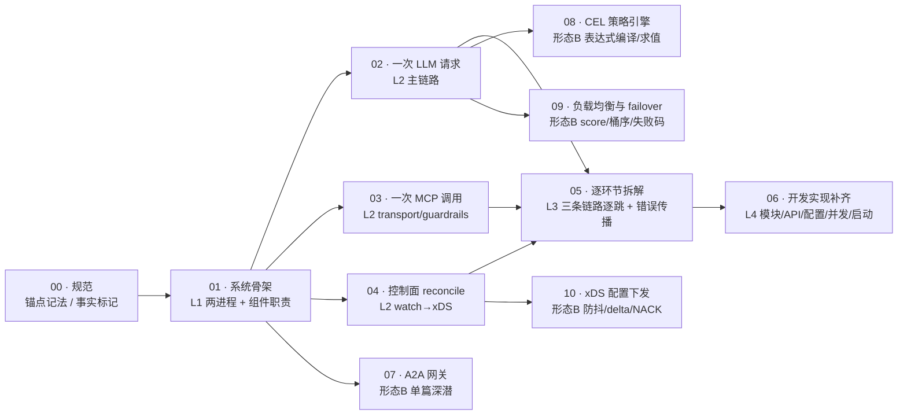

# agentgateway 源码阅读文档

> 代码基准：`adrian@47ea6aa03434e24502ec502ea98d7082112e2699`（工作区干净）；核实日期：2026-11-25。
> 本目录是 agentgateway 的**源码阅读文档库**，按「先总结、先生产、再逐层拆解」组织成四层，所有结论都能顺着锚点回到当前工作区源码。

## 这套文档讲什么

**Agentgateway** 是基于 AI 原生协议（**MCP** 与 **A2A**）的开源代理，为 agent↔LLM、agent↔tool、agent↔agent 通信提供安全、可观测与治理。三大能力：**LLM Gateway**（统一 OpenAI 兼容 API 路由到 OpenAI/Anthropic/Gemini/Bedrock，含预算/spend 控制、负载均衡、failover）、**MCP Gateway**（tool 联邦、stdio/HTTP/SSE/Streamable HTTP 传输、OAuth）、**A2A Gateway**（agent 间安全通信、能力发现、任务协作）。

代码形态是**常驻服务**，由两个进程加一个内嵌 UI 构成：

| 组件 | 语言 | 入口 | 角色 |
|---|---|---|---|
| **数据面网关** | Rust（workspace 14+ crates） | `crates/agentgateway-app/src/main.rs` → `agentgateway_app::run()` | 实际转发流量的代理进程 |
| **控制面 controller** | Go | `controller/cmd/agentgateway/main.go` → `setup.New().Start()` | watch K8s CR、翻译成配置、经 xDS 下发 |
| **UI** | TS/JS | `ui/`（内嵌进数据面 admin 端口） | 控制台 |

## 学习路径

**怎么读**：

- **只想快速上手**：读 `01-系统骨架.md` 建立全局地图，再挑 `02`/`03`/`04` 里最相关的一篇走一遍链路。
- **要改某条链路的代码**：先读对应 L2 篇，再读 `05-逐环节拆解.md` 里那条链路的逐跳细节与失败传播，最后查 `06-开发实现补齐.md` 的模块/配置/并发。
- **要懂工程约定**：`00-docs-style-guide.md` 说明锚点记法与四个事实标记。

## 文档目录

| 文件 | 层 | 一句话定位 | 状态 |
|---|---|---|---|
| [`00-docs-style-guide.md`](00-docs-style-guide.md) | 规范 | 锚点记法（符号+偏移）、四个事实标记、禁词、图表下限 | ✅ |
| [`01-系统骨架.md`](01-系统骨架.md) | L1 | 两个常驻进程 + 内嵌 UI 的职责、真实入口、生产总流程图 | ✅ |
| [`02-一次LLM请求.md`](02-一次LLM请求.md) | L2 | 一个 OpenAI 兼容请求从 `:4000/v1/chat/completions` 到上游 provider 的完整路径、路由/负载均衡/failover | ✅ |
| [`03-一次MCP调用.md`](03-一次MCP调用.md) | L2 | 一次 MCP tool 调用的 transport 选择、federation、guardrails、OAuth | ✅ |
| [`04-控制面reconcile.md`](04-控制面reconcile.md) | L2 | 控制面 watch CR → reconcile → 翻译 → xDS 下发 → 数据面热加载 → NACK 闭环 | ✅ |
| [`05-逐环节拆解.md`](05-逐环节拆解.md) | L3 | 三条链路逐跳拆解（LLM 7 门 / MCP 14 跳 / 控制面 11 站），含分支与错误传播 | ✅ |
| [`06-开发实现补齐.md`](06-开发实现补齐.md) | L4 | crate/包关系、API 面、配置体系、存储与状态、并发模型、启动生命周期、测试部署、隐式知识清单 | ✅ |
| [`07-A2A网关.md`](07-A2A网关.md) | 形态B | A2A Gateway 单篇深潜：请求识别（`RequestType`）、card 改写、调用观测、`a2a` 策略开关 | ✅ |
| [`08-CEL策略引擎.md`](08-CEL策略引擎.md) | 形态B | CEL 策略引擎深潜：表达式编译/注册/求值、70 个扩展函数、链路生效点 | ✅ |
| [`09-负载均衡与failover.md`](09-负载均衡与failover.md) | 形态B | 两层负载均衡：副本挑选 `score` 公式、桶序兜底、四种虚拟模型路由失败码、重试 | ✅ |
| [`10-xDS配置下发.md`](10-xDS配置下发.md) | 形态B | xDS 增量下发：控制面防抖/delta、数据面热加载、NACK 双向闭环 | ✅ |
| [`10-xDS配置下发.md`](10-xDS配置下发.md) | 形态B | xDS 增量下发深潜：CR→翻译→防抖合并→delta→`:9978` 推送→数据面热加载→NACK 双向闭环（含 `KGW_DEBOUNCE_AFTER/MAX`、多副本 `NeedLeaderElection=false`） | ✅ |

## 速览：三条主流程一句话

- **一次 LLM 请求**：客户端打 `:4000/v1/chat/completions` → 按模型名 `resolve` 出 provider（`model_router.rs`）→ 两层负载均衡挑副本（`loadbalancer.rs`）→ 构造上游请求（`setup_request`）→ 转发并结算预算（`process_response`）。
- **一次 MCP 调用**：MCP 客户端进来 → `setup_upstream` 按 target 选 transport（SSE/Streamable/Stdio/OpenAPI）→ guardrails 分请求/响应两阶段拦截 → tool federation 扇出合并 → 回传。
- **控制面 reconcile**：`kubectl apply` 一个 CR → informer watch → `TranslateAgentgatewayPolicy` 翻译 → `buildXDSCollection` 组装 → xDS `:9978` 增量下发 → 数据面 xDS handler 落 store → `BindEvent` 热加载（失败 NACK 保旧态）→ NACK 回写 K8s Event。（注：`reload_config` 属本地配置/测试路径，非 xDS 热加载链，详见 `10`。）
- **一次 A2A 请求**：`GET /.well-known/agent.json`（发现）或 `POST tasks/send`（调用）→ `apply_to_request` 判 `RequestType` → 设 `backend_protocol=a2a` → 转发 → `apply_to_response` 改写 agent card URL + 只读观测（`ResponseOutcome`）。

## 约定与标记

读任何一篇前，先看 [`00-docs-style-guide.md`](00-docs-style-guide.md) 的**锚点记法**（`符号 + 偏移`，不用裸行号）与**四个事实标记**（`[源码未确认]` / `[源码未找到]` / `[推断]` / `[待运行验证]`）。全库所有篇目共用这套口径。

## 更新记录

- 2026-11-25：首次生成四层文档库（L1 骨架 + L2 三条链路 + L3 逐环节 + L4 开发补齐 + 规范篇），代码基准 `47ea6aa0`。
- 2026-11-25：收敛 crate 职责缺口标记（`[推断]` 25→8，逐个 crate 读 `lib.rs` 头部坐实）；补 A2A Gateway 单篇深潜（`07`）。
- 2026-11-25：第二轮缺口收敛（`[推断]`→4、`[源码未确认]`→11，坐实 `MAX_VIRTUAL_MODEL_DEPTH=4`、xDS 端口 `controller/api/settings/settings.go:175`、Helm chart 位置等）；加深三篇专题 —— CEL 策略引擎（`08`）、负载均衡与 failover（`09`）、xDS 配置下发（`10`）。
- 2026-11-25：新增 xDS 配置下发单篇深潜（`10`），坐实防抖默认 `10ms/1s`（env `KGW_DEBOUNCE_AFTER`/`KGW_DEBOUNCE_MAX`）、端口 `9978`、NACK 双向闭环；纠正「数据面 xDS 热加载走 `reload_config`」的口径（该链属 `LocalClient` 本地配置/测试路径）。
